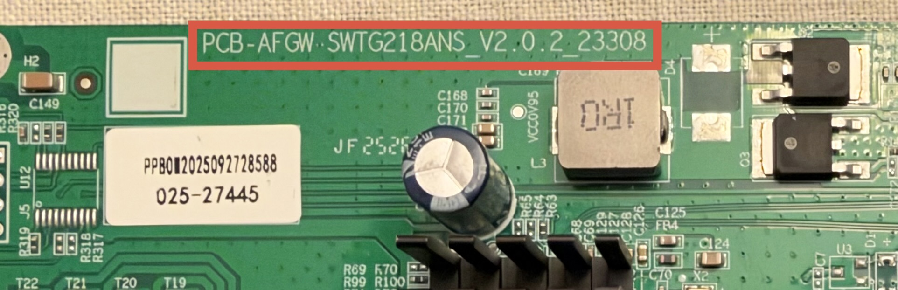

# Adding a new device

A device is supported by adding one board header `.h` and board definition `.c` file
under `machine/`. 
the build selects the definition by name, and CI compiles every file it finds.

To compile for your added device, do:
```
make MACHINE=<MACHINE>
```
## Names
Names are derived from the board, not invented. Using an example device here we can see how
to construct the name.

The example uses `RealHD` as the vendor Name and `PSW8-25MG` as the switch model (these are from
labels on the outside of the device itself/the box it came from/the advert). The other text is from
the PCB inside the casing and the photo shows where this is from.



- `<PCB_LABEL>` is `PCB-AFGW SWTG218ANS_V2.0.2_23308` — the text inside the red box in the picture.
- `<PCB_DOC_NAME>` is `PCB-AFGW_SWTG218ANS_V2.0.2_23308`: the label with each space replaced by `_`.
- `<MACHINE_PCB>` is `PCB_AFGW_SWTG218ANS_V2.0.2_23308`: the `PCB_DOC_NAME` with every remaining punctuation character (hyphens, dots, ...) converted to `_`.
- `<MACHINE_PCB_EXT>` is `PCB_AFGW_SWTG218ANS_V2.0.2_23308__POE`: `<MACHINE_PCB>` plus an extension suffix for an _optional_ add-on; see the later section for details.
- `<MACHINE_MODEL>` is `RealHD PSW8-25MG` — the human-readable vendor and model string shown in the UI.
- `<MACHINE>` is `REALHD_PSW8_25MG`: (`<MACHINE_MODEL>`) in all capitals with punctuation converted to `_`. This is the name passed to `make MACHINE=...`.

### Quick Start
1. Start from your `<PCB_LABEL>`, not from the printed vendor or model name: those are often misleading, and the same product name can correspond to several different PCBs.
2. Check whether `doc/devices/<PCB_DOC_NAME>.md` exists. If it does, your device is most likely already supported.
   - If you find a doc file that matches your `<PCB_DOC_NAME>` except for punctuation, please file a bug report so we can investigate as this should not happen.
3. If your device's PCB is already covered then reuse the existing definition:
   - run `ls machine/pcb/<MACHINE_PCB>*.c | grep -v "_init.c"` to list the supported variants and pick the one matching your PCB
   - create the symlink `ln -s pcb/<MACHINE_PCB>.c machine/<MACHINE>.c` or `ln -s pcb/<MACHINE_PCB_EXT>.c machine/<MACHINE>.c`
   - write `machine/<MACHINE>.h`, and symlink `_init.c` as needed (details below)
   - build with `make MACHINE=<MACHINE> CI=1` and verify on your hardware
   - when everything works, update the documentation and open a pull request.

### Extension suffixes
These are usually additional boards that add functionality to the base model. They are also 
used to clarify differences in the Uplink/10GBE port population on boards where the PCB markings
are insufficient to do so. These are represented by the following suffixes, appended onto the 
`<MACHINE_PCB>` with two `_` (underscores). Additional plugins are appended with a single underscore (`_`).

The current list of suffixes is:
* POE: `POE`
* Reset/VLAN-switch: `VLANSW`
* Special Case[^1]: `UNMANAGED`

Uplink port configurations:
* 1xSFP + 1xRJ45: `1S1C`
* 2xRJ45: `2C`
* For the 8x1-variant: `1C`

For example for `MY_BOARD_V1.0.c` the 1SFP, 1RJ, POE variant would be: `MY_BOARD_V1.0__1S1C_POE.c`

[^1]: This is only used in the situation where it is necessary to disambiguate between a
managed and unmanaged device that share the same PCB but do not share the same pin map. In all cases
the managed switch assumes the base name and the unmanaged has _UNMANAGED appended.

## What a new device consists of

| File | Purpose |
|------|---------|
| `machine/pcb/<MACHINE_PCB>.c` | the `struct machine machine` board definition |
| `machine/pcb/<MACHINE_PCB>_init.c` | optional `machine_custom_init()` boot hook, for registers the machine definition cannot express |
| `machine/<MACHINE>.h` | `MACHINE_MODEL` (the model string shown in the UI and the CLI) and `MACHINE_CHIPSET` (`RTL8372` or `RTL8373`, note: in the case of RTL837xN the N is omitted) |
| `machine/<MACHINE>.c` | a symlink to the pcb/<PCBNAME>.c file
| `doc/devices/<PCB_DOC_NAME>.md` and `doc/supported_devices.md` | user-facing documentation |

`<MACHINE>` is the machine symbol without its `MACHINE_` prefix, so `MACHINE` is
passed exactly as spelled on the command line: `make MACHINE=MY_BOARD_1_0`
needs `machine/MY_BOARD_1_0.c` and `machine/MY_BOARD_1_0.h`.
- when everything works, update the documentation and open a pull request.

## Step 1: the board header

`machine/<MACHINE>.h` carries the product string and the SoC family. Use the
existing files as the template:

```c
#ifndef _MACHINE_MY_BOARD_1_0_H_
#define _MACHINE_MY_BOARD_1_0_H_

#define MACHINE_MODEL "Brand Model V1.0"
#define MACHINE_CHIPSET RTL8373

#endif
```

`MACHINE_CHIPSET` is `RTL8373` or `RTL8372`; a build without it will fail. It selects the default
logical port range: `MACHINE_MIN_PORT` is `0` for RTL8373 and `3` for RTL8372, while
`MACHINE_MAX_PORT` is `8`, the highest logical port index. A board with a different range defines
`MACHINE_MIN_PORT` and/or `MACHINE_MAX_PORT` in its header to override the
defaults.

The device product string is what the CLI or the Web-Interface will print to identify the device; `machine.h` includes it by name.

> [!NOTE]
> `machine_name` is a `char[30]` and `MACHINE_MODEL` is copied into it at
> compile time. A longer model string still builds, but SDCC emits
> `warning 147: excess elements in array of chars initializer` and the name is
> truncated in the UI. Keep it to 29 characters or less.

## Step 2: the board definition

`machine/<MACHINE>.c` starts with the shared prelude and then defines the single
`machine` object. Copy the closest existing board and adjust it — do not start
from a blank file, the field meanings are easier to see in a real example.
The best choice is usually a device that has the same number and type of Ethernet
ports and the same number of SFP+ cages.

The struct should contain important comments such as the LED colour and
port-type as shown in the following example and nothing else:

```c
#include "machine_defs.h"

__code const struct machine machine = {
	MACHINE_COMMON_SETTING,
	.n_sfp = 2,
	.log_to_phys_port = {0, 0, 0, 6, 1, 2, 3, 4, 5},
	.phys_to_log_port = {4, 5, 6, 7, 8, 3, 0, 0, 0},
	.is_sfp= {0, 0, 0, 2, 0, 0, 0, 0, 1},
	// Left SFP port (J4)
	.sfp_port[0].pin_detect = GPIO30_ACL_BIT3_EN,
	.sfp_port[0].pin_los = GPIO_NA,
	.sfp_port[0].pin_tx_disable = GPIO_NA,
	.sfp_port[0].sds = 1,
	.sfp_port[0].i2c = I2CBUS( GPIO39_I2C_SDA4, GPIO40_I2C_SCL3_MDC1 ),
	// Right SFP port (J2)
	.sfp_port[1].pin_detect = GPIO50_I2C_SCL2_UART1_TX,
	.sfp_port[1].pin_los = GPIO_NA,
	.sfp_port[1].pin_tx_disable = GPIO_NA,
	.sfp_port[1].sds = 0,
	.sfp_port[1].i2c = I2CBUS( GPIO41_I2C_SDA3_MDIO1, GPIO40_I2C_SCL3_MDC1 ),
	.reset_pin = GPIO54_ACL_BIT2_EN,
	.high_leds = { .mux = LED_27 | LED_29, .enable = LED_28_SYS | LED_29 },
	.port_led_set = { 0, 0, 0, 1, 0, 0, 0, 0, 1},
	.led_sets = {
		{   /* RJ45: Green LED */
			 LEDS_10G | LEDS_1G | LEDS_100M | LEDS_10M | LEDS_ACT | LEDS_LINK,
			0,
			/* Amber LED */
			LEDS_2G5 | LEDS_LINK | LEDS_ACT,
			0
		}, { /* SFP PORT: SINGLE GREEN LED */
			LEDS_10G | LEDS_2G5 | LEDS_1G | LEDS_100M | LEDS_10M | LEDS_ACT | LEDS_LINK,
			0,
			0,
			0,
		},
	},
};
```

`MACHINE_COMMON_SETTING` (from `machine_defs.h`) initializes `machine_name` and
`isRTL8373` from the header's `MACHINE_MODEL` and `MACHINE_CHIPSET`. The logical
port range comes from `MACHINE_MIN_PORT` and `MACHINE_MAX_PORT` in `machine.h`.
Keep it as the first initializer and list the board-specific fields after it.

### Fields

| Field | Meaning |
|-------|---------|
| `MACHINE_COMMON_SETTING` | expands to `machine_name` (`MACHINE_MODEL`) and `isRTL8373` (`1` for `RTL8373`, `0` for `RTL8372`); both are derived from the header's `MACHINE_CHIPSET` (see Step 1) |
| `n_sfp` | number of SFP+ cages |
| `n_10g` | SerDes 10G capability used by the RTL837xN init: `0` none, `1` one, `2` two 10G-capable SerDes |
| `log_to_phys_port[9]` | logical port (0-based index) → physical front-panel port number |
| `phys_to_log_port[9]` | the inverse, physical port 1 is index 0, unused slots are 0 |
| `is_sfp[9]` | `0` for copper, `1` for left slot and `2` for right slot |
| `sfp_port[2]` | per-cage wiring, `sfp_port[0]` is the leftmost cage |
| `reset_pin` | GPIO of the reset button, `GPIO_NA` if unpopulated |
| `high_leds` | mux/enable for the LED pins 27–29 (`LED_27`, `LED_28_SYS`, `LED_29`) |
| `port_led_set[9]` | which LED set (0–3) each logical port uses |
| `led_sets[4][4]` | Each port can have up to 4 GPIO output pins assigned. 4 sets of LEDs with 4 LED-conditions per set; the conditions define which GPIO pins become active for a port given a port link-state. Which LEDs are then enabled depends on the wiring of the pins to up to 3 LEDs for that port, which can make a logical combination of the 4 LED output-pins. |
| `led_mux_custom` / `led_mux[28]` | `1` plus the 28 mux values when the stock LED muxing does not fit the board |
| `mac_flash_offset` | flash offset of the factory MAC address, omit or `0` if the board does not store one |

Each `struct sfp_port` entry holds `pin_detect`, `pin_los`, `pin_tx_disable`,
`sds` (which SerDes drives the cage) and `i2c` (built with `I2CBUS(sda, scl)`,
or `GPIO_NA`-based values where a cage has no such pin).

`I2CBUS(...)` only accepts the pin pairs listed in `machine_defs.h`. A wrong
pair is caught at compile time: SDCC reports
`error 176: sizeof applied to an incomplete type` pointing at the offending
`.i2c` line, because the macro deliberately turns an invalid bus number into an
array of size 0.

### Reusing an existing definition

If the new board is electrically identical to one that already exists — same
port mapping, same SFP wiring, same LEDs — do not copy the file. Make the new
`.c` a symlink and keep only a distinct `.h`, so the two boards cannot drift
apart:

```
ln -s KP_9000_6XHML_X2.c machine/MY_BOARD_1_0.c
```

The new board still needs `machine/MY_BOARD_1_0.h` (pick the version number on
the PCB) with its own `MACHINE_MODEL` and `MACHINE_CHIPSET`: `MACHINE_MODEL` is
what distinguishes the products, and `MACHINE_CHIPSET` must match the SoC of
the board definition being reused.
Existing examples: `machine/PCB_K0402WS_V3.c`, `machine/KP_9000_9XHML_X_V3_2.c`
and the six `KP_9000_*` revision variants.

Two files that differ only in whitespace or comments are duplicates and should
be collapsed this way.

### Optional custom init hook

If the board needs custom initialization, add
`machine/pcb/<PCBNAME>_init.c` defining `machine_custom_init()`. The Makefile picks the
file up by name and compiles it.

Boards that need the same hook share one file: keep the code in a single
`machine/pcb/<PCBNAME>_init.c` whose `machine/pcb/<PCBNAME>.c` is a real file (not a symlink),
and make the other boards' `_init.c` symlinks to it, for example:

```
ln -s KP_9000_6XH_X2_init.c machine/pcb/MY_BOARD_1_0_init.c
```

## Step 3: build and verify

```
make MACHINE=MY_BOARD_1_0 CI=1
```

The generated flash image appears as `output/rtlplayground-<version>-MY_BOARD_1_0.bin`. An
unknown or empty `MACHINE` fails immediately with a message naming the expected
file, before anything is compiled.

Then run the checks CI runs:

```
make machine_check    # compiles machine/<NAME>.c and its optional _init.c for every machine
make -C test          # host-side unit tests
```

`make machine_check` discovers the definitions with
`$(wildcard machine/*.c)`, so a new file is covered without registering it
anywhere. CI (`.github/workflows/build.yml`) runs it on every push and pull
request, alongside full builds for a 4+2 and an 8+1 board.

A successful compile only proves the definition is syntactically valid. The
actual behaviour — port numbering, SFP detection, LEDs — has to be confirmed on
hardware, and the console commands (`port`, `stat`, `sfp`, `leds`) are the
tools for that.

## Step 4: documentation

Once the board has been tested on hardware:

1. Add a row to the table in [Supported devices](supported_devices.md).
2. Add `doc/devices/<MACHINENAME>.md` describing the board, the build target
   (`make MACHINE=MY_BOARD_1_0`), what works and what is unverified, plus
   photos and the PCB silkscreen marking.
   The photos should consist of: the front and reverse of the PCB and should be
   as straight as possible and croppped to show just the PCB; front of the device.
   The rear of the device is only necessary if it has a switch or power-port, other
   photos such as the label are not required.
   If the device has an internal power supply, it is critical that a warning is
   added to the documentation regarding the danger such as:
   ```
   [!CAUTION]
   This device contains a mains voltage power supply, which is a potentially lethal hazard. Even after the device is unplugged, high-voltage capacitors can remain charged afterward and may still shock you. Do not attempt to open/disassemble a mains powered device unless you understand how to do so safely.
   ```

3. If the board shares a PCB with other revisions, follow
   `doc/devices/KP-9000-6XH-X2.md` and document which `MACHINE` to pick for
   which silkscreen.

### Identifying the CPU variant

Use the read-only console command below to distinguish the CPU variants:

```text
regget 4
```

| Register 0x0004 value | CPU |
|---|---|
| `0x83700000` | RTL8370 |
| `0x83720000` | RTL8372 |
| `0x83727000` | RTL8372N |
| `0x83730000` | RTL8373 |
| `0x83737000` | RTL8373N |

Record the identified CPU in the device documentation. These values identify
only the CPU variant; document PHY and flash-chip models separately when verified.

Note:
The RTL8372 is always paired with the RTL8224 whereas
the RTL8372N is always paired with the RTL8224N
