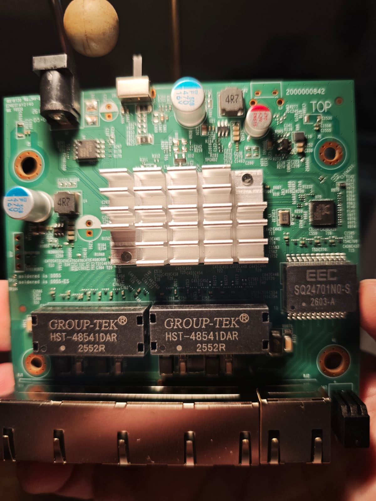
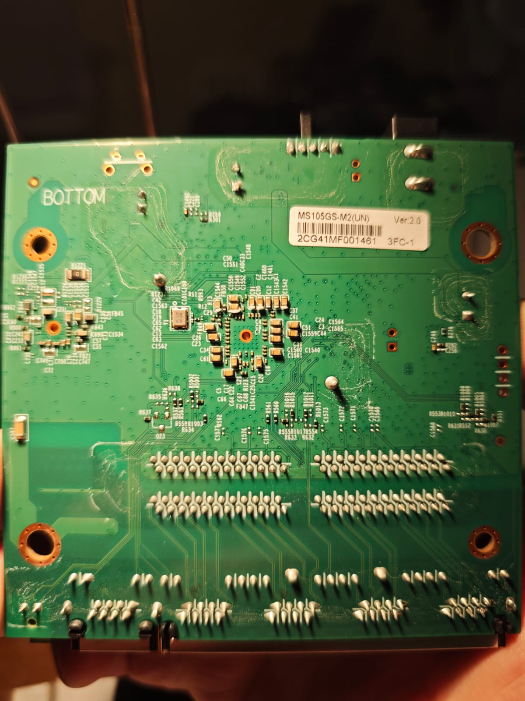
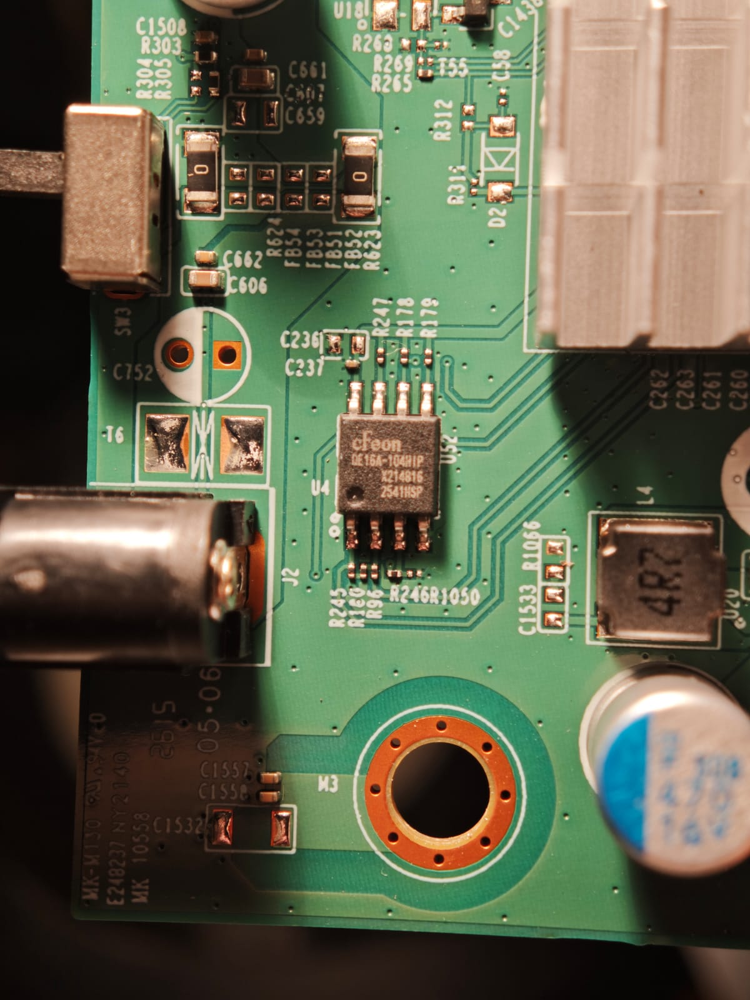

# Mercusys MS105GS-M2 V2.0

MS105GS-M2(UN), Ver:2.0: five 2.5GBASE-T RJ45 ports, no SFP cages.
The clear PCB marking is `2000000842`. Another marking near the power jack
may be the PCB identifier, but cannot be reliably read from the available
photograph. Other hardware revisions have not been checked.

```sh
make MACHINE=MERCUSYS_MS105GS_M2_V2 CI=1
```

## Hardware

| Component | Identification |
|---|---|
| Switch SoC | RTL8372N, register `0x0004 = 0x83727000` |
| External PHY | RTL8221D, marking read on the board; logical port 3 |
| Flash | U4, cFeon QE16A-104HIP / EN25QE16A, 2 MiB; JEDEC `1c4115` |
| Factory MAC | Flash offset `0x1fc000` |
| External PHY reset | GPIO38, active low |
| Loop Prevention selector | SW3, GPIO30; high OFF, low ON; not handled by this profile |
| Power | External DC adapter; no software control assigned to the Power LED |

Port numbering follows the enclosure.

| Physical RJ45 | Logical port | LED0 GPIO | LED1 GPIO | LED2 GPIO |
|---|---|---|---|---|
| 1 | 4 | 3 | 4 | 5 |
| 2 | 5 | 6 | 8 | 9 |
| 3 | 6 | 10 | 15 | 12 |
| 4 | 7 | 18 | 21 | 24 |
| 5 | 3 | 0 | 1 | 2 |

LED0/1/2 are controller signals, not three visible LEDs. The OEM configuration
assigns 2.5G, 1G and 10/100M link/activity conditions to them.

The board hook resets the external PHY and restores the OEM LED routing,
polarity and mode. Masked writes preserve bits 31:30 of LED IO-enable register
`0x65dc`, including bit 30 required by the port LEDs.
SW3 is not a reset button. This profile leaves its loop-prevention function
unimplemented; STP remains configurable through the normal CLI/web settings.

## Firmware updates

First installation requires an external SPI programmer at U4. Keep a full backup
of your own flash and preserve the factory sector at `0x1fc000`. Once RTLPlayground
is installed, subsequent updates can use its web interface over Ethernet.
The OEM web interface is not an established installation path for this device.

## Photos

Available original photos of the device, JPEG files below 4 MB each.
The unit has been reassembled; clearer PCB and exterior photos are not
currently available.






