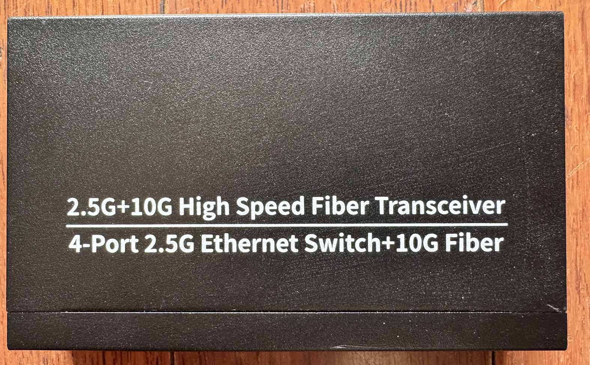
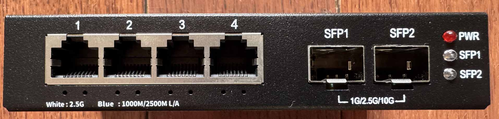
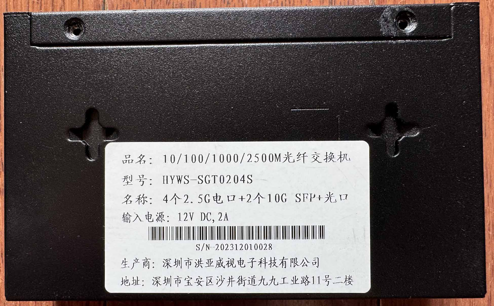
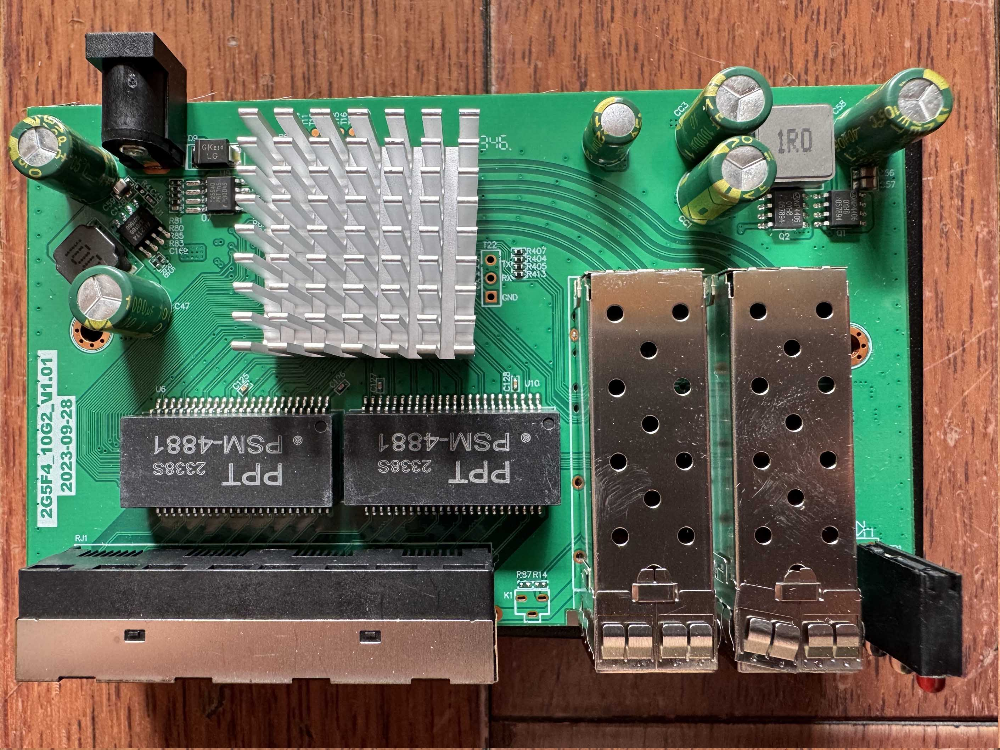
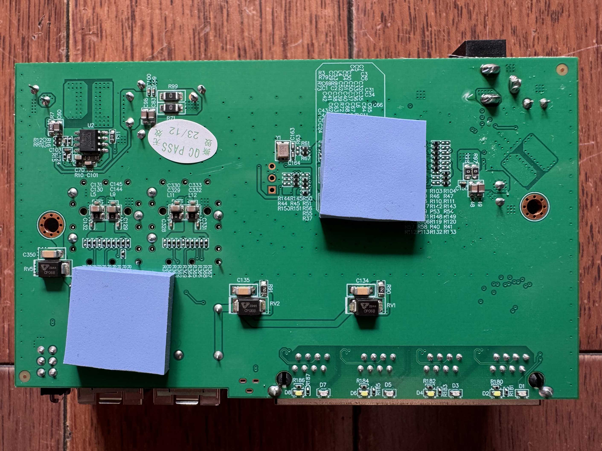
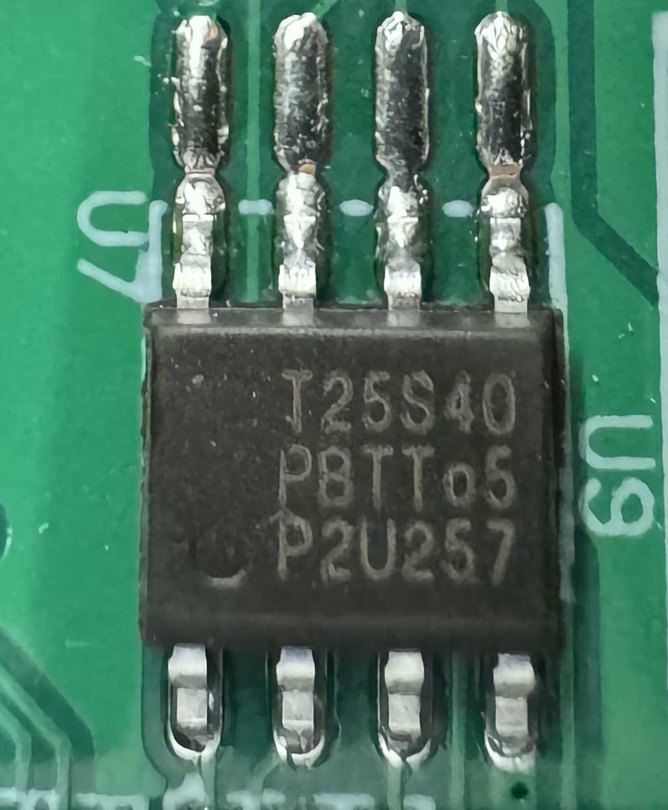

hongyavision HYWS-SGT0204S

RTL8372-based 4×2.5G + 2×SFP+ unmanaged switch.

Also marked on the PCB as `2G5F4_10G2_V1.01`.

Stock firmware runs a factory test console on UART at 9600 baud 8N1 (banner
`RTL8371B start`, prompt `RTL8371B:`). There is no management CLI and no Web
interface.

Using SPI clamp in-board is the only method for initial installation and update.
Erase the whole chip and verify the write (`flashrom -v`) before powering the
board, so an incomplete write is caught before the board is powered up.

Stock flash chip is 512 KB (Bright Moon `T25S40`, 4 Mbit, SOP-8), which the
RTLPlayground image fills exactly.

### Label specifications

Case, top / front / nameplate:





- **Manufacturer**: hongyavision (Shenzhen Hongyavision Electronic Technology
  Co., Ltd.)
- **Model**: HYWS-SGT0204S — the nameplate is printed in Chinese and reads
  "10/100/1000/2500M fibre switch" and "4x 2.5G copper port + 2x 10G SFP+
  optical port"
- **Ports**:
  - 4 × RJ45: 10/100/1000/2500 Mbps
  - 2 × SFP+: 1G / 2.5G / 10G
- **Power**: 12 V DC, 2 A
- **Serial number**: `S/N-YYYYMMDDNNNN`, e.g. `S/N-202312010028`

The top of the case only carries generic printing ("2.5G+10G High Speed Fiber
Transceiver / 4-Port 2.5G Ethernet Switch+10G Fiber"), so the nameplate on the
bottom is what identifies the device.

### What works

- All four 2.5GBASE-T RJ45 ports at 10/100/1000/2500 Mbps
- Both SFP+ ports supporting 1G, 2.5G and 10G modules
- Copper LEDs: white (2.5G) and blue (link/activity)
- SFP LEDs: one single LED per port (link/activity)
- SFP EEPROM and DDM readable on both cages, verified with a 10G module
  (`Rate: 0x67`, module identity and DDM values via the `sfp` console command)
- Serial console at 115200 8N1 (RTLPlayground) / 9600 8N1 (stock)

### Not verified

- The reset button footprint is unpopulated and the case has no opening for it,
  so it could not be tested.

### PCB overview

**Board markings**
- Top silkscreen: `2G5F4_10G2_V1.01`

**Key components**
- Main switch: RTL8372 (RTL8371B family), reported as `RTL8372` (non-N) by
  RTLPlayground. The chip sits under a heatsink and its package marking is not
  readable.
- U1: SPI NOR flash, Bright Moon `T25S40`, 4 Mbit / 512 KB, SOP-8
- A 3-hole reset button footprint is present but unpopulated, and the case has
  no opening for it, so there is no usable reset button

Top side:



Bottom:



The stock flash chip, Bright Moon `T25S40` (SOP-8, 4 Mbit / 512 KB):



### Port layout

| Front panel position | Logical port | Physical port | Type    |
|----------------------|--------------|---------------|---------|
| SFP left             | 8            | 5             | SFP+    |
| RJ45 1               | 4            | 1             | Copper  |
| RJ45 2               | 5            | 2             | Copper  |
| RJ45 3               | 6            | 3             | Copper  |
| RJ45 4               | 7            | 4             | Copper  |
| SFP right            | 3            | 6             | SFP+    |

Copper ports 1–4 match the KP-9000-6XH-X2 (2M-PCB43-V1.1) layout, which this
board is a sibling of. The two SFP+ cages are wired the other way round
compared to that board: physical port 5 is on SDS1 and physical port 6 is on
SDS0.

### Serial console

The board has three through-holes used as the serial console, next to the
heatsink in the middle of the board and visible in the top side photo above (the
silkscreen labels are printed rotated by 90°). **The silkscreen labels are
wrong**: they are shifted relative to the actual signals.

| Silkscreen label | Actual signal |
|------------------|---------------|
| TX               | GND           |
| RX               | TX            |
| GND              | RX            |

Wiring (following the measured signals, not the labels):

| USB-TTL adapter | Board pad            |
|-----------------|----------------------|
| GND             | pad labelled `TX`    |
| RX              | pad labelled `RX`    |
| TX              | pad labelled `GND`   |

- **Settings**: 115200 baud / 8N1 / 3.3V TTL (RTLPlayground), 9600 baud for the
  stock firmware
- The stock firmware only prints a few bytes and a factory test menu
  (`?`, `rst`, `f`, `r`, `10`, `100`, `g1`, `sd`, `eye`, …); it is not an
  interactive management console

### LED configuration

Case silkscreen, below the RJ45 ports:

```
White : 2.5G    Blue : 1000M/2500M L/A
```

The front panel also carries a `PWR` LED and one LED per SFP cage (`SFP1`,
`SFP2`) on the right hand side.

| Port       | LED          | Linked, idle | With traffic |
|------------|--------------|--------------|--------------|
| Copper     | white        | 2.5G only    | same         |
| Copper     | blue         | solid        | blinks (L/A) |
| SFP        | single LED   | solid        | blinks (L/A) |

Measured LED-ID mapping (from the RTL837x LED set registers):

| LED-ID | Function                        |
|--------|---------------------------------|
| LED-ID0| copper blue LED                 |
| LED-ID1| copper white LED                |
| LED-ID2| SFP single LED                  |

**Important**: `RTL837X_REG_LED_GLB_IO_EN` bit 6 must be set in
`machine_custom_init()`. Without it the RTL837x "solid" conditions (LINK/speed)
do not drive the LEDs at all and only `ACT` does, which makes the white LED
glow faintly at non-2.5G speeds.

### SFP GPIO assignments

| SFP               | pin\_detect (ModAbs)          | pin\_los         | SerDes | I2C SDA                 | I2C SCL                  |
|-------------------|-------------------------------|------------------|--------|-------------------------|--------------------------|
| Left (logical 8, physical 5) | GPIO30\_ACL\_BIT3\_EN | GPIO37   | SDS1   | GPIO39\_I2C\_SDA4       | GPIO40\_I2C\_SCL3\_MDC1  |
| Right (logical 3, physical 6)| GPIO50\_I2C\_SCL2\_UART1\_TX | GPIO10\_LED10 | SDS0 | GPIO41\_I2C\_SDA3\_MDIO1 | GPIO40\_I2C\_SCL3\_MDC1 |

`pin_tx_disable` is GPIO\_NA on both ports. Both I2C buses are confirmed
working: with the same 10G module inserted, the `sfp` console command reads its
vendor and model from the left cage (`Slot 1`) and from the right cage
(`Slot 2`), DDM values included. The insertion also shows which SerDes drives
each cage - the left cage reports `sds_config sds: 01` and the right cage
`sds: 00`, which matches the table above.

### Machine target

Build for this device with `make MACHINE=2G5F4_10G2_V1_01`, which selects the
`machine/2G5F4_10G2_V1_01.c` board definition. It is derived from
`machine/KP_9000_6XHML_X2.c` with the SFP cage order and the reset pin changed.
The fitted T25S40 cannot be read in DIO mode on this board: an image that leaves
DIO enabled does not come up at all, both at the default read clock divider of 4
and at 8 (two boards tested), while the same image with single-IO boots and runs
normally. The board definition therefore sets `flash_sio`, which makes
`flash_init()` use `CMD_FREAD` at divider 8. Only the management plane is
slower, the ASIC keeps forwarding in hardware.
