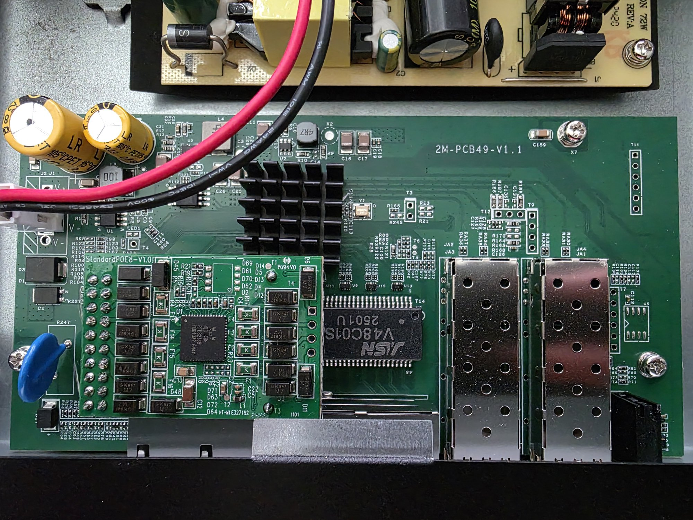
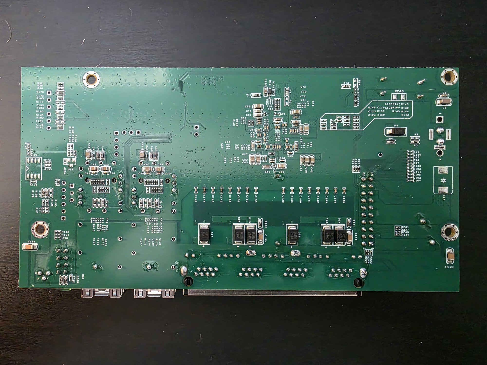

# MokerLink POE-2G040210GSM (2M-PCB49-V1.1)

The PoE version of the MokerLink 2G040210GSM web-managed 4+2 switch: 4 × 2.5G RJ45 with PoE and
2 × 10G SFP+, on an RTL8372 with 2 MiB of flash.

> [!CAUTION]
> This switch has its power supply inside and runs from mains voltage, which can be a dangerous or
> potentially lethal hazard. High-voltage capacitors can stay charged after it is unplugged. Unplug
> it and let the capacitors discharge before opening it or probing the board.

### Label specifications

- **Name**: 4-port 2.5G PoE web-managed switch
- **Model**: POE-2G040210GSM
- **Ports**:
  - 4 × RJ45: 10/100/1000/2500 Mbps, PoE
  - 2 × SFP+: 1000 / 2500 / 10000 Mbps

### Machine target

`make MACHINE=POE_2G040210GSM`

| | 2G040210GSM | POE-2G040210GSM |
| --- | --- | --- |
| PCB | `2M-PCB43-V1.1` | `2M-PCB49-V1.1` |
| Target | `KP_9000_6XHML_X2_V1_1` | `POE_2G040210GSM` |

The target started as a copy of `KP_9000_6XHML_X2_V1_1`. Most pins turned out to differ on this
board; everything in it was checked here.

### What works

Tested on one switch:

- Boot, web UI and web firmware updates. The first install was with a CH341A clip (flashrom chip
  name `W25Q16.V`).
- All four RJ45 ports, each on the matching front-panel port (tested at 1G).
- Both SFP+ ports: module detect, EEPROM and diagnostics, and a DAC in port 6 linking at 10G and
  carrying a VLAN trunk (see [SFP](#sfp)).
- The LEDs (see [LEDs](#leds)).
- The reset button, GPIO48: held more than 3 s it restarts the switch.
- The MAC address, read from the stock firmware's copy at `0x1FC000`. Keep that sector when writing
  a full 2 MiB image with a clip: an image padded with `0xFF` erases it, and the switch then makes up
  a locally administered MAC. Web updates leave it alone.
- PoE, with an image added to the firmware (see [PoE](#poe)): a class 0 device on port 1 powers up
  and links. Without the image the switch works normally and PoE stays off.

Not tested: 2.5G links (and so the green LEDs), the 10 s reset to defaults.

### PoE

The PoE controller is an RTL8238B on a daughterboard (StandardPOE8-V1.0), with no microcontroller
of its own. It sits on the RTL8372's I²C bus 0 (SDA `GPIO47`, SCL `GPIO46`) at `0x20` and `0x21`.
It does nothing until an image is uploaded to it, which the stock firmware does at every boot.

`machine/POE_2G040210GSM_init.c` repeats the stock firmware's start-up sequence at boot (the steps
are listed at the top of the file). The image is the PoE controller vendor's firmware, so it isn't
in this repository. To use PoE, take the images from your own switch's stock flash backup and add
them to a built firmware image:

```
tools/add_pse_image.py output/POE_2G040210GSM/rtlplayground-<version>-POE_2G040210GSM.bin \
    image0.bin image1.bin rtlplayground-poe.bin
```

Then install `rtlplayground-poe.bin` as usual. The tool places the images at `0x34000`, between the
last code bank and the web UI, and recalculates the image CRC.

In a 2 MiB stock dump of this board the two images are back to back, both starting with
`00 00 39 82`:

| | Offset | Length | Used when |
| --- | --- | --- | --- |
| `image0.bin` | `0xf8428` | `0x52ac` | register `0xe8` doesn't read 2 (this board) |
| `image1.bin` | `0xfd6d4` | `0x1f5c` | register `0xe8` reads 2 |

For example: `dd if=stock.bin of=image0.bin bs=1 skip=$((0xf8428)) count=$((0x52ac))`.

The controller powers valid PoE devices by itself once it runs. Per-port PoE control and readings
aren't implemented. For reference, from the stock firmware's PoE pages: front ports 1-4 are channels
3, 2, 1, 0 of `0x20`; per channel, register `0x30 + 4 * ch` holds the current (low 16 bits,
`raw * 125 / 4096` mA) and voltage (high 16 bits `& 0x7fff`, `raw / 512` V), `0x0c + ch` the
detection (low nibble, 4 = valid) and class (high nibble, `0xc` = class 0), and bit `4 + ch` of
`0x10` is set while the port is powered. Registers read back least significant byte first.

### SFP

Found by moving a module between the cages while watching the GPIO inputs:

| | Port 5 (left) | Port 6 (right) |
| --- | --- | --- |
| Module detect (low = module in) | GPIO38 | GPIO37 |
| EEPROM I²C SDA | GPIO39 | GPIO41 |
| EEPROM I²C SCL | GPIO40 | GPIO40 |
| MAC / SerDes | 8 / 1 | 3 / 0 |
| LOS | not found | not found |

No GPIO input followed LOS, so it may not be wired to a GPIO. The MAC and SerDes mapping is the
SWTG024AS boards' (`SWGT024_V2_0_MANAGED` has the same tables); a DAC in the right cage links on
MAC 3. A fibre jumper between the two cages doesn't show which way round it is, since frames sent
out of one port arrive at the other either way.

### LEDs

Each RJ45 port has a green and an amber LED, each SFP port a green one, and there is a system LED
marked "S". The pads were found by routing them to a lit source one by one:

| LED | Pad | | LED | Pad |
| --- | --- | --- | --- | --- |
| Port 1 amber | 9 | | Port 3 amber | 18 |
| Port 1 green | 10 | | Port 3 green | 21 |
| Port 2 amber | 12 | | Port 4 amber | 24 |
| Port 2 green | 15 | | Port 4 green | 25 |
| Port 5 (left SFP) | 26 | | Port 6 (right SFP) | 6 |

- Green lights for a 2.5G or 10G link, amber for 1G and below, both blinking on activity. The SFP
  LEDs show any link and activity.
- Pads 0-7 are disabled at reset, so `POE_2G040210GSM_init.c` enables pad 6.
- The "S" LED is the chip's LED 28 output. It lights steadily; setting the system LED state to
  blink or off made no difference, so the reset button's blink feedback doesn't show.

### Headers

Pin 1 is the square pad. "Measured" is a continuity check on this board; the rest is a guess from
the 2M-PCB23-V3.1's matching headers.

| Header | Pin | Signal | Source |
| --- | --- | --- | --- |
| `T3`, 2 pins | 1 | GND | measured |
| `T7`, slave interface, 6 pins | 2 | GND | measured |
| | 4 | 3V3 | measured |
| | 1, 3 | SCL, SDA | guess |
| `T9`, serial console, 4 pins | 2 | GND | measured |
| | 4 | 3V3 | measured |
| | 1, 3 | U0TXD, U0RXD | guess |
| `T10`, `T12`, 3 pins each | 2 | GND | measured (SMI headers?) |
| `T11`, 6 pins | 3 | 3V3 | measured |
| | 5 | GND | measured |

### PCB overview

- Top silkscreen: 2M-PCB49-V1.1; PoE daughterboard: StandardPOE8-V1.0, with the RTL8238B (`U1`)
- `U6`: flash, Winbond W25Q16JVSIQ, 2 MiB
- `U16`: the 2×10 daughterboard socket. Pins 1-6 are signals, 8 is 3V3, 17 and 18 are GND; the PoE
  supply reaches the daughterboard another way.
- `J1`/`J2`: power from the internal 72 W supply board

Top side, with the PoE daughterboard and the supply board above it:



Headers `T3`, `T7`, `T9`-`T12`:


Power input `J1`/`J2` and the daughterboard socket `U16`:


Flash `U6`:


Bottom:



### Still open

- 2.5G links and the green LEDs.
- SFP LOS.
- Per-port PoE control and readings.
- The serial console on `T9` (pins and baud rate unconfirmed).
- Making the "S" LED blink.
