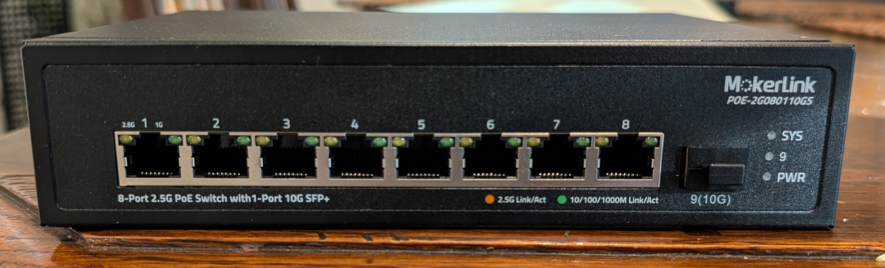
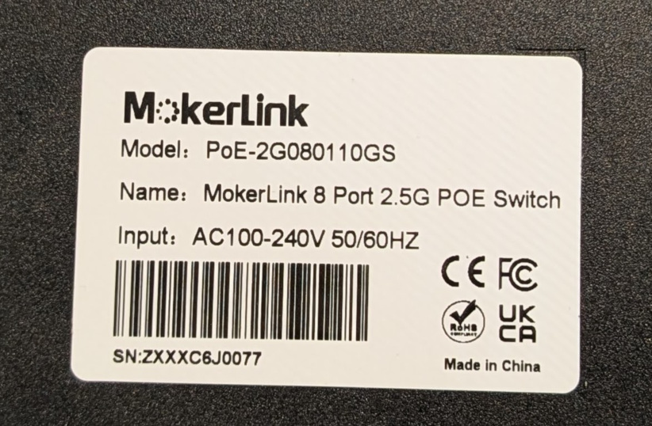
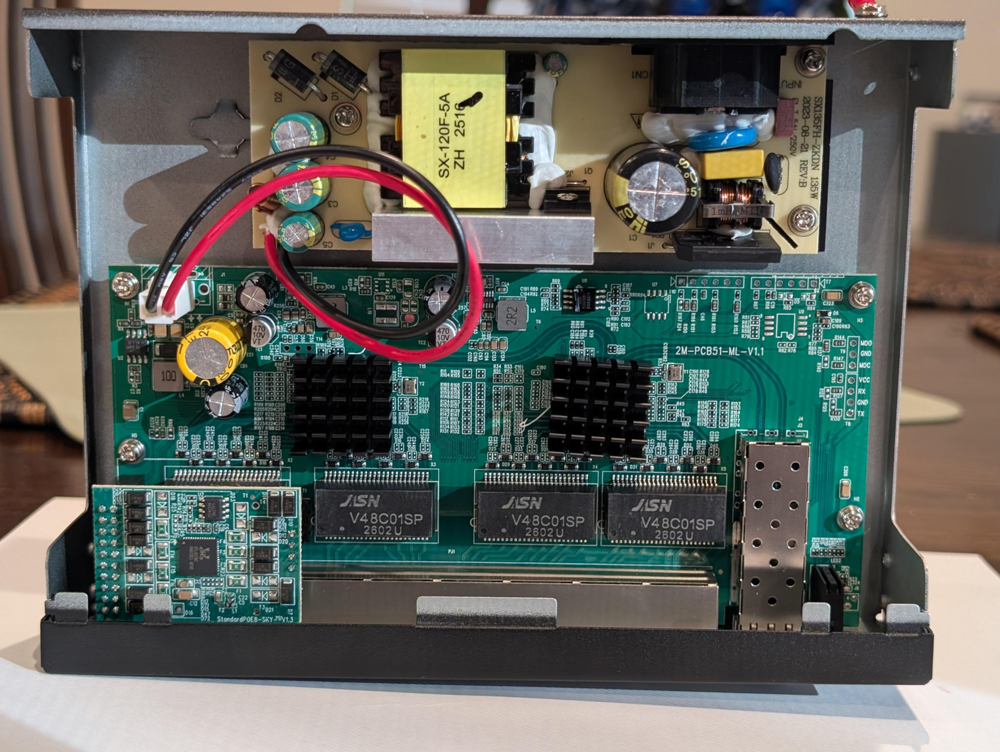
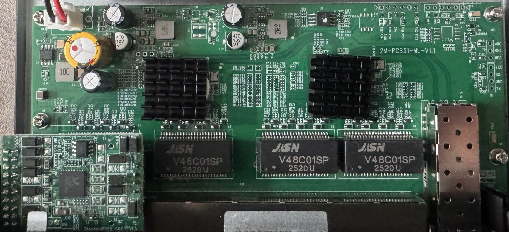
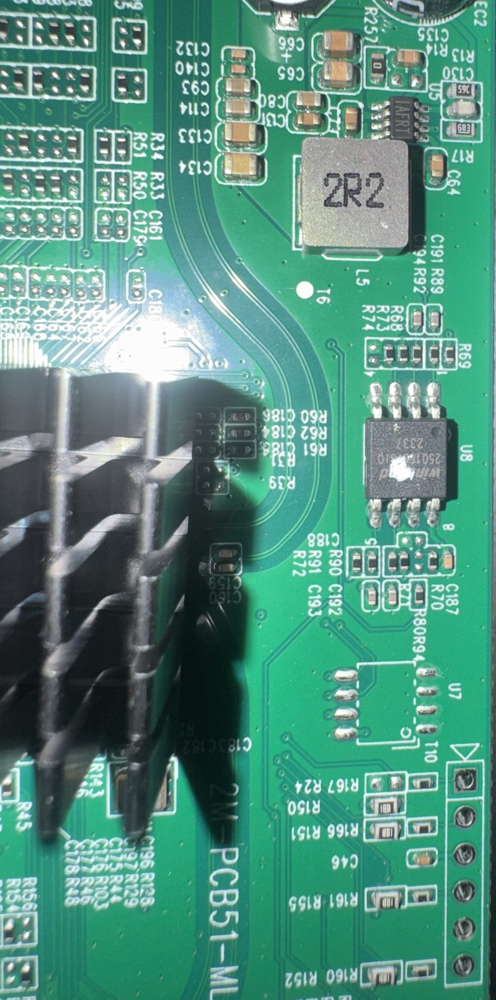
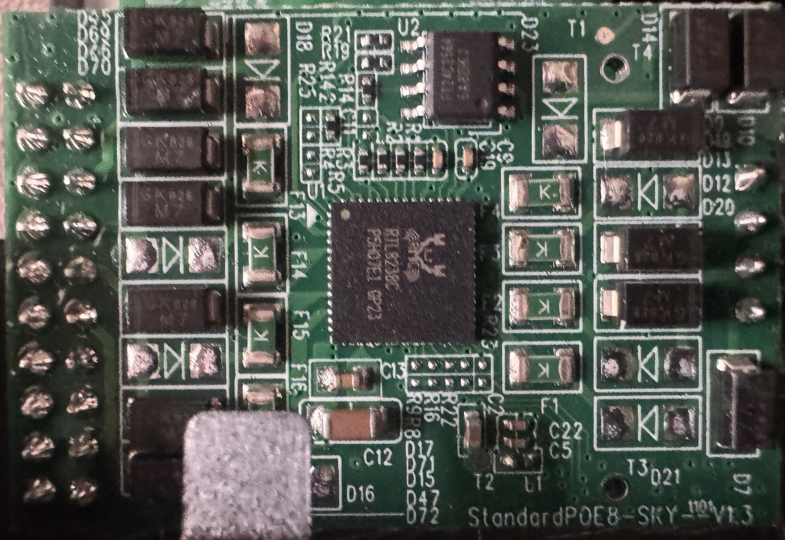

# MokerLink POE-2G080110GS

The `POE-2G080110GS` is an unmanaged 8x2.5G RJ45 and 1xSFP+ PoE switch sold by Mokerlink. There is also a `POE-2G080110GSM` managed version of the switch which may be similar but this has not been verified on actual hardware.
The`KP-9000-9XHP-X` is the KeepLink rebrand for same product.

## Brands
| Brand  | Type             |Managed| PCB              | Flash           | Chip RTL      |
|--------|------------------|-------|------------------|-----------------|---------------|
| Mokerlink | POE-2G080110GS | No | 2M-PCB51-ML-V1.1 | 4MB (W25Q32JV) | 8373N + 8224N |
| KeepLink  | KP-9000-9XHP-X | No | 2M-PCB51-ML-V1.1 | 4MB (W25Q32JV) | 8373N + 8224N |
| KeepLink  | KP-9000-9XHPML-X-AC | Yes | 2M-PCB51-ML-V1.1 | 2MB (W25Q16) | 8373N + 8224N |

## Hardware overview
Front

Label

The stock firmware from a POE-2G080110GS device had a sha256sum of `4c280853465eaad80e1772075c0f2d29c11fb8c561547f06353d3a5443c388e9`.

### PCB

Top silkscreen is marked `2M-PCB51-ML-V1.1`. PoE is provided by RTL8238C. Flash chip is 4 MB Winbond 25Q32JV (U8).

> [!CAUTION]
> This device operates on mains voltage, which can be a dangerous or potentially lethal hazard. Even after the device is unplugged, high-voltage capacitors can remain charged afterward and may still shock you. Do not attempt to open/disassemble a mains powered device unless you understand how to do so safely. Also, opening the device may void your warranty.

## Managed vs unmanaged

The managed `KP-9000-9XHPML-X-AC` differs from the unmanaged boards above:

- U8 is a 2 MB W25Q16.
- Reset button on the front (GPIO48).
- Label MAC in flash at `0x1FC000`.
- Different power supply.

PCB

U8

PoE board `StandardPOE8-SKY-V1.3`

Tested on two units:

- RJ45 ports, VLANs, LLDP.
- SFP+ with a 10G optic and a 10G DAC.
- Label MAC from `0x1FC000`.
- Installing from the stock web UI with `installer/`. There is no public download of the stock firmware (V100.9.9.1.7), so back up the flash first.
- PoE with the RTL8238C driver that waits on #712, see [this comment](https://github.com/logicog/RTLPlayground/pull/712#issuecomment-7076615670).
- Reset button on GPIO48 (one unit).

## Machine targets

| Device | Machine target |
|---|---|
| MokerLink POE-2G080110GS | `MOKERLINK_POE_2G080110GS` |
| keepLiNK KP-9000-9XHP-X | `MOKERLINK_POE_2G080110GS` |
| keepLiNK KP-9000-9XHPML-X-AC | `KEEPLINK_KP_9000_9XHPML_X_2M_PCB51_ML_V1_1` |

	make MACHINE=MOKERLINK_POE_2G080110GS
	make MACHINE=KEEPLINK_KP_9000_9XHPML_X_2M_PCB51_ML_V1_1

## Notes

The stock firmware blinks both the 2.5G and 1G LEDs on activity, despite the front of the device indicating that each LED should be independent. The `MOKERLINK_POE_2G080110GS` machine config behaves as the front of the device indicates (and what seems more logical) -- each port LED turns on and blinks independently.
