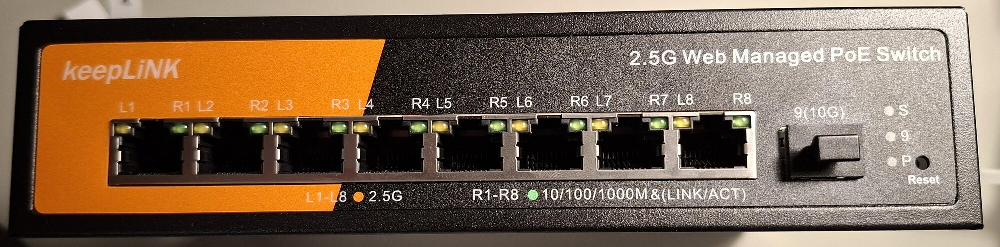
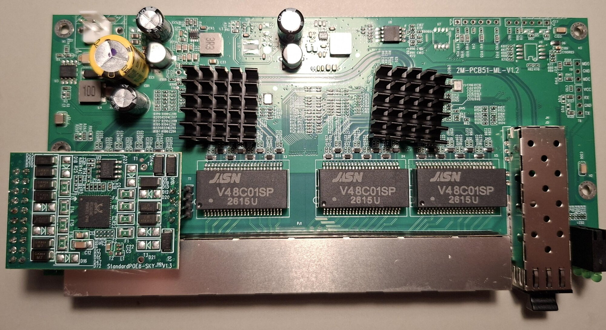
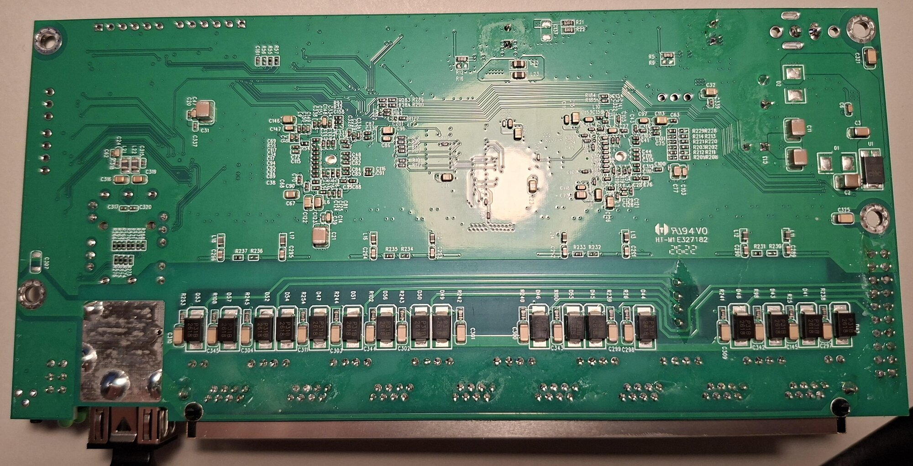
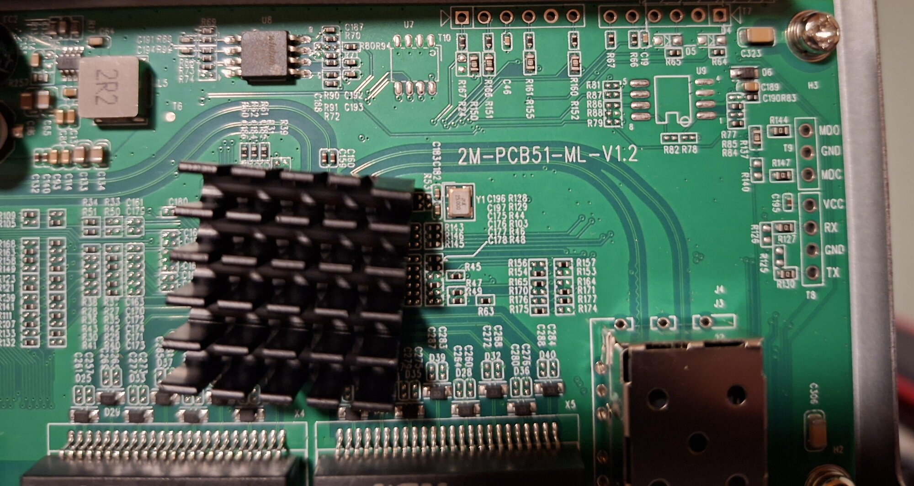
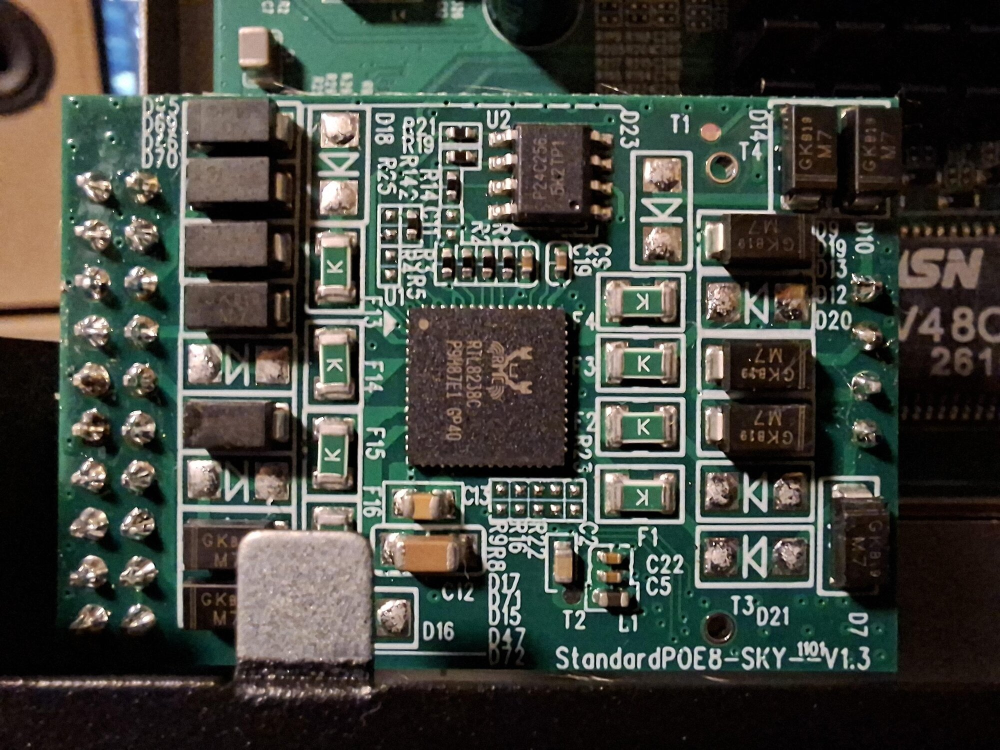

# keepLink KP-9000-9XHPML V1.2

The `KP-9000-9XHPML-X` is a managed 8x2.5G RJ45 PoE switch with one SFP+ cage, sold by keepLiNK. The web UI of the stock firmware calls it `KP-9000-9XHPML-X-AC`, hardware version V1.2. The board is the managed sibling of the unmanaged [2M-PCB51-ML-V1.1](2M-PCB51-ML-V1.1.md) (MokerLink POE-2G080110GS, keepLiNK KP-9000-9XHP-X): same ports, SFP+ wiring and LEDs, but 2 MiB of flash, the label MAC in its own flash sector and a populated reset button.

Not to be confused with the KP-9000-9XHPML-X V3.1 (two RTL8238B, discussed in #265): keepLiNK sells both hardware lines under the same name. Check the silkscreen.

## Brands
| Brand    | Type             | Managed | PCB              | Flash           | Chip RTL      |
|----------|------------------|---------|------------------|-----------------|---------------|
| keepLiNK | KP-9000-9XHPML-X | Yes     | 2M-PCB51-ML-V1.2 | 2MB (W25Q16JV)  | 8373N + 8224N |

`regget 4` reads `0x83737000` (RTL8373N).

> [!CAUTION]
> This device contains a mains voltage power supply, which is a potentially lethal hazard. Even after the device is unplugged, high-voltage capacitors can remain charged afterward and may still shock you. Do not attempt to open/disassemble a mains powered device unless you understand how to do so safely.

## Hardware overview

Front:

## PCB

Top silkscreen `2M-PCB51-ML-V1.2`. Flash is a Winbond W25Q16JV (U8, top edge). PoE comes from the daughterboard `StandardPOE8-SKY-V1.3` with an RTL8238C and a P24C256 EEPROM.

PCB top:

PCB bottom:

Silkscreen and the headers at the right edge:

PoE daughterboard:

### Headers

| Header | Pins |
|--------|------|
| `T8`   | serial console: `VCC`, `RX`, `GND`, `TX` (3.3 V) |
| `T9`   | SMI: `MDO`, `GND`, `MDC` |

### Reset button

GPIO48, active low (`gpio` while pressing it). Held for more than 3 s it restarts the switch, for more than 10 s it writes the default configuration back first.

### Factory MAC

The stock firmware keeps the label MAC in its own flash sector at `0x1FC000`, the model name at `0x1FD000` and its configuration at `0x1FE000`. RTLPlayground only reads the MAC (`mac_flash_offset`).

## Stock firmware

V100.9.25 of Jan 20 2026. keepLiNK publishes no update for this model, but the file for the KP-9000-9XHML-X on its [download page](https://en.keeplink.com.cn/down.html) (`https://en.keeplink.com.cn/upload/20260817143041171242.bin`, sha256 `c26e7394362c788114012ecd374547940dcbb97dc91c9250a53026127c4b0913`) is byte for byte the firmware in the flash of this device: one firmware serves both boards. It carries both PoE controller images (21164 bytes and 8028 bytes; this board's RTL8238C takes the 8028-byte one), so the PSE image can be taken from that download without opening the switch.

## Installing

Installed from the stock web UI with the OEM installer (`installer/`, built for `KEEPLINK_KP_9000_9XHPML_V1_2`), then updated through RTLPlayground's web UI. Both worked on this device.

## Status

Tested on one device with this board definition:

- RJ45 ports 1-8 match the front panel numbering; links at 2.5G and 1G, LEDs amber at 2.5G and green at 1G.
- VLANs (untagged and tagged, per-port PVID), EEE off, saving the configuration, restart.
- Reset button and factory MAC as described above.
- Updates over the web UI.

Not tested:

- SFP+ (no module at hand); its wiring is that of the V1.1.
- PoE: the RTL8238C needs its image uploaded at every boot, otherwise the PoE ports stay dark. A driver will follow on top of the PoE infrastructure of #712.

### Machine target

	make MACHINE=KEEPLINK_KP_9000_9XHPML_V1_2
