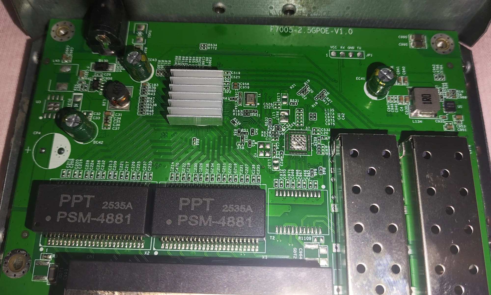
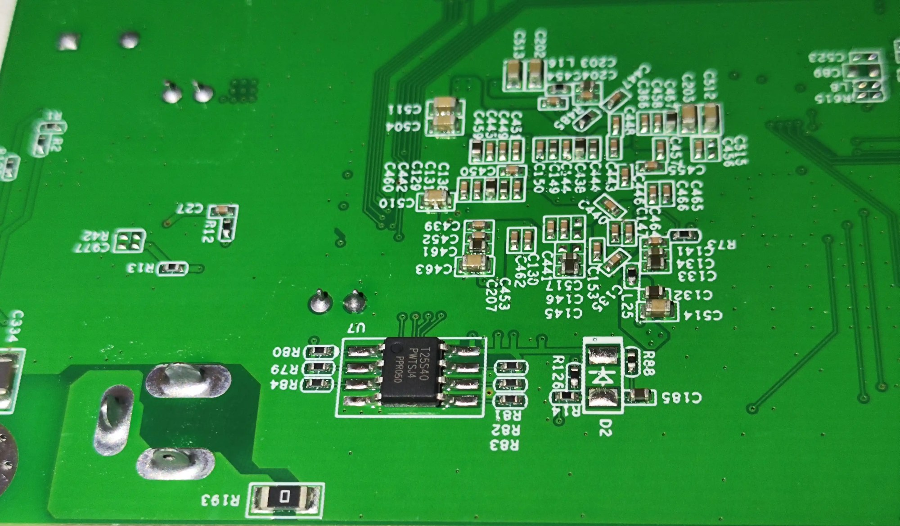
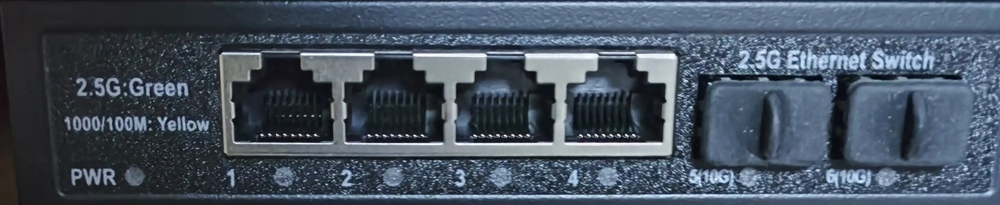
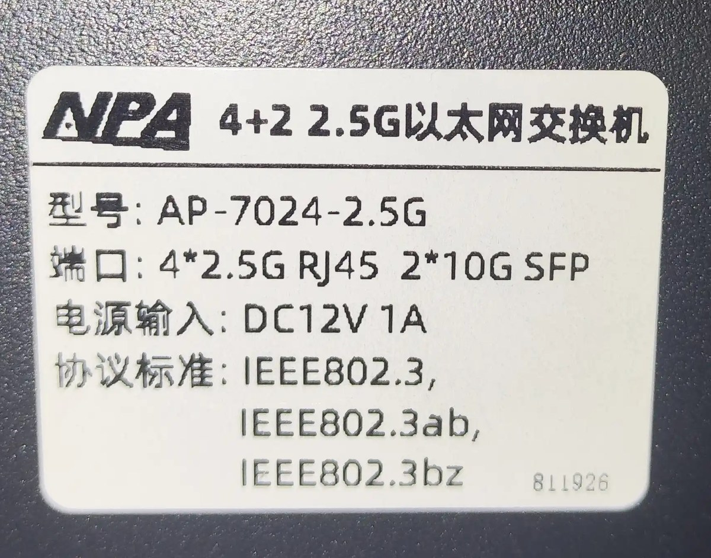

# F7005-2.5GPOE-V1.0

Documentation for the unmanaged 4 + 2 switch sold as `AP-7024-2.5G` by NPA. The
PCB is silkscreened `F7005-2.5GPOE-V1.0` along the top edge.

### Brands

| Brand | Type | Managed | PCB | Flash | Chip RTL |
|-------|------|---------|-----|-------|----------|
| NPA | AP-7024-2.5G | No | F7005-2.5GPOE-V1.0 | T25S40 (4 Mbit / 512 KB) | 8372N |

`regget 4` reads `0x83727000` (RTL8372N).

### What works

- all four 2.5GBASE-T RJ45 ports at 10/100/1000/2500 Mbps
- both SFP+ cages with 1G, 2.5G and 10G modules; a 10G AOC linked between
  two units of this board
- the four RJ45 port lamps and the two SFP+ cage lamps
- the serial console on the populated four-pin header, Web UI, VLAN,
  configuration save and reboot

### Not verified

- PoE: the PCB is a PoE design (`2.5GPOE`), but the PoE parts are not fitted on
  this unit, so PoE delivery was not tested. RTLPlayground cannot configure PoE
  in any case.
- no reset button is fitted, `.reset_pin` is `GPIO_NA`

### Build target

```
make MACHINE=NPA_AP_7024_2_5G
```

This selects the `NPA_AP_7024_2_5G` entry in `machine/machines.json` and the
`machine/pcb/F7005_2_5GPOE_V1_0.c` board definition, which is derived from
`machine/pcb/FG_4GT_2SX_V2_0.c` with the SFP+ EEPROM buses and the flash mode
changed.

### Ports

```text
physical RJ45 1-4   -> logical 4-7
left SFP+ cage      -> physical 5, logical 8, SDS1, detect GPIO38
right SFP+ cage     -> physical 6, logical 3, SDS0, detect GPIO37
```

Neither cage has a LOS input or a TX-disable pin wired, link state comes from
the SerDes.

### SFP+ EEPROM buses

Unlike the other 4+2 boards, whose two cages share I2C bus 3, this board wires
each cage to its own bus:

| Cage | Front panel | Logical | SerDes | Detect | LOS | TX-disable | I2C |
|------|-------------|---------|--------|--------|-----|------------|-----|
| left | 5 | 8 | SDS1 | `GPIO38` | `GPIO_NA` | `GPIO_NA` | bus 0, `SDA0` = `GPIO47`, `SCL0` = `GPIO46` |
| right | 6 | 3 | SDS0 | `GPIO37` | `GPIO_NA` | `GPIO_NA` | bus 1, `SDA1` = `GPIO49`, `SCL1` = `GPIO48` |

### Serial console

The four-pin header `JP1` next to the right-hand SFP+ cage is populated
(silkscreen `VCC RX GND TX`, pin 1 is VCC), so the RTLPlayground console is
available at 115200 8N1 without any modification. The stock firmware runs a
Realtek factory test console (banner `RTL8371B start`) instead.

### LEDs

The front panel is silkscreened `2.5G: Green` / `1000/100M: Yellow`: every RJ45
port has a green and a yellow lamp, driven by LED set 0. Green is on for a 2.5G
link, yellow for 10M/100M/1G, both with activity. The two SFP+ cages have one
lamp each (`5(10G)`, `6(10G)`) and use LED set 1, which is on for a link at any
speed. A `PWR` lamp is wired to the SYS LED. The RJ45 and SFP+ lamps were
checked on hardware.

The LED wiring and mux are the ones of the FG-4GT-2SX family. The
`RTL837X_REG_LED_GLB_IO_EN` value of the stock firmware is restored in the init
hook, without it the solid LED conditions do not drive the lamps.

### Flash

The board carries a Bright Moon `T25S40`, 4 Mbit / 512 KB, SOP-8: `U7` on the
bottom side. This part cannot be read in DIO mode, so the board definition sets
`flash_sio`, which makes `flash_init()` use `CMD_FREAD` at divider 8 for code
fetches. With single-IO reads the board boots and runs normally; only the
management side is slower, the ASIC keeps forwarding in hardware.

The RTLPlayground image fills the 512 KB flash exactly, so there is no room for
a staged update: install and update the image over SPI.

### PCB overview

Top side, silkscreen `F7005-2.5GPOE-V1.0`:



Bottom side, SPI flash `U7` in the middle:



### Device

Front panel, left to right: `PWR` lamp, RJ45 ports `1`-`4` with one lamp each,
SFP+ cages `5(10G)` and `6(10G)` with one lamp each, legend `2.5G: Green` /
`1000/100M: Yellow`.



The case label reads `NPA 4+2 2.5G Ethernet switch`:



- **Model**: `AP-7024-2.5G`
- **Ports**: 4 x 2.5G RJ45 + 2 x 10G SFP
- **Power input**: DC 12 V / 1 A
- **Standards**: IEEE 802.3, 802.3ab, 802.3bz

### Hardware notes

- two dual-port RJ45 jacks with integrated magnetics, marked `PPT 2535A PSM-4881`
- SPI flash `U7` on the bottom side: Bright Moon `T25S40`, 4 Mbit / 512 KB
- SoC RTL8372N, the boot console prints `Detecting CPU: RTL8372N`; it is paired
  with RTL8224N PHYs. SoC and PHYs sit under the heatsink, their markings are
  not readable.
- 25 MHz crystal `Y1` next to the heatsink
- a 4-pin UART header and a DC barrel jack on the top side
- the PCB is a PoE design (`2.5GPOE`), but the PoE parts are not fitted; the
  unit is powered from the 12 V / 1 A jack
- all four copper ports link with the reset MDI polarity, so the board
  definition leaves `.mdi_cfg` at its default
- this is an unmanaged device and the stock firmware stores no factory MAC, so
  `mac_flash_offset` is left at `0` and the address is derived from the chip
  UUID (locally administered, `06:` prefix), stable per unit
