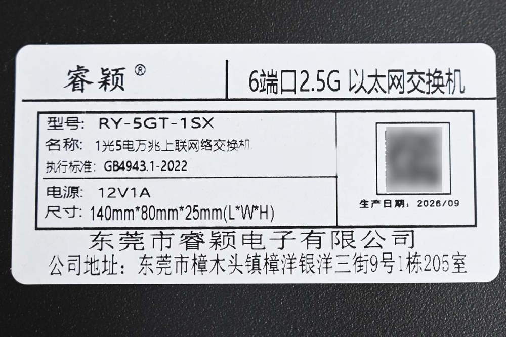
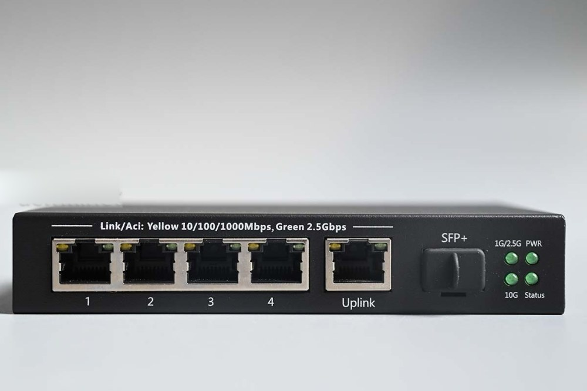
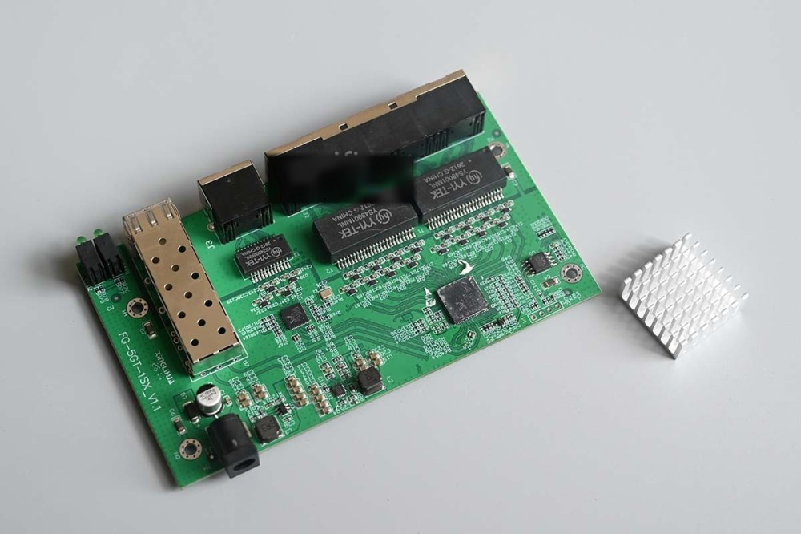
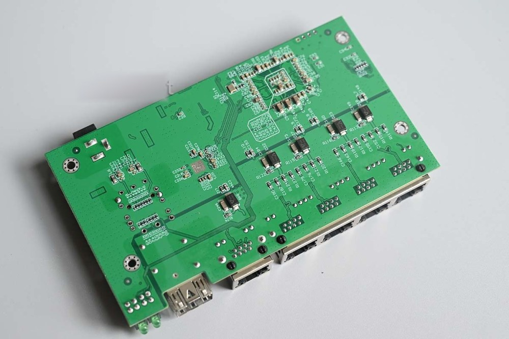

# FG-5GT-1SX_V1.1

Documentation for the unmanaged switch marked as `FG-5GT-1SX_V1.1`.

## Brands

* Ruiying RY-5GT-1SX
* Ruiying TY-5GT-1SX



## Hardware

* SoC: RTL8372N (4 x 2.5G PHY), plus an external RTL8221B for the fifth RJ45 port on SDS0
* Flash: PUYA P25Q32SH, 4 MB
* Ports: 5 x 2.5GBASE-T RJ45 + 1 x 10G SFP+
* Power: 12V 1A barrel plug, 140 x 80 x 25 mm

## Build target

```
make MACHINE=RUIYING_RY_5GT_1SX
```

## What works

- All five 2.5GBASE-T RJ45 ports at 10/100/1000/2500 Mbps
- The SFP+ cage with 1G, 2.5G and 10G modules
- LEDs, using the LED mux profile of the stock firmware

## PCB overview

**Board markings**

- Top silkscreen: FG-5GT-1SX_V1.1, XWJ32A V1.1 20251222

Front panel



Top side, heatsink removed



Bottom



## Power supply

Input power is delivered via barrel plug, `12V 1A` adapter (model LD-1212GS).

## Photos

Teardown photos taken from the acwifi.net review of this switch.
