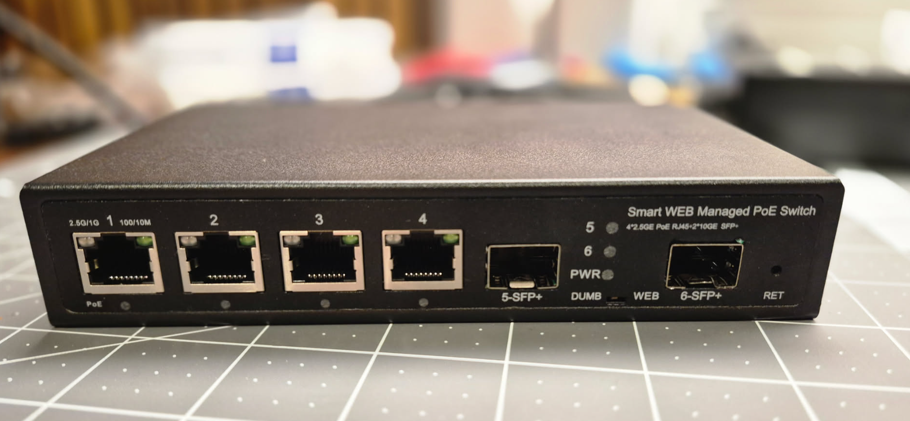
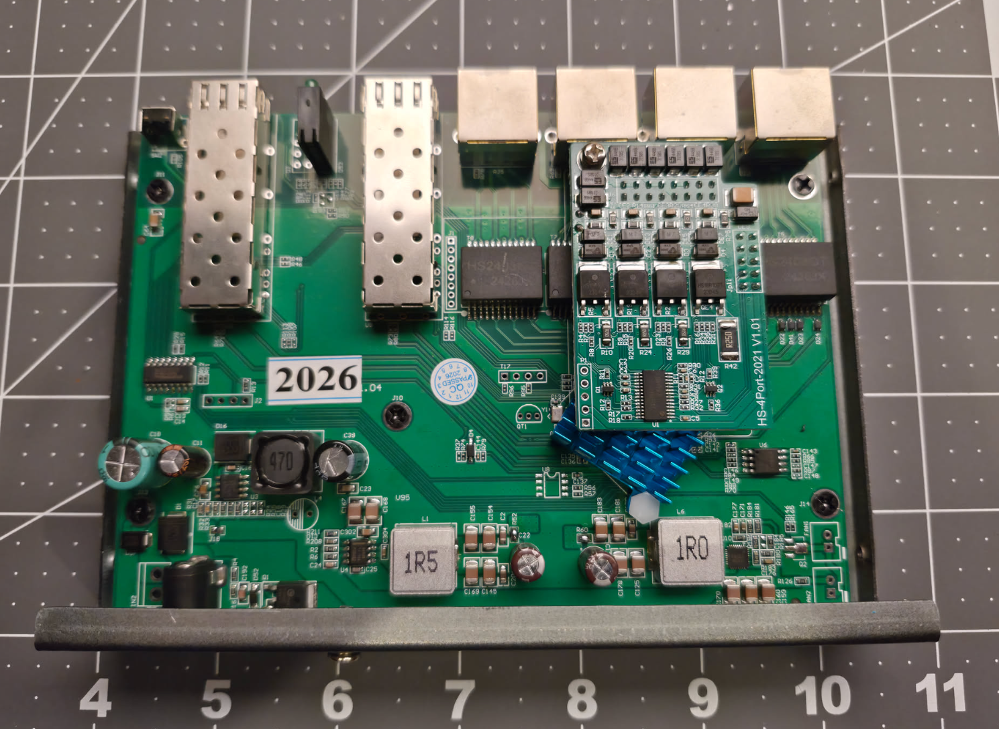

# POE Plus G604GTP-2SX-SL

RTL8372-based 4×2.5G PoE + 2×SFP+ switch.

Build with:

```
make MACHINE=G604GTP_2SX_SL
```

### Brands

| Brand | Type | Managed | PCB | Flash | Chip RTL |
|-------|------|---------|-----|-------|----------|
| POE Plus | G604GTP-2SX-SL | Web (stock) | Hasivo RTL-4GT-2S+ V1.04 | 2 MB | RTL8372 (non-N) |


### What works

- All four 2.5GBASE-T RJ45 ports
- Both SFP+ cages with 10G modules (fiber with DDM, and a 10GBASE-T copper module)
- SFP module insert/remove detection on both cages
- Copper and SFP port LEDs, including activity
- Power LED (solid once booted)
- PoE works standalone (PDs are powered), but is not configurable via RTLPlayground

### What does not work

- The per-port PoE LEDs stay off
- Reset button

### Not tested

- 1G and 2.5G SFP modules
- The DUMB / WEB slide switch on the front panel

### Photos

Front panel



PCB, marked `Hasivo RTL-4GT-2S+ V1.04` (under the 2026 sticker), with the PoE
daughterboard fitted over the RJ45 ports



### Port layout

| Front panel position | Physical port | Type   
|----------------------|---------------|--------
| RJ45 1               | 1             | Copper 
| RJ45 2               | 2             | Copper 
| RJ45 3               | 3             | Copper 
| RJ45 4               | 4             | Copper 
| SFP left             | 5             | SFP+   
| SFP right            | 6             | SFP+   
