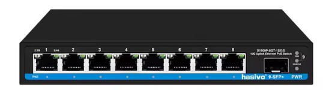
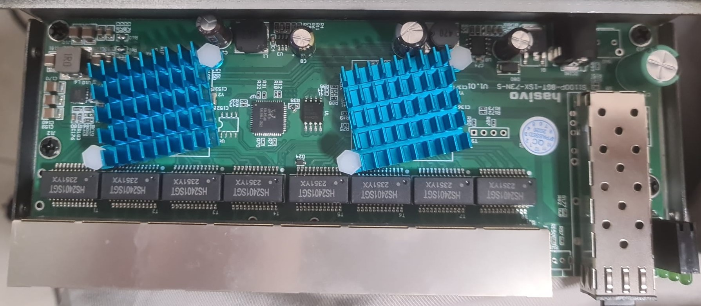
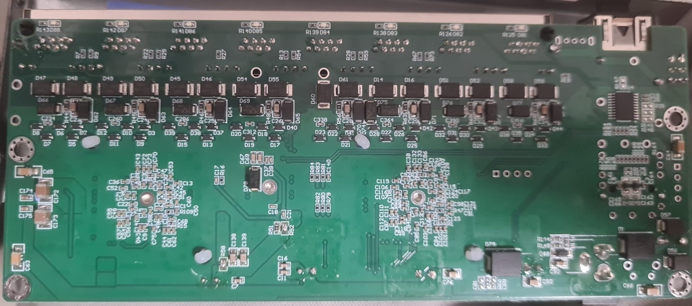

# Hasivo S1100P-8GT-1SX-S

RTL8373N switch with 8 × 2.5G RJ45 ports and 1 × SFP port. GD25Q16 2 MiB flash (`mac_flash_offset = 0x1FC000`).

## Port mapping

| Front port | ASIC MAC | Interface |
| --- | --- | --- |
| 1–8 | 0–7 | RJ45 |
| 9 | 8 | SFP (SDS1) |
| Internal | 9 | CPU |

## Board signals

| Function | GPIO |
| --- | --- |
| SFP detect | 30 |
| SFP LOS | 37 |
| SFP TX disable | Not connected (`GPIO_NA`) |
| SFP I2C SDA / SCL | 39 / 40 |
| Reset | 54 |

The profile preserves the original 28-entry LED mux configuration. PoE management is not implemented.

## Build

`make MACHINE=HASIVO_S1100P_8GT_1SX_S CI=1`

## Photos

Front panel:

PCB upper side:

PCB lower side:

## Validation

Pin assignments and LED behavior are carried over from the owner's earlier profile. Current-upstream build and physical hardware validation are pending.
