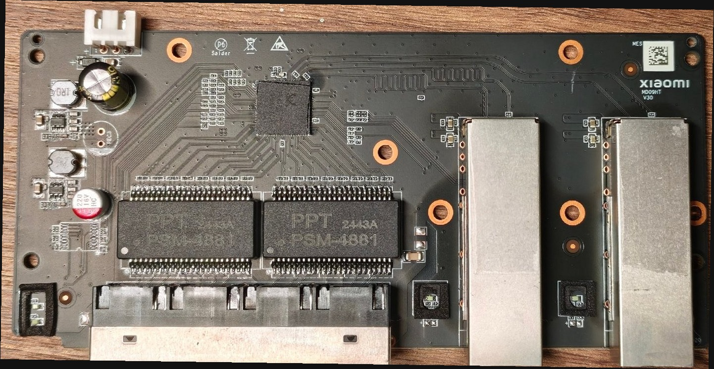
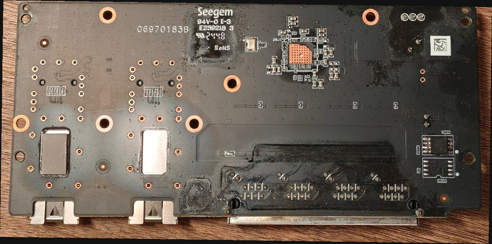

# MD09HT V30

Documentation for the unmanaged 4 + 2 switch sold as `SW-106T-A` by Xiaomi. The
PCB is silkscreened `MD09HT` / `V30` next to the logo on the top side.

### Brands

| Brand | Type | Managed | PCB | Flash | Chip RTL |
|-------|------|---------|-----|-------|----------|
| Xiaomi | SW-106T-A | No | MD09HT V30 | EN25Q80C (8 Mbit / 1 MB) stock | 8372N |

### What works

- all four 2.5GBASE-T RJ45 ports at 10/100/1000/2500 Mbps
- both SFP+ cages with 1G/2.5G/10G modules
- per-port LEDs, all off while the port has no link
- Web UI, VLAN, configuration save, reboot

### Not verified

- the unit used for development has its stock 1 MB flash replaced with a 4 MB
  part, so an untouched 1 MB device is untested; the 512 KB image fits either way
  (one half holds the image, the other half stages the update)
- the reset button footprint is unpopulated, `reset_pin` is `GPIO_NA`

### Build target

```
make MACHINE=XIAOMI_SW_106T_A
```

### Ports

```text
physical 1-4    -> logical 4-7
left SFP+ cage  -> physical 5, logical 8, SDS1, detect GPIO38
right SFP+ cage -> physical 6, logical 3, SDS0, detect GPIO37
```

Neither cage has a LOS or TX-disable pin wired, link state comes from the
SerDes. The copper PHYs are wired with the MDI pairs swapped: register `0xa90`
must be `0x03`; with the reset default `0x0c` physical ports 1 and 2 never link.

### LEDs

One LED per port, driven through a custom `led_mux`. All LEDs stay off while a
port has no link; the activity LED follows the traffic.

### Flash

Retail units carry a cFeon `Q80C-104HIP` (EN25Q80C, 8 Mbit / 1 MB) on the back
side, and the board has a second, unpopulated SOIC-8 footprint.

This is an unmanaged device and the stock firmware stores no factory MAC, so
`mac_flash_offset` is `0` and the address is derived from the chip UUID (locally
administered, `06:` prefix), stable per unit.

### PCB overview

Top side, silkscreen `MD09HT` / `V30` at the right edge:



Bottom side:



### Hardware notes

- 2 x `PPT PSM-4881` 2.5G port modules
- RTL8372N (DRQFN) with RTL8224N PHYs
- 12 V / 1 A external supply, 4.0/1.7 mm DC plug
- plastic case, unpopulated reset button footprint
