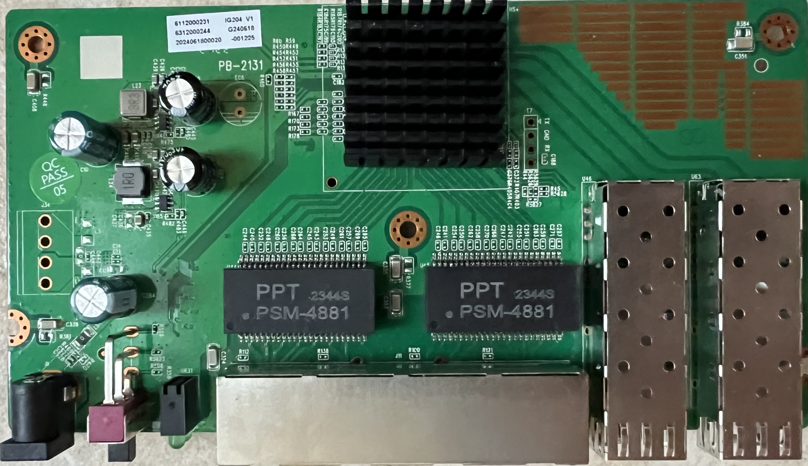
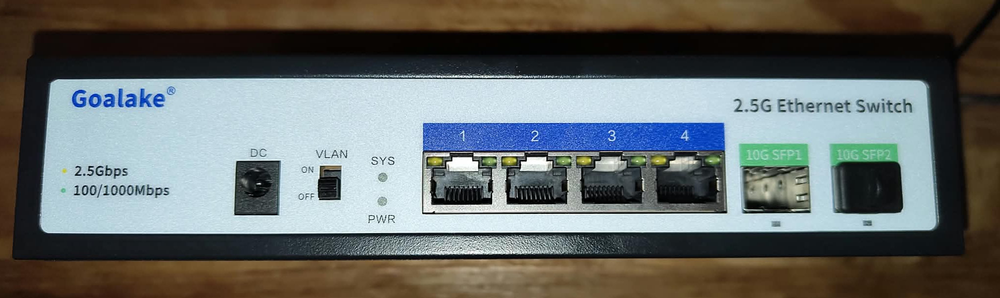
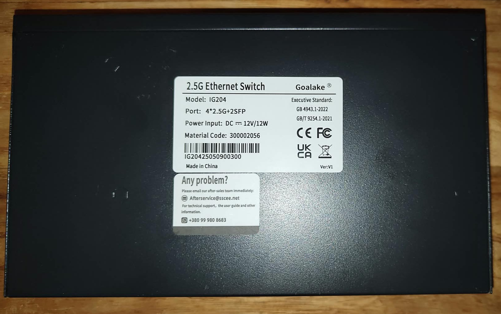

# Steamemo/Goalake IG204-V1

Following is documentation for unmanaged switch marked as `IG204-V1`.

Original software is running UART on 9600 baud rate, contains a rudimentary CLI.

Initial installation is only possible via a direct write to the SPI flash.

### Brands

| Brand    | Type       | Managed | PCB        | Flash       | Chip RTL      |
|----------|------------|---------|------------|-------------|------------|
| Goalake  | IG204 (V1 on PCB, not on case)  | No      | PB-2131    | cFeon QE32A 4096K | RTL8372N  |
| STEAMEMO | IG204-V1   | No      | PB-2131    | cFeon Q32A | RTL8372N  |

### Targets
`STEAMEMO_IG204_V1` or `GOALAKE_IG204`. The define only changes branding in the UI, hardware config is indentical.

### Label specifications (STEAMEMO)

- **Name**: 2.5G Ethernet Switch
- **Model**: IG204 V1
- **Ports**:
  - 4 × RJ45: 10/100/1000/2500 Mbps
  - 2 × SFP: 1000 / 2500 / 10000 Mbps

Goalake's label is indentical, but has no V1 marking externally, only on its PCB.

### What works

- All four 2.5GBASE-T RJ45 ports at 10/100/1000/2500 Mbps  
- Both SFP ports supporting 1G, 2.5G and 10G modules 
- LEDs

## Connectors

### Front overview

```
┌───────────────────────────────────────────────────────────────────────────────────────────────────┐
│                                                                     ┌───────────┐   ┌───────────┐ │
│            "SYS"  ┌─────────┐ ┌─────────┐ ┌─────────┐ ┌─────────┐   │ SFP (U45) │   │ SFP (U63) │ │
│ ON  [ ]      O    │  RJ45   │ │  RJ45   │ │  RJ45   │ │  RJ45   │   │ PORT   5  │   │ PORT   6  │ │
│ OFF [X]      O    │  PORT 1 │ │  PORT 2 │ │  PORT 3 │ │  PORT 4 │   │ LOG    8  │   │ LOG    3  │ │
│    "VLAN"  "PWR"  │  LOG  4 │ │  LOG  5 │ │  LOG  6 │ │  LOG  7 │   │ SerDes 1  │   │ SerDes 0  │ │
│                   └─────────┘ └─────────┘ └─────────┘ └─────────┘   └───────────┘   └───────────┘ │
└───────────────────────────────────────────────────────────────────────────────────────────────────┘
```


`U45` SFP1 PINs | Signal | GPIO | Notes |
|---------------|--------|------|-------|
|2|	TX_FAULT	      | --- | | 
|3|	TX_DISABLE	      | --- | |
|4|	MODDEF2 – SDA     | GPIO39 | |
|5|	MODDEF1 – SCL     | GPIO40	| Shared with both SFP |
|6|	MODDEF0 – PRESENT | GPIO30 | |
|7|	RATE SEL          | ---    | |
|8|	LOS	              | GPIO37 | | 
|9|	TO?               | ---    | |
`

`U63` SFP2 PINs | Signal | GPIO | Notes |
|---------------|--------|------|-------|
|2|	TX_FAULT	      | --- | | 
|3|	TX_DISABLE	      | --- | |
|4|	MODDEF2 – SDA     | GPIO41 | |
|5|	MODDEF1 – SCL     | GPIO40	| Shared with both SFP |
|6|	MODDEF0 – PRESENT | GPIO50 | |
|7|	RATE SEL          | ---    | |
|8|	LOS	              | GPIO51 | | 
|9|	TO?               | ---    | |

### VLAN switch
PB-2131 contains a front switch labeled "VLAN", wired to `GPIO36`. Flipping it to ON pulls the GPIO high. On stock firmware this enables port isolation on the RJ45 ports.

On the `STEAMEMO_IG204_V1` target the switch also selects the configuration source at boot: OFF (GPIO low) ignores the saved settings and applies the default configuration built into the firmware, ON (GPIO high) loads the saved settings normally. Flipping it while the device is running reboots the device, so the new mode is applied.

## PCB overview

**Board markings**  
- Top silkscreen: PB-2131

Top side PCB



Case front Goalake



Case bottom Goalake



### Connectors
### T7, serial console

| `T7` pin | Signal      |
| -------- | ----------- |
| 1        | TX (Output) |
| 2        | GND         |
| 3        | RX (Input)  |
| 4        | 3V3         |

### Power supply

Input power is delivered via barrel plug, a `12V 1A` adapter is provided.
