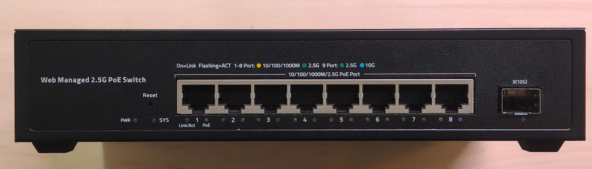
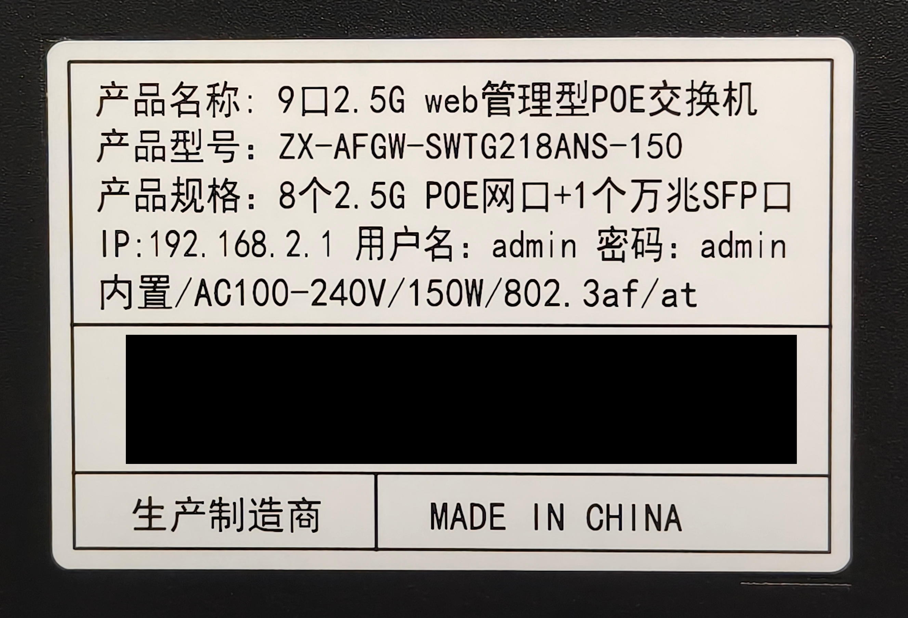
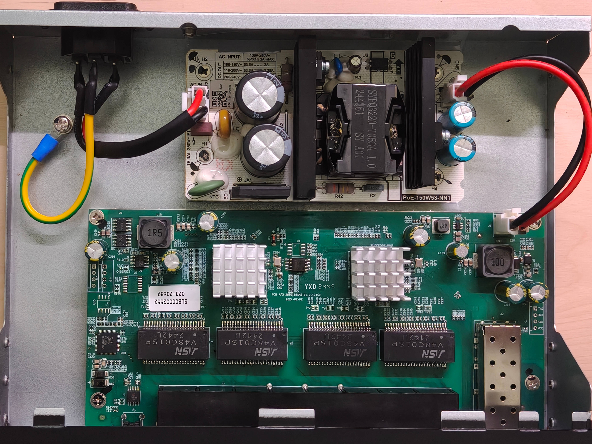
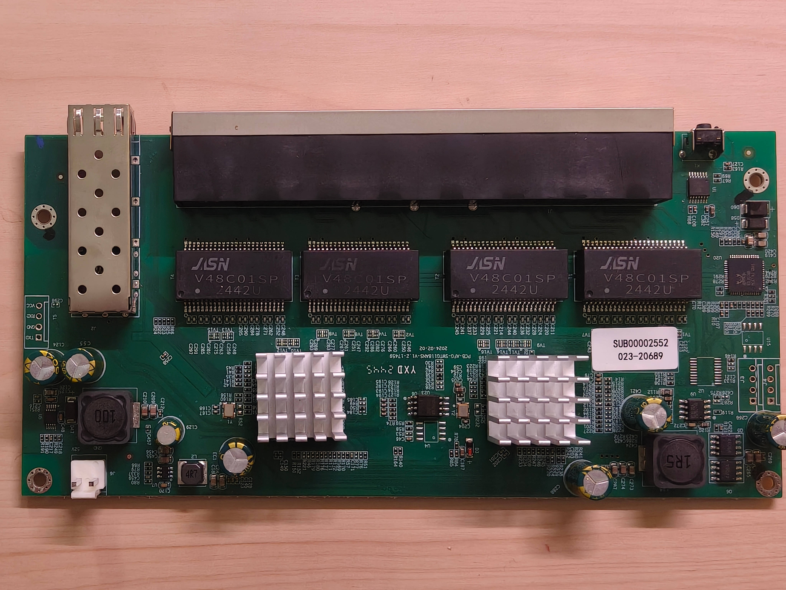
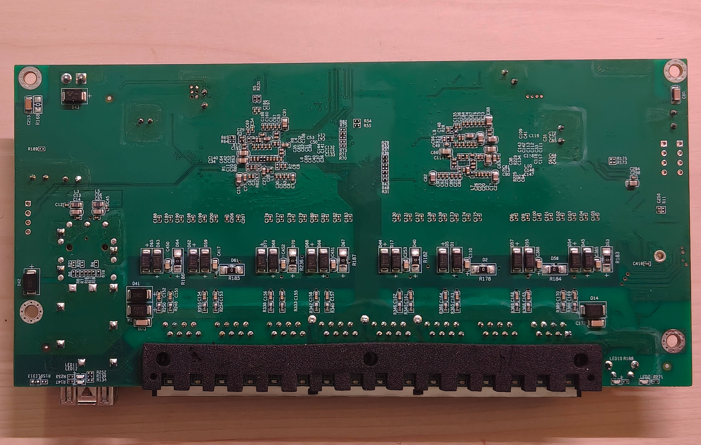

# PCB-AFG-SWTG118ANS-V1.2-17459

RTL8373-based 8×2.5G PoE + 1×10G SFP+ web-managed switch, sold as the
**Horaco ZX-AFGW-SWTG218ANS-150**. This is the older revision of the board documented in
[PCB-AFGW SWTG218ANS V2.0.2](PCB-AFGW-SWTG218ANS_V2.0.2_23308.md); units with
this PCB ship with OEM firmware V100.x. It needs its own target because the LED
wiring differs from V2.0.2.

> [!CAUTION]
> This device contains a mains voltage power supply, which is a potentially lethal hazard. Even after the device is unplugged, high-voltage capacitors can remain charged afterward and may still shock you. Do not attempt to open/disassemble a mains powered device unless you understand how to do so safely.

### Label specifications

- **Brand**: Horaco
- **Model**: ZX-AFGW-SWTG218ANS-150
- **PCB marking**: `PCB-AFG-SWTG118ANS-V1.2-17459`, silkscreened between the two heatsinks
  (upside down when the ports face away), dated 2024-02-02. The title
  of issue #725 spells it `SWTG218ANS`; the board reads `SWTG118ANS`.
- **CPU**: RTL8373
- **Flash**: 2 MB, FM25Q16A
- **Ports**:
  - 8 × RJ45: 10/100/1000/2500 Mbps with PoE
  - 1 × SFP+: 1G / 2.5G / 10G
- **Power input**: internal AC power supply, 150 W for PoE AC100-240V, 150W, 802.3af/at (PoE-150W53-NN1) 
- **Stock firmware**: web-managed PoE switch, OEM V100.9.9

### Build target

```
make MACHINE=HORACO_ZX_AFGW_SWTG218ANS_150
```

### What works

- All eight RJ45 ports 2.5G, 1G, 100M
- SFP+ port with a 10G module
- LEDs: green on 2.5G link/activity and amber on 1G/100M/10M link/activity per
  RJ45 port; blue on 10G and green on 2.5G/1G/100M on the SFP+ port; `SYS` LED

### Not verified

- SFP+ with 1G and 2.5G modules
- Reset button (`GPIO48`, taken over from the V2.0.2 definition)
- PoE: the PoE controller needs a firmware upload from the switch at every cold
  start, which RTLPlayground does not do on this target, so PoE stays off. See
  issue #265 / #712 for the work on PoE support.

### LED configuration

Taken from the LED init routine of OEM firmware V100.9.9:

| Register | Value |
|---|---|
| `LED1_0_SET0` (0x6548) | `0x01410141` |
| `LED3_2_SET0` (0x6544) | `0x01410174` |
| `LED1_0_SET1` (0x6540) | `0x00000140` |
| `LED3_2_SET1` (0x653c), bits 15:0 | `0x0155` |
| `LED3_0_SET1` (0x6528) | bits 7:0 = 0, bits 19:16 = 0xf |
| `LED_PORT_SET_SEL` (0x654c) | SFP+ port uses LED set 1 |
| `PIN_MUX_0` | bits 27 and 29 set |
| `LED_GLB_IO_EN` (0x65dc) | bit 29 set, bit 27 clear |
| `LED_MODE` (0x6520) | bits 12:9 = 0, bits 8:5 = 7 (set in `machine_custom_init()`) |

The OEM firmware does not write `LED_GLB_MUX_1..6`, so this target keeps the
default pad mux (`led_mux_custom = 0`). The SYS LED (pad 28) is kept enabled as
on V2.0.2; the OEM LED routine does not touch it.

### Port layout

| Logical port | Physical port | Type |
|---|---|---|
| 1-8 | 1-8 | RJ45 |
| 9 | 9 | SFP+ |

### Photos

Switch Front:



Switch Label:



Internal Layout:



PCB Top:



PCB Bottom:



