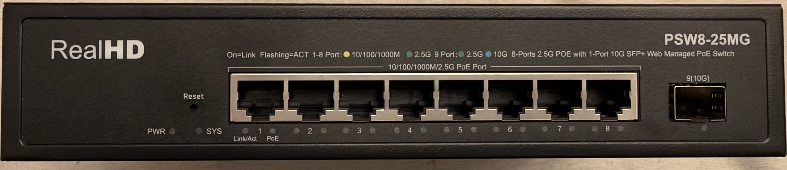
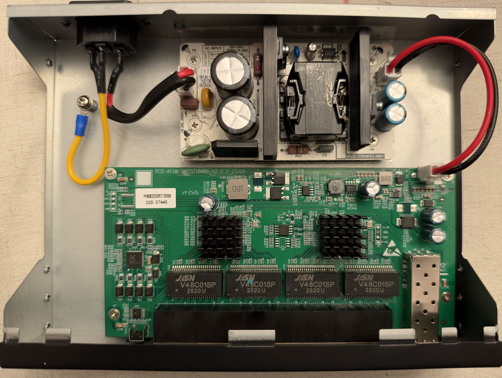
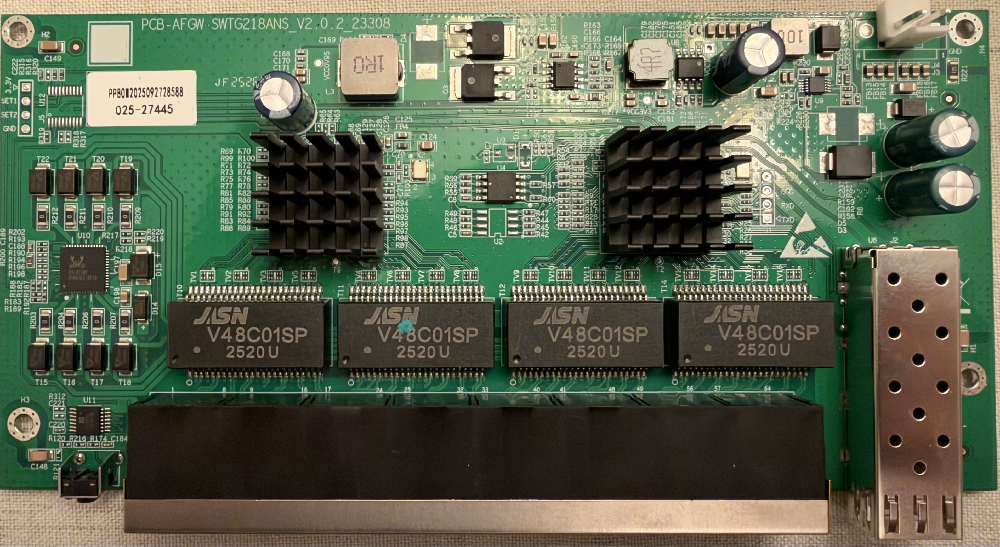
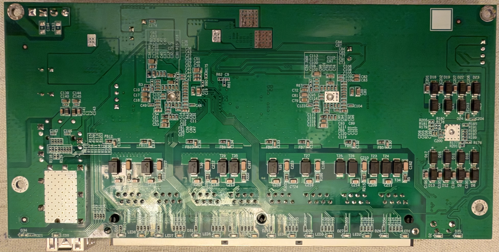

# PCB-AFGW SWTG218ANS V2.0.2

RTL8373-based 8×2.5G PoE + 1×10G SFP+ web-managed switch, sold as the
**RealHD PSW8-25MG**.

### Label specifications

- **Manufacturer**: RealHD
- **Model**: PSW8-25MG
- **PCB marking**: `PCB-AFGW SWTG218ANS_V2.0.2` (silkscreened as `PCB-AFGW SWTG218ANS_V2.0.2_23308`)
- **Ports**:
  - 8 × RJ45: 10/100/1000/2500 Mbps with PoE
  - 1 × SFP+: 1G / 2.5G / 10G (front panel marking `9(10G)`)
- **Power input**: internal AC PSU, `100-240V~ 50/60Hz 2A MAX`, DC output `53.5V 2.8A 150W`
- **Front panel LEDs**: `PWR`, `SYS`, per RJ45 port `Link/Act` and `PoE`, per SFP port 2.5G (green) and 10G (blue)
- **Stock firmware defaults**: web-managed PoE switch

### What works

- All eight 2.5GBASE-T RJ45 ports at 10/100/1000/2500 Mbps (PoE is not configurable via RTLPlayground)
- SFP+ port supporting 1G, 2.5G and 10G modules
- LEDs: green (2.5G) and amber (1G/100M/10M) per RJ45 port with activity, green (1G/2.5G) and blue (10G) on the SFP port, plus the `SYS` LED

### Photos

Front panel:



Board mounted in the case, with the internal PSU above it:



### PCB overview

Top side:



Bottom side:



A 4-pad UART header with `RXD` / `TXD` silkscreened sits next to the right heatsink. 

### Port layout

| Logical port | Physical port | Type   |
|--------------|---------------|--------|
| 1-8          | 1-8           | RJ45   |
| 9            | 9             | SFP+   |

### LED configuration

RJ45 ports use LED SET0, the SFP+ port uses LED SET1. The board needs the custom
LED mux (`led_mux_custom = 1`), and `RTL837X_REG_LED_GLB_IO_EN` is written to
`0x7f24977f` in `machine_custom_init()` so the LED pins are enabled as wired here.

| SET  | LED pin 0                                     | LED pin 1                                             |
|------|-----------------------------------------------|-------------------------------------------------------|
| SET0 | Green — lights on 2.5G link with activity     | Amber — lights on 1G / 100M / 10M link with activity  |
| SET1 | All speeds — lights on any link with activity | 10G — lights on 10G link with activity                |

On the front panel this gives one bi-color `Link/Act` LED per RJ45 port (green at
2.5G, amber at 10/100/1000M, blinking with activity) and one `PoE` LED per RJ45
port, which is driven by the PoE hardware and not by the switch. The SFP+ port has
a green 2.5G LED and a blue 10G LED.

### SFP GPIO assignments

| SFP (logical 9) | pin_detect (ModAbs) | pin_los | pin_tx_disable | SerDes | I2C SDA          | I2C SCL              |
|-----------------|---------------------|---------|----------------|--------|------------------|----------------------|
| SFP             | GPIO38              | GPIO_NA | GPIO_NA        | SDS1   | GPIO39_I2C_SDA4  | GPIO40_I2C_SCL3_MDC1 |

### Machine configuration

```
make MACHINE=REALHD_PSW8_25MG
```

### Programming

The serial console runs at 8N1 on 115200 baud with the RTLPlayground firmware
(see the UART header note under *PCB overview*). The stock firmware baud rate 57600. The flash chip was 2MB.

### PoE

The 8 RJ45 ports support PoE, powered by the internal 150W AC PSU (DC output
53.5V 2.8A) mounted above the main board.

Note: RTLPlayground does not provide PoE management for this board. The PoE
hardware runs with its own configuration, the same as on the other PoE boards in
this project.
