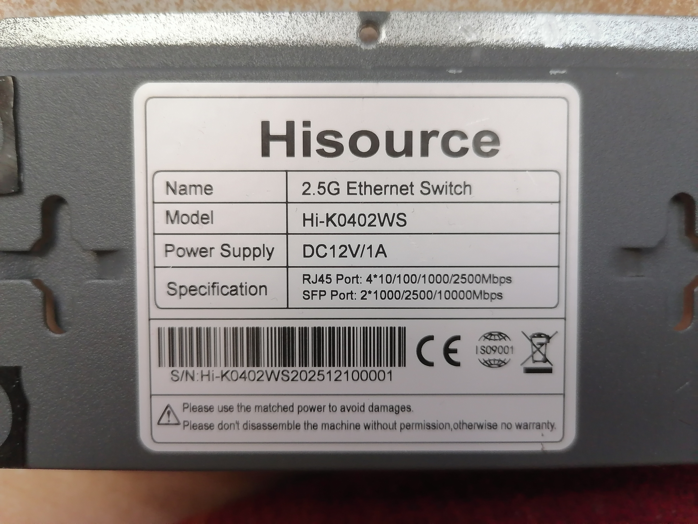
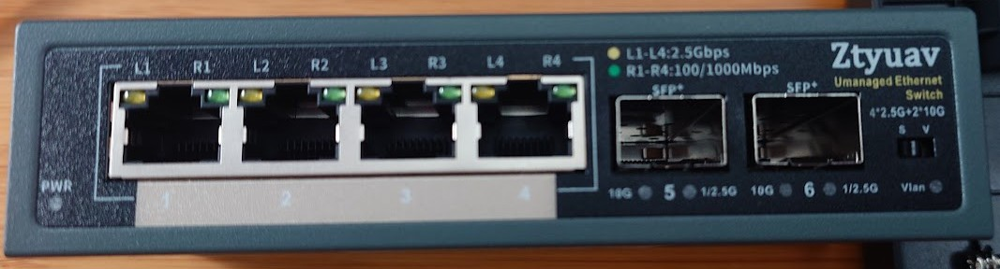
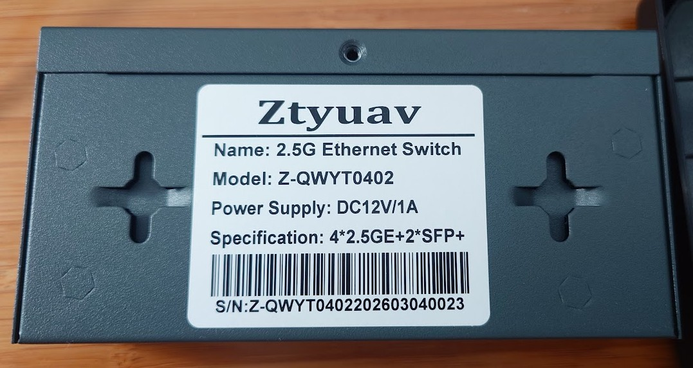
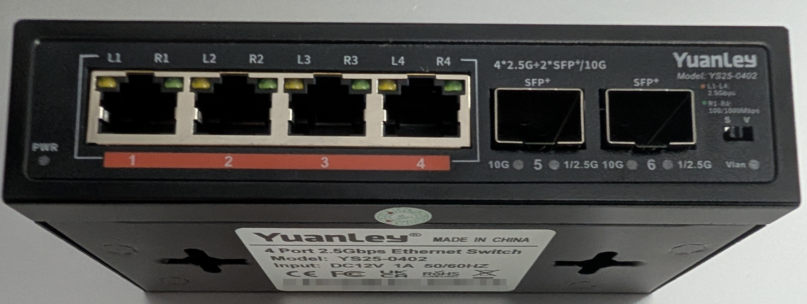
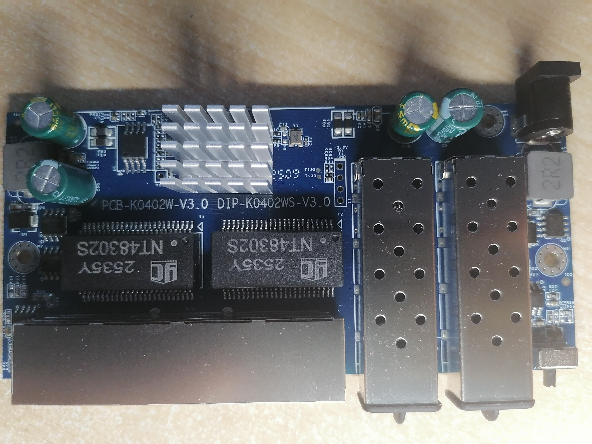
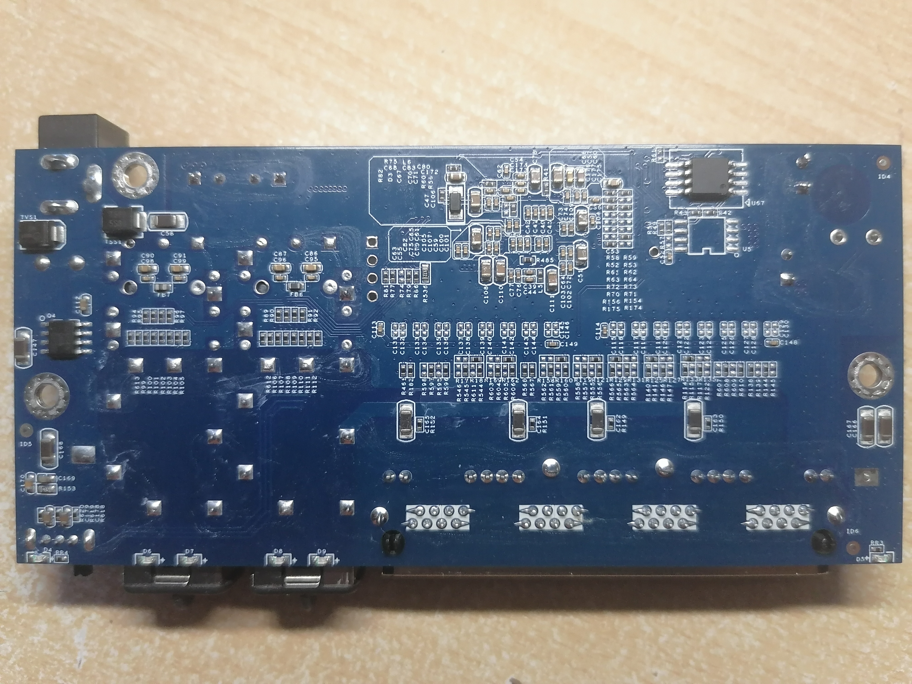
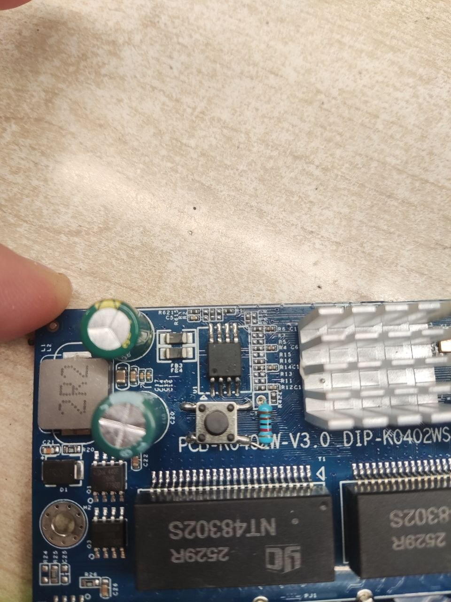

# PCB-K0402WS-V3.0

Following is documentation for a variety of unmanaged switch internally marked as `PCB-K0402WS-V3.0`. They are sold under many brands.

Original software is running UART on 9600 baud rate.

Note during opening the device: there might be a hidden 5th screw on the back
of the device just above the big label, might be covered by a QC sticker.

### Brands

* Hisource Hi-K0402WS

* Davuaz Da-K6402W

  This variant has **no reset button** - the front panel switch is a VLAN
  switch marked `S<>V`, not a reset. The reset button is only a modification
  on this board (a push button from TP131 to ground through 1 kOhm), so the
  reset input is left unpopulated. #824 enables the internal pull-up on that
  input, which keeps the boot from mistaking the floating pin for a pressed
  button.

  The front switch on the Da-K6402W is marked `S<>V` and selects the flash chip
  that is active. With it in the `S` position the switch runs the firmware from
  the chip that carries the web interface, with it in `V` the original firmware
  runs - and that one has no network stack at all (no DHCP, no IP), so the web
  interface is not reachable in that position.

  Keep the switch in the `S` position for RTLPlayground. Note when
  programming: the clip does not have to hold the HOLD line, so it programs
  the chip the switch has selected, regardless of which chip it is clipped to.

  **Status:** the machine target `DAVUAZ_DA_K6402W` reuses the
  `PCB-K0402W-V3.0` board definition unchanged. Verified on the device: `regget
  4` reports `0x83727000` (RTL8372N), the green and the amber port LEDs light
  up as documented, the four copper ports are numbered 1 to 4 as expected, and
  both SFP cages work - a 10G module in the left cage (physical port 5,
  logical port 8, SDS1) and in the right cage (physical port 6, logical port
  3, SDS0) link at 10G, read their EEPROM over I2C and report the vendor, the
  part number, the temperature, the supply voltage, the TX bias and the
  optical power.

* Ztyuav Z-QWYT0402

* SICSOLINK SL-G0402F

* YuanLey YS25-0402 Note: there are [multiple revisions](PCB-K0402W-V1.0.md) of the YS25-0402. This is the newer revision that has a "Vlan" switch on the front.

### CPU, PHY and flash

| Part | Identification |
|------|----------------|
| SoC | RTL8372N: `regget 4` returns `0x83727000` |
| PHY | the four 2.5G ports are the internal PHYs of the RTL8372, the board has no external RTL8224 |
| Flash | `BY25Q16BS`, 16 Mbit / 2 MB |

The stock firmware of the device is the Realtek RTL837x SDK firmware without a
web interface, so the flash has to be programmed with an SPI clip.

### Programming

Using SPI clamp in-board is the only method for initial installation.

The board has two flash chips `BY25Q16BS` with 16M-bit size. The front switch, switches between the two flash chips.
These can be programed independently by using said switch - so it is e.g. possible to run the original and new firmware in parallel.
The switch actually controls the HOLD line of each flash chip, and toggling the switch results in a reboot.

If the programming clip keeps HOLD not connected, the flashing will commence on whatever the switch selected, regardless on which chip was clipped.

For the initial flash (at least with flashrom), the bin file produced by the build is much smaller than the flash chip, it is suggested to pad the file to keep flashrom happy: `truncate -s 2097152 rtlplayground-*-HISOURCE_HI_K0402WS_PCB_K0402WS_V3_0.bin`. Note: do not then proceed to use this resulting padded file for the web flashing (as it bricks the device), use the original unpadded .bin.

### What works (expected from label + similar devices)

- All four 2.5GBASE-T RJ45 ports at 10/100/1000/2500 Mbps  
- Both SFP ports supporting 1G, 2.5G and 10G modules 
- LEDs

### PCB overview

**Board markings**  
- Top silkscreen: PCB-K0402W-V3.0 / DIP-K0402WS-V3.0  

Top side

Bottom

### T2, serial console

| `J2` pin | Signal      |
| -------- | ----------- |
| 1        | 3V3         |
| 2        | RX (Input) |
| 3        | TX (Output)  |
| 4        | GND         |

## Power supply

Input power is delivered via barell plug, `12V 1A` adapter was provided.
Board has two supply rails. `0.95` and `3.3` volt.

### `0.95` Core Voltage

Voltage is made by a `Techcode TD1720` .

### `3.3` Voltage

Voltage is created by chip marked as `Techcode TD1720`.

**There seems to have been a miscalculation when choosing the inductor and the device is ~25% more efficient with an 5V power supply.**

## Reset Mod

A reset button can be easily added by soldering a push button from TP131 (near the Spi ROM) to ground via a 1KOhm resistor.

**PS:** `The reset button GPIO must be defined in the machine.c file before building the image, it must be selected the GPIO30_ACL_BIT3_EN instead of GPIO_NA under the PCB-K0402W-V3.0 configuration.`

Photo of the mod

