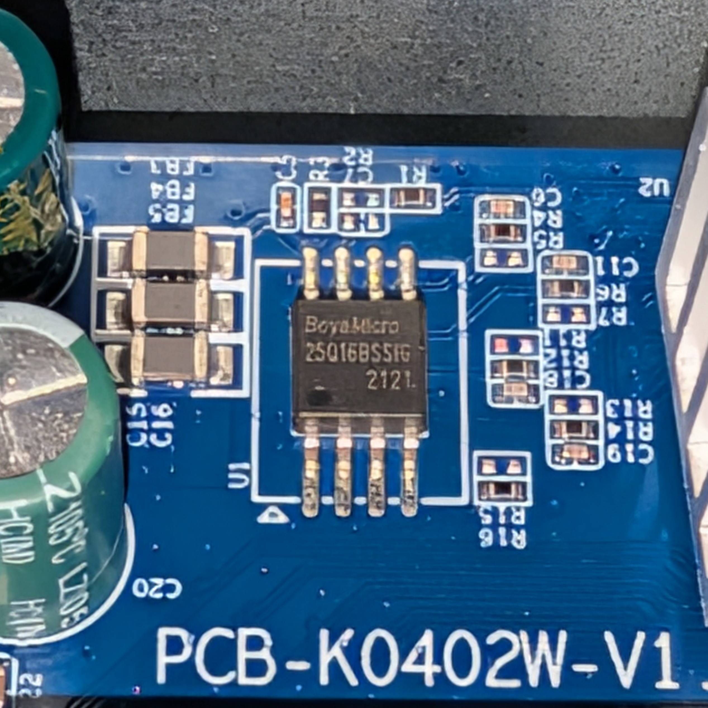
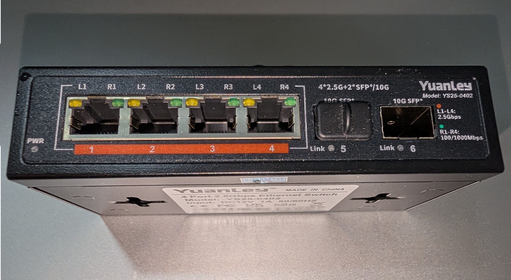
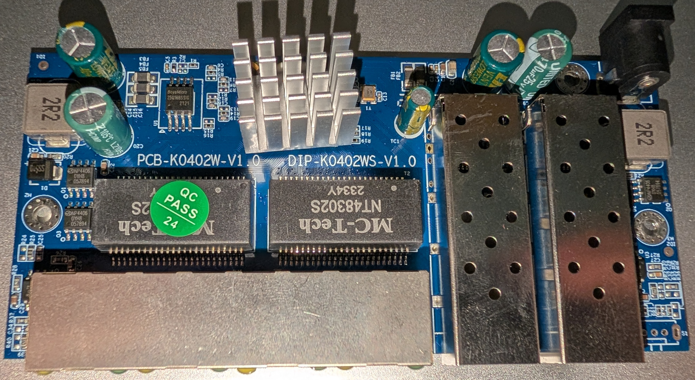
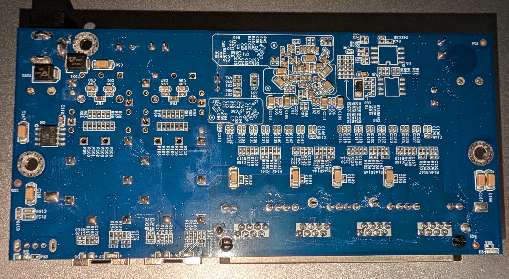
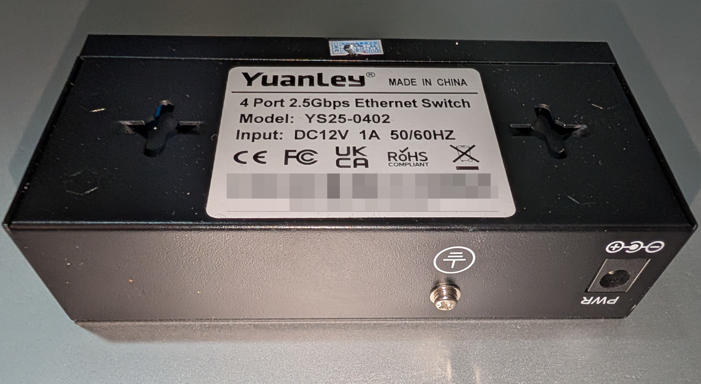
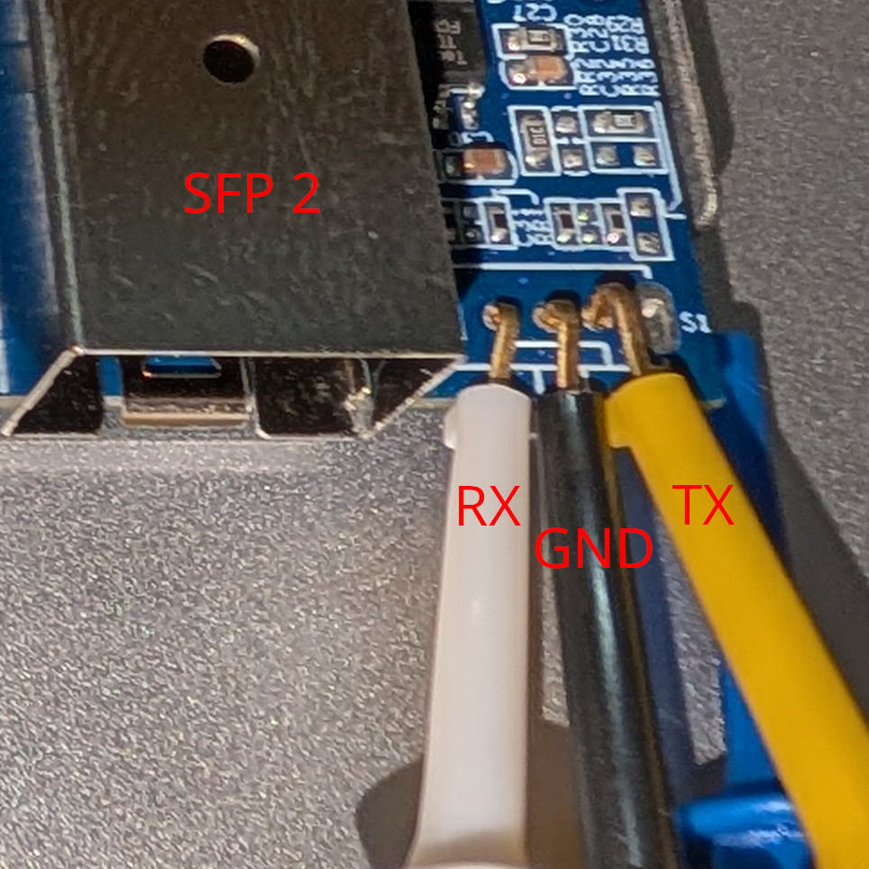

# PCB-K0402WS-V1.0

This is the first revision of the PCB-K0402WS series of boards; it's very similar to 2.0 in terms of layout/wiring.

The board does have footprints for a VLAN modeswitch at the front and a second flash chip on the bottom of the PCB, but these have been seen to ship unpopulated.

### Brands

* YuanLey YS25-0402 Note: there are [multiple revisions](PCB-K0402WS-V3.0.md) of the YS25-0402. This first revision lacks the "Vlan" switch cutout on the front of the enclosure.

### Programming

Use a SOIC-8 clamp to the flash chip (U1 on silkscreen) at the top of the board, leaving it otherwise unpowered.

The board has been seen to ship with a single [BoyaMicro BY25Q16BSSIG](https://www.lcsc.com/datasheet/C382744.pdf) 16Mbit (2MiB) chip, though exact BOM may vary.

### What works

- All four 2.5GBASE-T RJ45 ports at 10/100/1000/2500 Mbps
- Both SFP ports supporting 1G, 2.5G and 10G modules
- LEDs (Power LED is always on)

### PCB overview

#### Board markings
- Top silkscreen: PCB-K0402W-V1.0 / DIP-K0402WS-V1.0

#### Key components
- U1: SPI NOR flash, 2 MiB
- S1: unpopulated slide switch footprint (three through-holes used as serial console)

Front panel

PCB top

PCB bottom

Bottom and rear

### Power supply

Input power is delivered via a standard DC barrel jack (5.5x2.1mm) with an included 12V 1A adapter.

There is an optional grounding screw next to the DC input.

### Serial console

The PCB has a slide switch footprint (unpopulated) at the front right that is connected to the UART. It is labeled as "S1" on the silkscreen.

Facing the top front (port) side of the board, the pinout from left to right is:

| Position | Signal | GPIO              |
|----------|--------|-------------------|
| 1        | RX     | GPIO32\_UART0\_RX |
| 2        | GND    | N/A               |
| 3        | TX     | GPIO31\_UART0\_TX |

Standard 0.1" / 2.54mm pin headers will not fit, so wires or clips may be used instead.

The image below shows some oversized clips clumsily attached.

