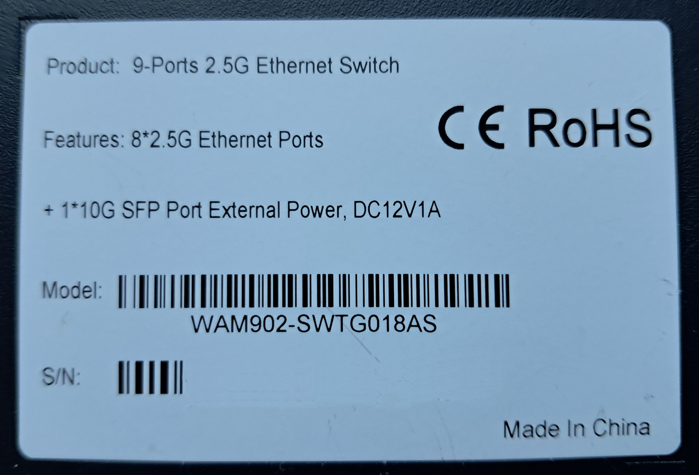
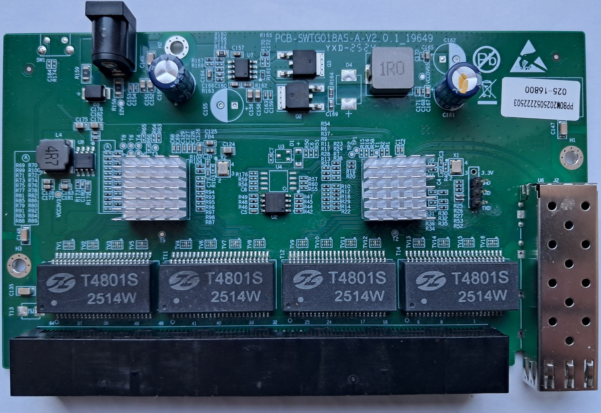
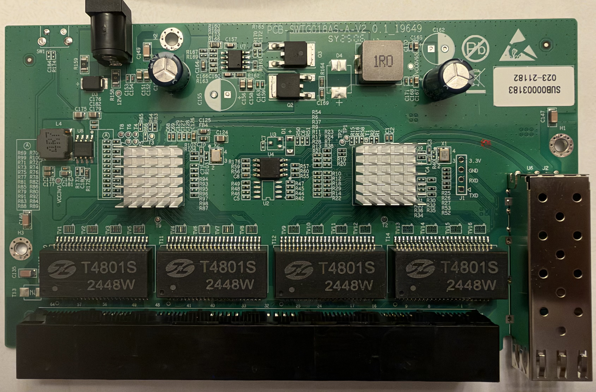
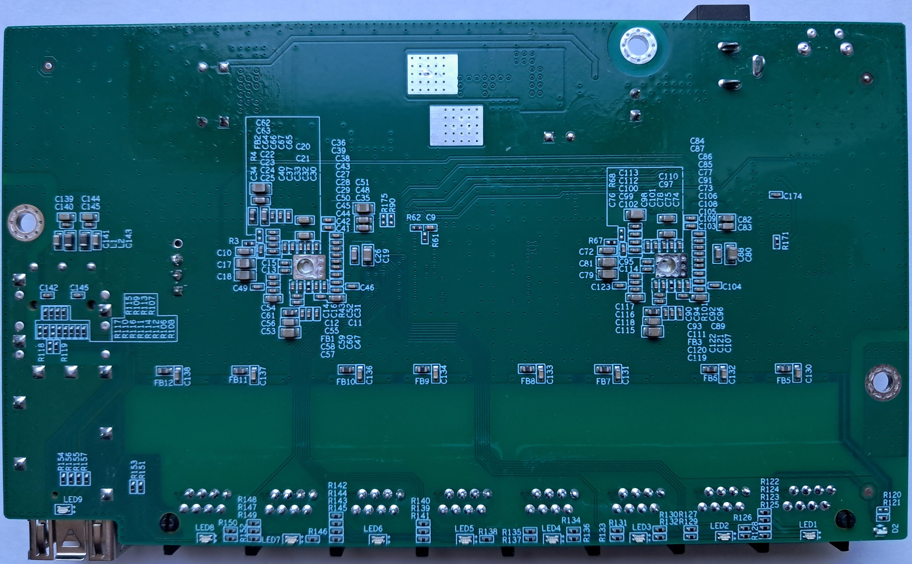

# PCB-SWTG018AS-A V2.0.1_19649
## Brands
| Brand   | Type             |Managed| PCB              | Flash           | Chip RTL      |
|---------|------------------|-------|------------------|-----------------|---------------|
| Ampcom  | PCB-SWTG018AS-A V2.0.1_19649 | No    | PCB-SWTG018AS-A V2.0.1_19649 | 512KB            | 8373N + 8224N |
| Horaco  | HC-SWTGW218AS  | Yes   | PCB-SWTG018AS-A V2.0.1_19649 | 2MB(25Q16JVSIQ) | 8373N + 8224N |
| Horaco  | HC-SWTG218AS  | Yes   | PCB-SWTG018AS-A V2.0.1_19649 | 2MB  | 8373N + 8224N |
| GoodTop | GT-ST018M        | Yes   | PCB-SWTG018AS-A V2.0.1_19649 | 2MB             | 8373N + 8224N |
| MokerLink | MOKERLINK_2G08110GSN     | No    | PCB-SWTG018AS-A V2.0.1_19649 | 512KB(25Q40)    | 8373N + 8224N |

The following is a documentation for the board marked as `PCB-SWTG018AS-A V2.0.1_19649`.
The board supports both managed and unmanaged switches.
It is sold under several brands, such as Ampcom and MokerLink (unmanaged) or Horaco and GoodTop (managed), see the table above.

The original software runs the UART at a baud rate depending on the switch type:
- **Unmanaged switch**: 9600 baud
- **Managed switch**: 57600 baud

Using a SOIC clamp in-board is the only method for initial installation.

The board has a single flash populated at `U4` or `U2`. A 2MB flash on `U4` and a 512KB flash on `U2` have been reported.

### Label specifications

- **Name**: 9-Ports 2.5G Ethernet Switch
- **Ports**:
  - 8 × RJ45: 10/100/1000/2500 Mbps
  - 1 × SFP+: 1000 / 2500 / 10000 Mbps
- **Power**: 12V DC, 1A barrel connector 

### What works
The device is fully supported:
- All 8 2.5GBASE-T RJ45 ports work at 10/100/1000/2500 Mbps
- The SFP+ port supports 1G, 2.5G and 10G modules 
- LEDs work with the same indiciations as the OEM firmware

### PCB overview

**Board markings**
- Top silkscreen: SWTG018AS-A-V2.0.1_19649

Top side (Unmanaged)

Top side (Managed)

Bottom

### J1, serial console

| `J1` pin | Signal      |
| -------- | ----------- |
| 1        | 3V3         |
| 2        | GND         |
| 3        | RX (Input) |
| 4        | TX (Output)  |

R52 and R53 resistors (33 Ohm) are typically populated for managed switch. They may not be populated for unmanaged, user need to add those resistors before using J1 header.

## Power supply

Input power is delivered via barell plug, `12V 1A` adapter was provided.
