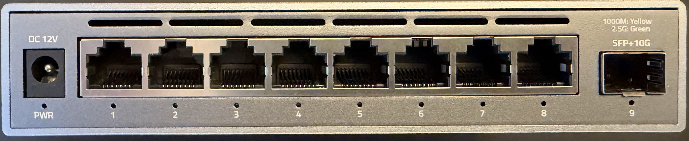
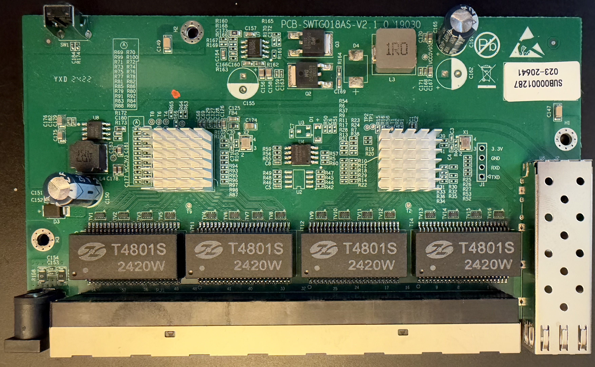
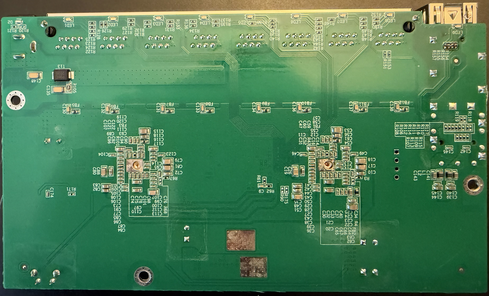

# PCB-SWTG018AS-V2.1.0\_19030 

This is the documentation for the board marked as `PCB-SWTG018AS-V2.1.0_19030`.

Original software is running UART on 57600 baud rate.

### Brands

| Brand | Type | Managed | PCB | Flash | Chip RTL |
|---|---|---|---|---|---|
| XikeStor | SKS3200-8E1X | Yes | PCB-SWTG018AS-V2.1.0\_19030 | 2MB (25Q16JVSIQ) | RTL8373N + RTL8224N|

### Machine target

| Device | Machine target |
| --- | --- |
| XikeStor SKS3200-8E1X | `MACHINE=XIKESTOR_SKS3200_8E1X` |

### What works
- All eight 2.5GBASE-T RJ45 ports at 10/100/1000/2500 Mbps
- SFP ports
- LEDs

### PCB identifier

PCB silkscreen: `PCB-SWTG018AS-V2.1.0_19030`

### Photos

Front panel:

PCB top:

PCB bottom:

### J1, serial console

| `J1` pin | Signal      |
| -------- | ----------- |
| 1        | 3V3         |
| 2        | GND         |
| 3        | RX (Input)  |
| 4        | TX (Output) |

### Power supply

Input power is delivered via barell plug, `12V 1A` adapter was provide
