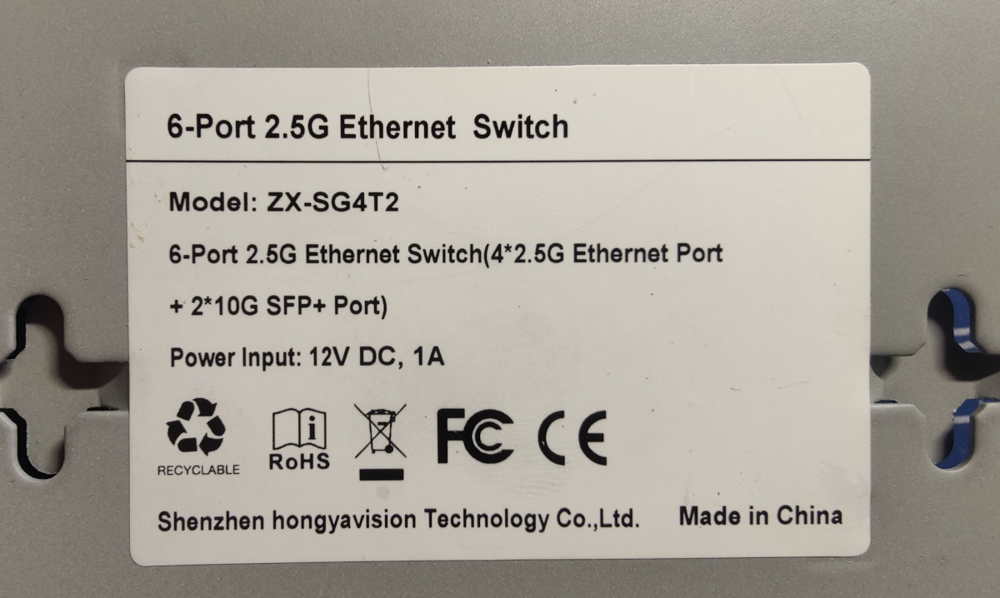
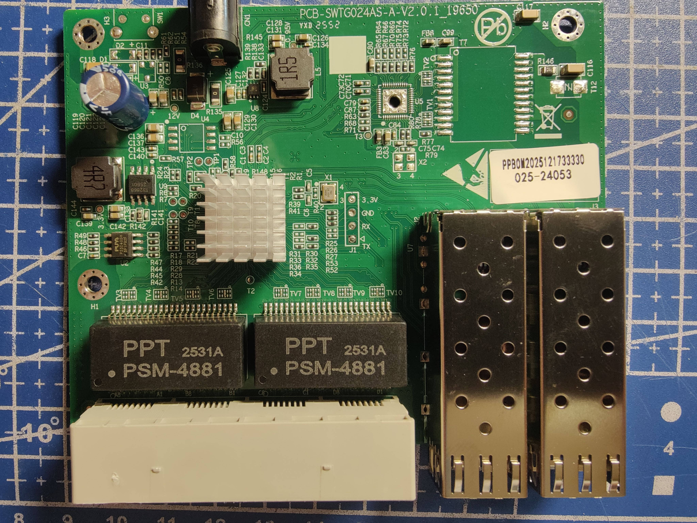
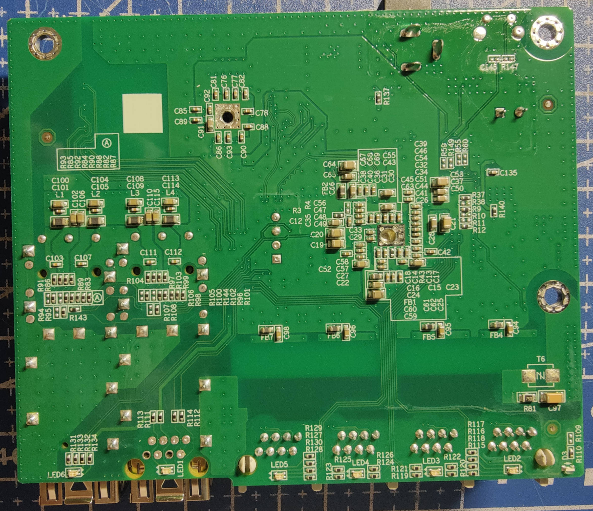

# SWTG024AS-A-V2.0.1_19650
The PCB is used in two port variants, `4C_2SFP` and `5C_1SFP`, which differ in the
RJ45 population and in how the SFP+ cage is wired.
It is highly similar to PCB-SWTG024AS-V2.0_16895, with the only difference being the GPIO configuration for the SFP port.

## Brands
|Brand    |Type          |Managed|Variant  |PCB                           |Flash           |Chip RTL|
|---------|--------------|-------|---------|------------------------------|----------------|--------|
| Horaco  | ZX-SG4T2     | No    | 4C_2SFP | PCB-SWTG024AS-A-V2.0.1_19650 | 512K (P25D40SH)| 8372N  |
| Horaco  | HC-SWTG124AS | Yes   | 4C_2SFP | PCB-SWTG024AS-A-V2.0.1_19650 | 2M   (W25Q16JV)| 8372N  |
| GoodTop | GT-ST024M    | Yes   | 4C_2SFP | PCB-SWTG024AS-A-V2.0.1_19650 | 2M             | 8372N  |
| Horaco  | HC-SWTGW215AS| Yes   | 5C_1SFP | PCB-SWTG024AS-A-V2.0.1_19650 | 2M   (W25Q16JV)| 8272N  |

## SWTG024AS-A-V2.0.1_4C_2SFP

### Label specifications

- **Name**: 
- **Ports**:
  - 4 × RJ45: 10/100/1000/2500 Mbps
  - 2 × SFP+: 1000 / 2500 / 10000 Mbps

### What works
The device is fully supported:
- ALL 2.5GBASE-T RJ45 ports work at 10/100/1000/2500 Mbps
- The SFP+ port supports 1G, 2.5G and 10G modules 

### PCB overview

**Board markings**
- Top silkscreen: PCB-SWTG024AS-A-V2.0.1_19650

Top side

Bottom

On Horaco HC-SWTG124AS with board PCB-SWTG024AS-A-V2.0.1_19650 the reset button is soldered at `SW1` (on the top left, GPIO48).

### J1, serial console

| `J1` pin | Signal      |
| -------- | ----------- |
| 1        | 3V3         |
| 2        | GND         |
| 3        | RX (Input)  |
| 4        | TX (Output) |

## SWTG024AS-A-V2.0.1_5C_1SFP

### Label specifications

- **Name**: 
- **Ports**:
  - 5 × RJ45: 10/100/1000/2500 Mbps
  - 1 × SFP+: 1000 / 2500 / 10000 Mbps

<!--  -->

### What works
The device is fully supported:
- ALL 2.5GBASE-T RJ45 ports work at 10/100/1000/2500 Mbps
- The SFP+ port supports 1G, 2.5G and 10G modules 
- LEDs work with the same indiciations as the OEM firmware

### PCB overview

**Board markings**
- Top silkscreen: PCB-SWTG024AS-A-V2.0.1_19650

Top side

<!--  -->

Bottom

<!--  -->

### J1, serial console

| `J1` pin | Signal      |
| -------- | ----------- |
| 1        | 3V3         |
| 2        | GND         |
| 3        | RX (Input)  |
| 4        | TX (Output) |
