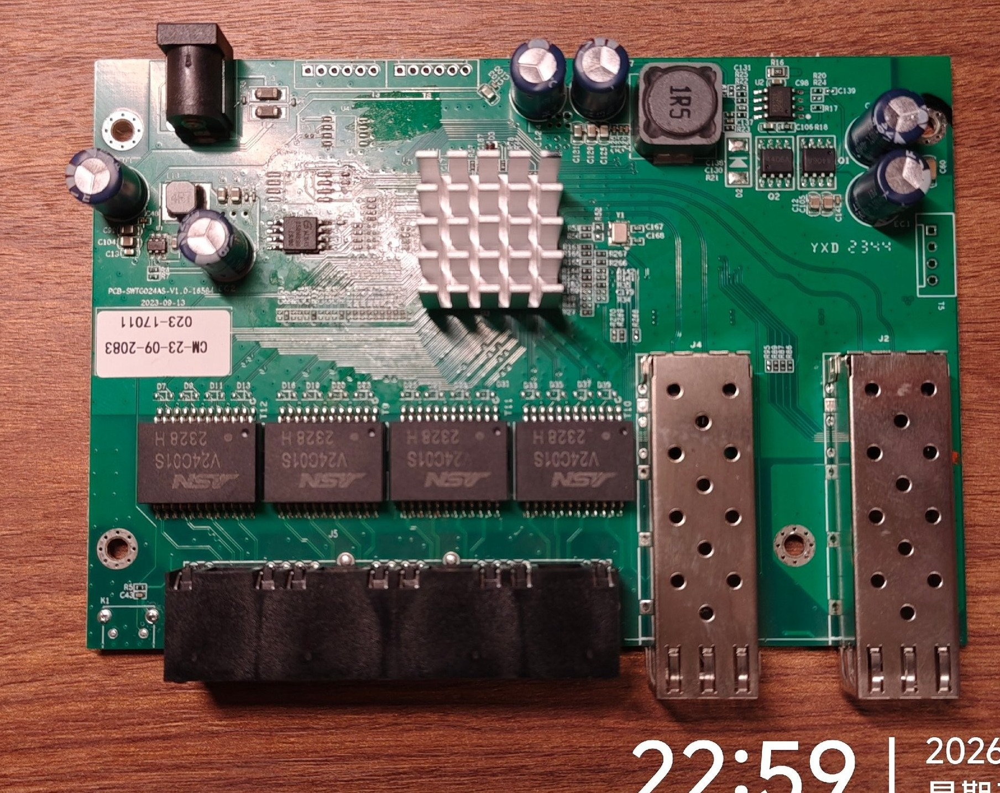
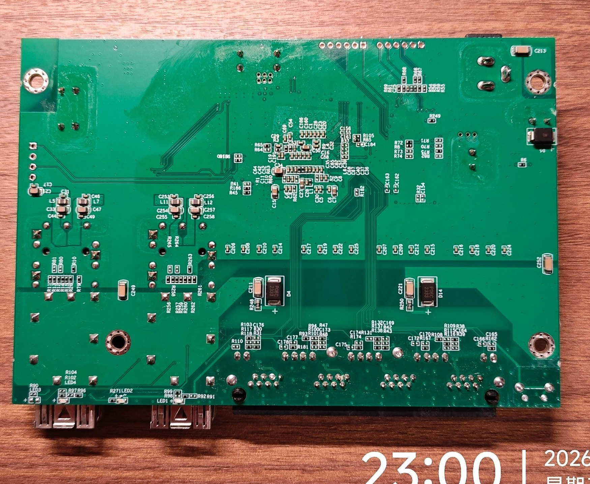
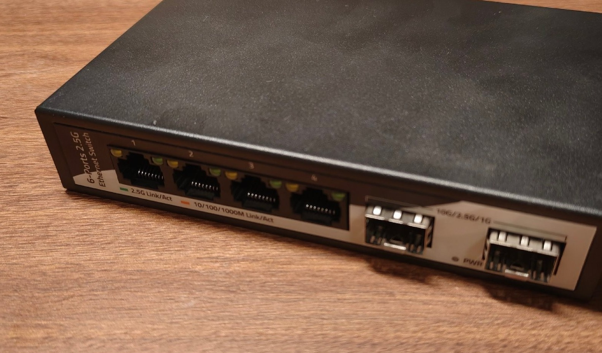

# PCB-SWTG024AS-V1.0-16584

Documentation for the unmanaged 4 + 2 switch sold as `ZX-SWTG024AS`. The PCB is
silkscreened `PCB-SWTG024AS-V1.0-16584`, with `2023-09-13` below it.

### Brands

| Brand | Type | Managed | PCB | Flash | Chip RTL |
|-------|------|---------|-----|-------|----------|
| ZX | ZX-SWTG024AS | No | PCB-SWTG024AS-V1.0-16584 | 4 Mbit / 512 KB stock | 8372 |

### What works

- all four 2.5GBASE-T RJ45 ports at 10/100/1000/2500 Mbps
- both SFP+ cages with 1G/2.5G/10G modules
- per-port LEDs
- Web UI, VLAN, configuration save and reboot

### Not verified

- a 512 KB flash leaves no room for a staged update, so the unit documented here
  has a 4 MB part fitted by the submitter; web updates work on that one
- the reset button footprint is unpopulated, `reset_pin` is `GPIO_NA`

### Build target

```
make MACHINE=ZX-SWTG024AS
```

### Ports

```text
physical 1-4        -> logical 4-7
left SFP+ cage (J4) -> physical 5, logical 8, SDS1, detect GPIO30
right SFP+ cage (J2)-> physical 6, logical 3, SDS0, detect GPIO50
```

Both cages have a LOS input wired (`GPIO37` and `GPIO51`); neither has a
TX-disable pin.

### LEDs

Two LED sets through a standard mux: the RJ45 ports use a green `2.5G + link`
lamp and an amber `1G/100M/10M + link/activity` lamp, the SFP+ cages use a single
green lamp covering 1G, 2.5G and 10G.

### Flash

The board has no factory MAC: this is an unmanaged device and the stock firmware
stores none, so `mac_flash_offset` is left at `0` and the address is derived from
the chip UUID (locally administered, `06:` prefix), stable per unit.

### PCB overview

Top side, silkscreen `PCB-SWTG024AS-V1.0-16584` at the left edge:



Bottom side:



### Device



The case label reads `6-Ports 2.5G Ethernet Switch`, model `ZX-SWTG024AS`,
4 x 2.5G RJ45 + 2 x 10G SFP+, 12 V / 1 A, made by Shenzhen hongyavision
Technology.

### Hardware notes

- 4 x `ASN V2400S` magnetics
- RTL8372 (the non-N variant, paired with RTL8224 PHYs)
- 12 V / 1 A external supply, metal case
