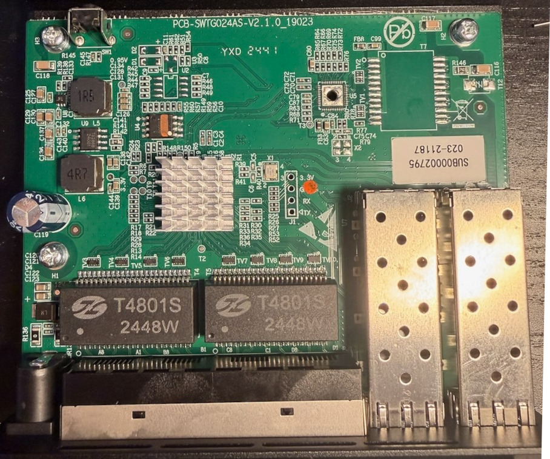
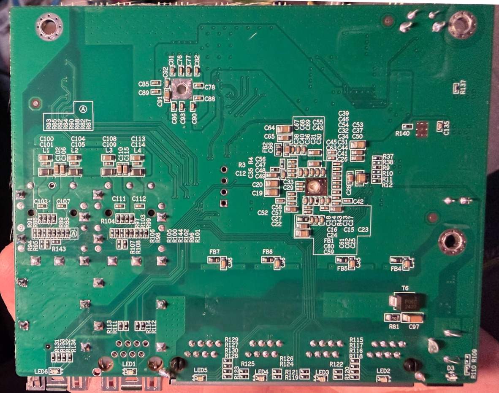

### SWTG024AS-V2.1

## Brands
|Brand|Type|Managed|PCB|Flash|Chip RTL|Ports|
|---|---|---|---|---|---|---|
| Xikestor | SKS3200-4E2X     | Yes | PCB-SWTG024AS-V2.1.0_19023 | 25Q16A         | 8372N | 4 + 2 |
| Solola   | SL902-SWTG024AS  | Yes | PCB-SWTG024AS-V2.1.0_19023 |                | 8372N | 4 + 2 |
| Sodola   | SL902-SWTGW215AS | Yes | PCB-SWTG024AS-V2.1.0_19023 | W25Q16JV (2MB) | 8372N | 5 + 1 |

## Variants
The PCB is populated in two variants:

| Variant | Ports | Build |
|---|---|---|
| 2xSFP | 4 × RJ45 + 2 × SFP+ | `make MACHINE=PCB_SWTG024AS_V2_1_0` |
| 1xSFP+1xRJ45 | 5 × RJ45 + 1 × SFP+ | `make MACHINE=SODOLA_SL902_SWTGW215AS` |

### Label specifications

- **Ports** (2xSFP):
  - 4 × RJ45: 10/100/1000/2500 Mbps
  - 2 × SFP+: 1000/2500/10000 Mbps
- **Ports** (1xSFP+1xRJ45):
  - 5 × RJ45: 10/100/1000/2500 Mbps
  - 1 × SFP+: 1000/2500/10000 Mbps
- **Power**: 1A @ 12V DC

#### Xikestore SKS-3200-4E2X label

### What works
- ALL 2.5GBASE-T RJ45 ports work at 10/100/1000/2500 Mbps
- The SFP+ ports supports 1G, 2.5G and 10G modules.
- LEDs work with the same indiciations as the OEM firmware.

### PCB overview

**Board markings**
- Top silkscreen: PCB-SWTG024AS-V2.1.0_19023

On the Sodola SL902-SWTGW215AS (1xSFP+1xRJ45) the reset button is on GPIO48 (active low).

Top side

Bottom

### Serial console

The four-pin through-hole serial header can be seen to the right of the CPU heatsink in the photo above. It is labelled J1, with pin 1 (Indicated by a triangle on the silkscren) at the bottom. the pinout is also on the silkscreen:

| Pin | Label  |
|-----|--------|
| 1   | TX     |
| 2   | RX     |
| 3   | GND    |
| 4   | 3V3    |

Adding a header is a few moments work with a soldering iron. Only pins 1-3 are required for serial port use, and the stock firmware outputs at 57600bps at boot.