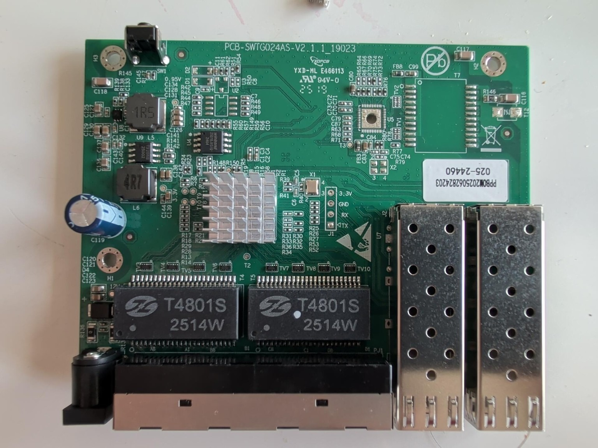

# Sodola SL902-SWTGW124AS

PCB silkscreen: `PCB-SWTG024AS-V2.1.1_19023`

Build with `make MACHINE=SODOLA_SL902_SWTGW124AS`. This target reuses the
[V2.1.0 profile](PCB-SWTG024AS-V2.1.0_19023.md).
The V2.1.0 build at `1a97904` worked on this board; the alias build has not been tested on hardware.

