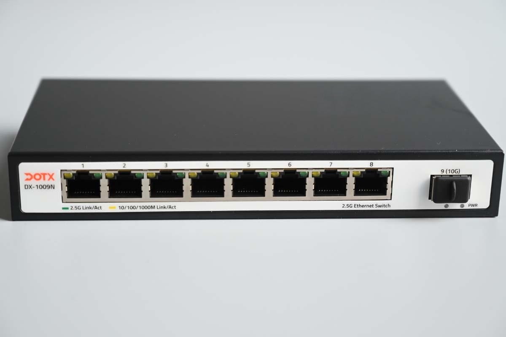
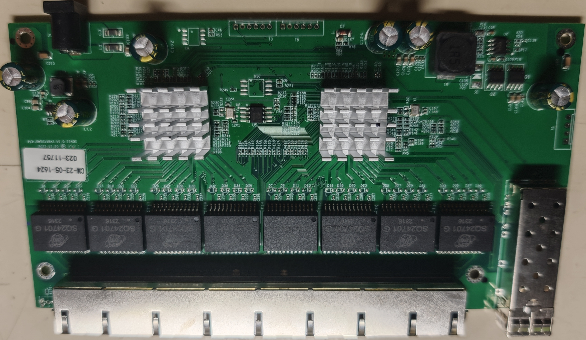
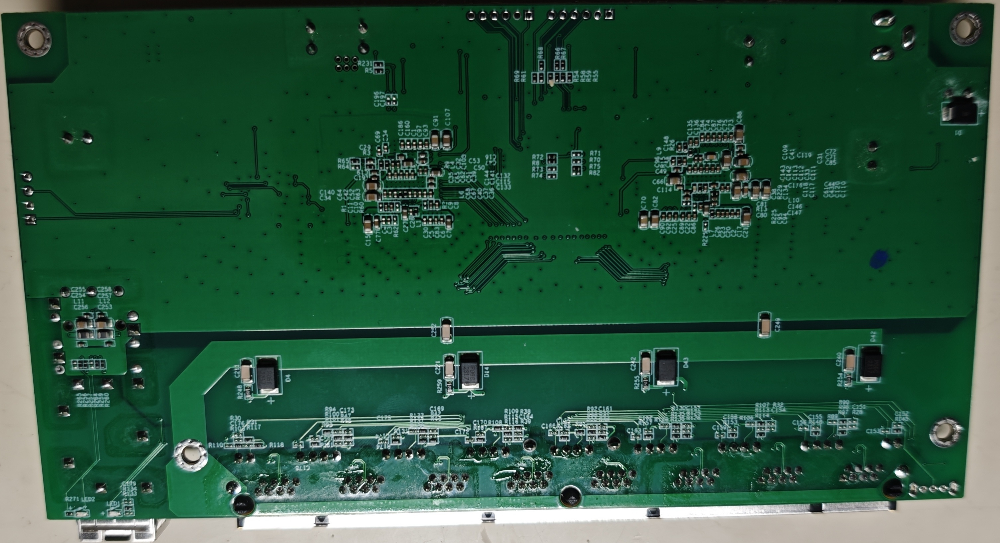

### PCB-SWTG118AS-V1.0-11430

## Brands

| Brand | Type | Managed | PCB | Flash | Chip RTL |
| --- | --- | --- | --- | --- | --- |
| DOTX | DX-1009N | No | PCB-SWTG118AS-V1.0-11430 | W25Q40 (512 KiB) | RTL8373 |

### Label specifications

- **Name**: DOTX DX-1009N
- **Ports**:
  - 8 × RJ45: 10/100/1000/2500 Mbps
  - 1 × SFP+: 1000 / 2500 / 10000 Mbps

### Machine target

Select `MACHINE=DOTX_DX_1009N` for the PCB marked `PCB-SWTG118AS-V1.0-11430`.

```text
make MACHINE=DOTX_DX_1009N CI=1
```

This target uses the independent board definition
`machine/pcb/PCB_SWTG118AS_V1_0_11430.c`. The machine entry
`machine/DOTX_DX_1009N.c` is a symlink to that definition.

### What works

Tested and working on the DOTX DX-1009N:

- All eight 2.5GBASE-T RJ45 ports at 10/100/1000/2500 Mbps
- The SFP+ cage with 1G, 2.5G and 10G modules
- LEDs, matching the indications of the stock firmware

Online firmware updates is unavailable on 512k flash chip.

### Device front



### PCB overview

**Board markings**

- Top silkscreen: PCB-SWTG118AS-V1.0-11430
- Port layout: 8 × 2.5G RJ45 + 1 × SFP+

Top side



Bottom



Front photo source: [acwifi.net](https://acwifi.net/).
