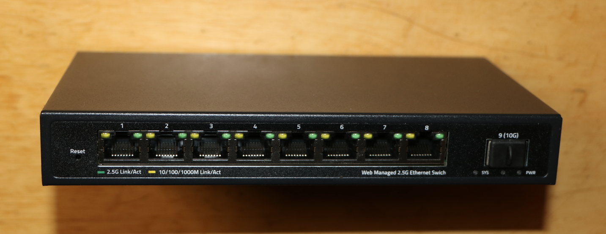

### ZX-MOKERLINK_ZX_SWTGW218AS

## Brands
|Brand|Type|Managed|PCB|Flash|Chip RTL|
|---|---|---|---|---|---|
| Mokerlink | ZX-MOKERLINK_ZX_SWTGW218AS | Yes|  PCB-SWTG118AS-V2.0-16029 | 2MB (FM25Q16A)| 8273N + 8224N |
| Sodola | | | | | |
| Horaco | HC-MOKERLINK_ZX_SWTGW218AS | Yes | SWTG118AS-V2.1 | 2MB | 8373 (non-N) |
| XikeStor | SKS3200-8E1X | Yes | SWTG118AS-V2.1-17462 | 2MB (25Q16JVSIQ) | |
| XikeStor | SKS3200M-8GPY1XF | Yes | SWTG118AS-V2.1-17462 | 2MB (25Q16JVSIQ) | |

The PCB-SWTG118AS-V2.0-16029 boards use `MACHINE=MOKERLINK_ZX_SWTGW218AS`.

The SWTG118AS-V2.1-17462 variants use the GPIO38 SFP detect pin and therefore
need a different target:

| Device | Machine target |
| --- | --- |
| XikeStor SKS3200-8E1X | `MACHINE=XIKESTOR_SKS3200_8E1X` |
| XikeStor SKS3200M-8GPY1XF | `MACHINE=XIKESTOR_SKS3200M_8GPY1XF` |

Both targets reuse `pcb/PCB_SWTG018AS_V2_1_0.c`. The V2.0 firmware uses GPIO30
and would never detect the module on these boards (see #781).

The Horaco HC-MOKERLINK_ZX_SWTGW218AS is also sold with the
[PCB-SWTG018AS-A V2.0.1_19649](PCB-SWTG018AS-A-V2.0.1_19649.md) board, which needs a different firmware. Check the marking
on the PCB before flashing.

The PHY and flash-chip models for the tested Horaco units remain unverified.

## Photos

## PCB

See up'n'atom's Repo:

https://github.com/up-n-atom/SWTG118AS/blob/main/photos/SWTG118AS-v2.0/SWTG118AS-v2.0-pcb-top.JPG

https://github.com/up-n-atom/SWTG118AS/blob/main/photos/SWTG118AS-v2.0/SWTG118AS-v2.0-pcb-bottom.JPG

