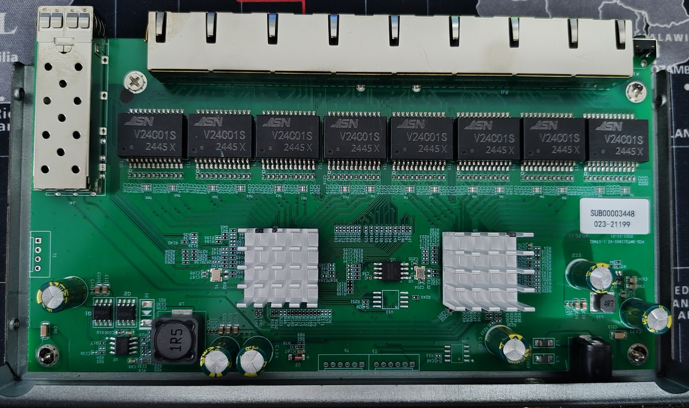
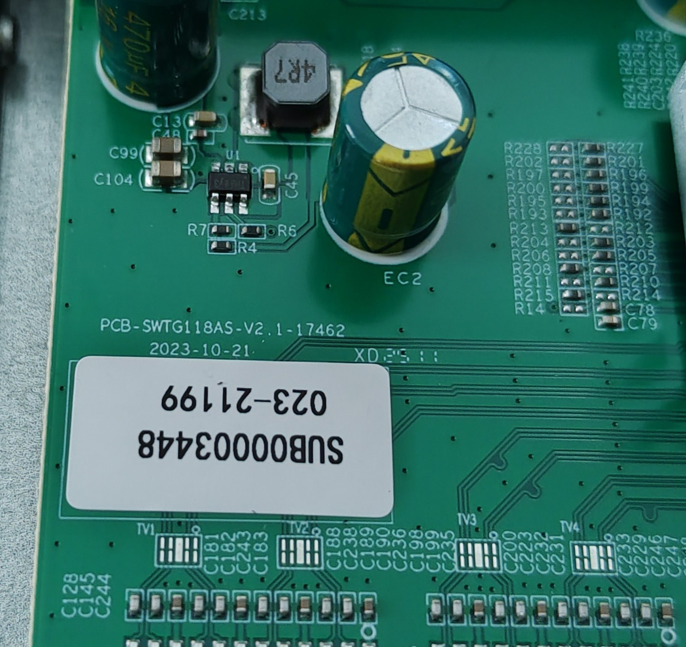
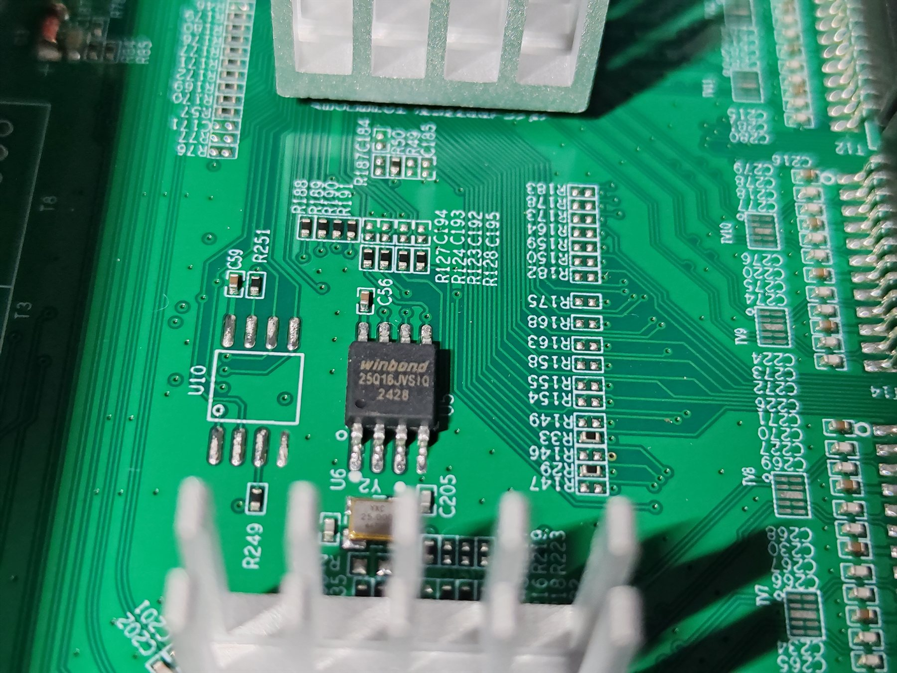
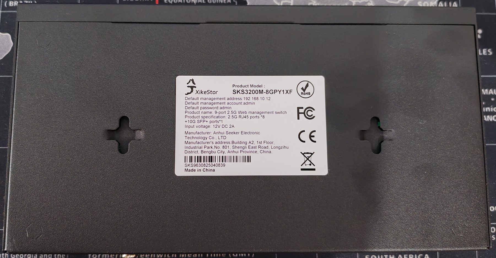

# PCB-SWTG118AS-V2.1-17462

This is the documentation for the board marked as `SWTG118AS-V2.1-17462`.
It is a revision of the [PCB-SWTG118AS-V2.0-16029](PCB-SWTG118AS-V2.0-16029.md)
board with a different SFP detect pin.

## Brands

| Brand | Type | Managed | PCB | Flash | Chip RTL |
|---|---|---|---|---|---|
| XikeStor | SKS3200M-8GPY1XF | Yes | SWTG118AS-V2.1-17462 | 2MB (25Q16JVSIQ) | RTL8373 |
| Horaco | ZX-SWTGW218AS | Yes | SWTG118AS-V2.1-17462 | 2MB (25Q16JVSIQ) | RTL8373N + RTL8224N |

## Machine target

Select the machine target by the PCB silkscreen, not by the retail model name.
The `SWTG118AS-V2.1-17462` boards use the GPIO38 SFP detect pin, so they must
not use the V2.0-16029 definition, which expects GPIO30.

| Device | Machine target |
| --- | --- |
| XikeStor SKS3200M-8GPY1XF | `MACHINE=XIKESTOR_SKS3200M_8GPY1XF` |
| Horaco ZX-SWTGW218AS | MACHINE=`HORACO_ZX_SWTGW218AS` |

The target use `pcb/PCB_SWTG118AS_V2_1_17462.c`.

Build example:

```
make MACHINE=XIKESTOR_SKS3200M_8GPY1XF
```

## Status

- Build verified for `XIKESTOR_SKS3200M_8GPY1XF` with `make ... CI=1`.

## PCB

PCB silkscreen: `PCB-SWTG118AS-V2.1-17462`.

## Photos

PCB (front):



PCB silkscreen marking:



Winbond `25Q16JVSIQ` flash chip:



Device label:



## T5, serial console

| `T5` pin | Signal      |
| -------- | ----------- |
| 1        | TX (Output) |
| 2        | GND         |
| 3        | RX (Input)  |
| 4        | 3V3         |


