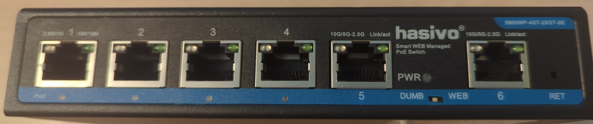
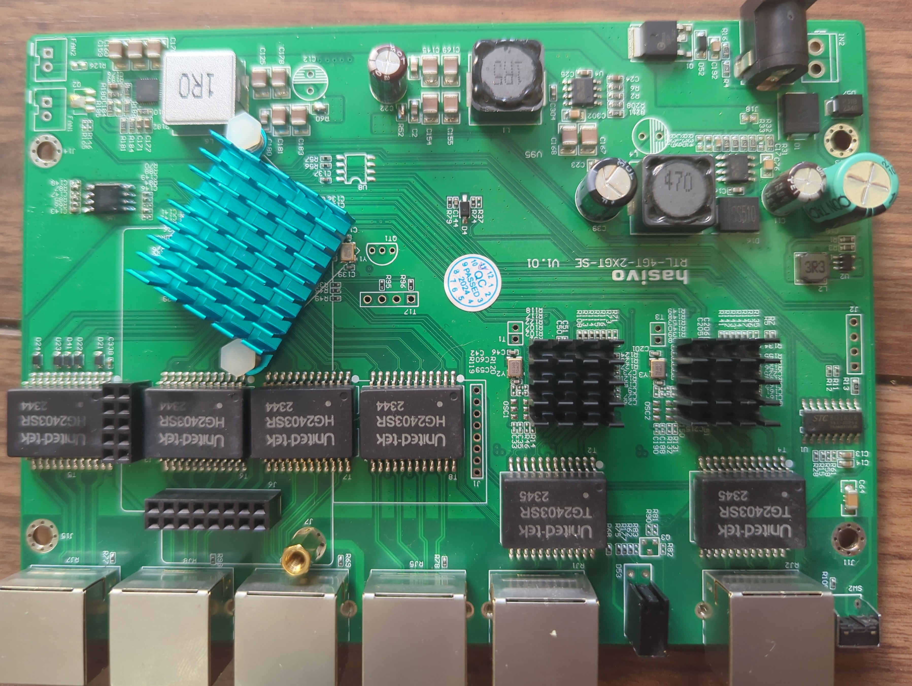
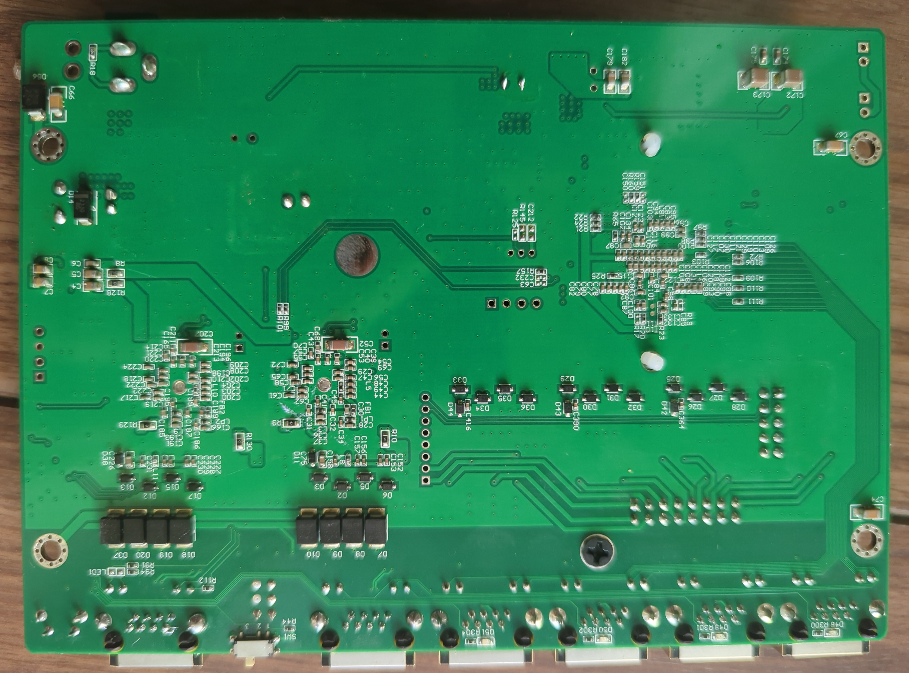
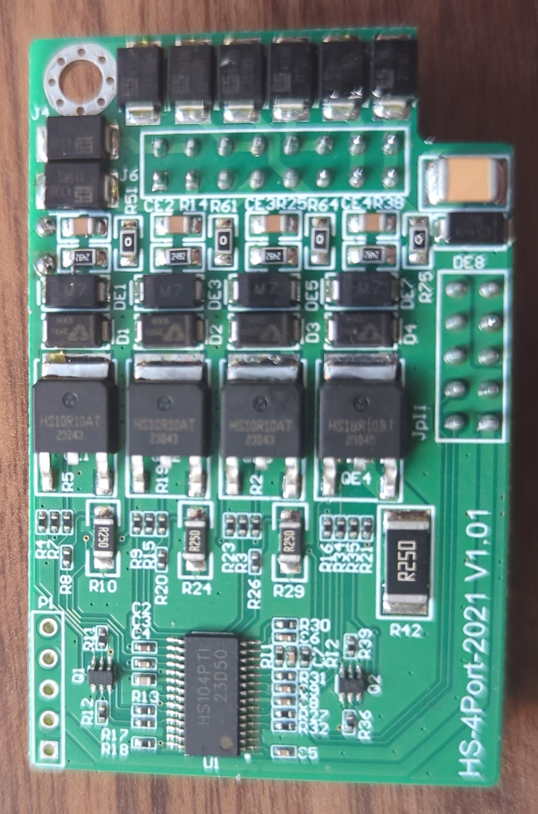
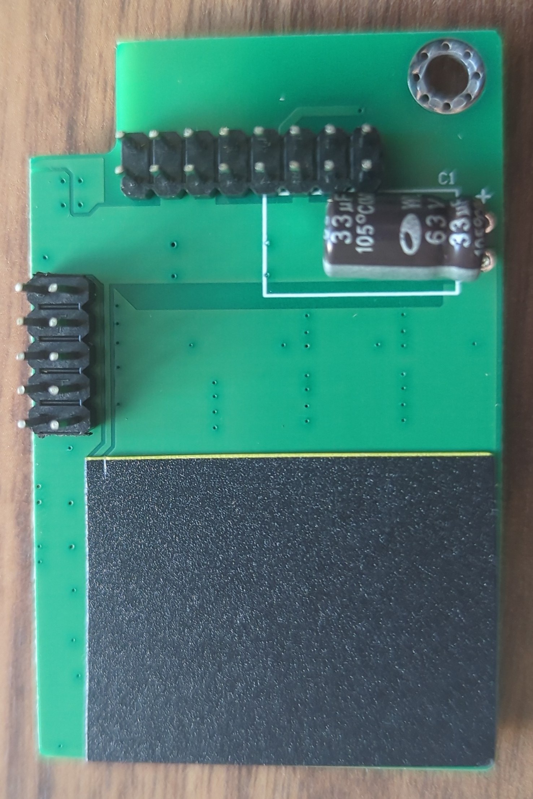

# Hasivo S600WP-4GT-2XGT-SE

```
make MACHINE=HASIVO_S600WP_4GT_2XGT_SE
```

| Brand | Type | Managed | PCB | Flash | Chip RTL |
|-------|------|---------|-----|-------|----------|
| Hasivo | S600WP-4GT-2XGT-SE | Web (stock) | Hasivo RTL-4GT-2XGT-SE V1.01 | 2 MB (FM25Q16) | RTL8372 |

- Top silkscreen: `RTL-4GT-2XGT-SE V1.01`
- PoE daughterboard: `HS-4Port-2021 V1.01` with a Hasivo HS104PTI PSE controller

### Photos









