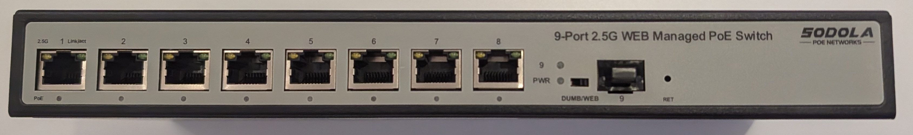
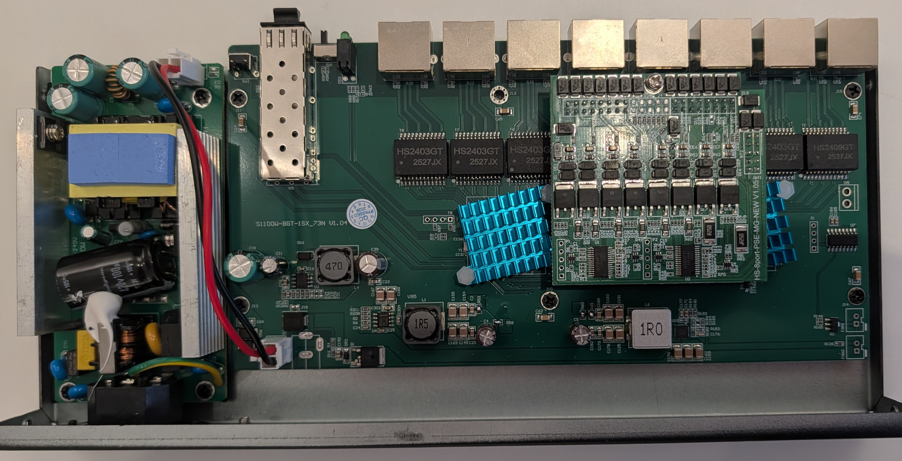
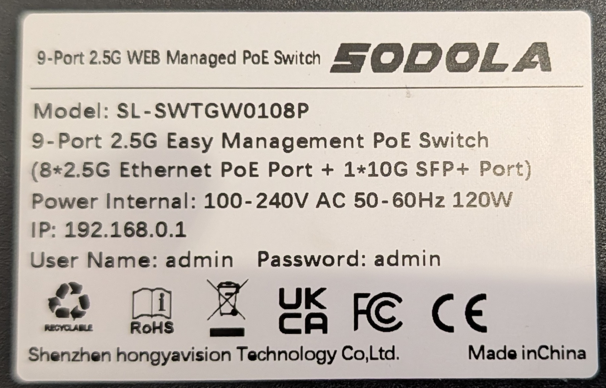

# Sodola SL-SWTGW0108P

RTL8373N switch with 8 × 2.5G RJ45 ports, POE and 1 × SFP port.

SFP has not yet been tested due to having no available modules.

> [!CAUTION]
> This device contains a mains voltage power supply, which is a potentially lethal hazard. Even after the device is unplugged, high-voltage capacitors can remain charged afterward and may still shock you. Do not attempt to open/disassemble a mains powered device unless you understand how to do so safely.

## PCB identifier

`S1100W-8GT-1SX_73N V1.04`

## Machine target

	make MACHINE=SODOLA_SL_SWTGW0108P

## Serial Port

Labelled "T9", to the left of the left blue heatsink. From left to right: N/C, RXD, GND, TXD.

Serial port J1 appears to be debug port for some other controller - possibly POE chip? Running at 9600, prints lots of messages like: `buffer[1]: 0 buffer[2]: 0`.

## Photos

Front panel:

PCB top:

Label:

