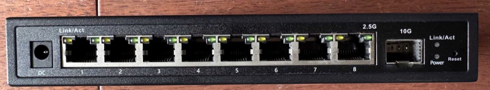
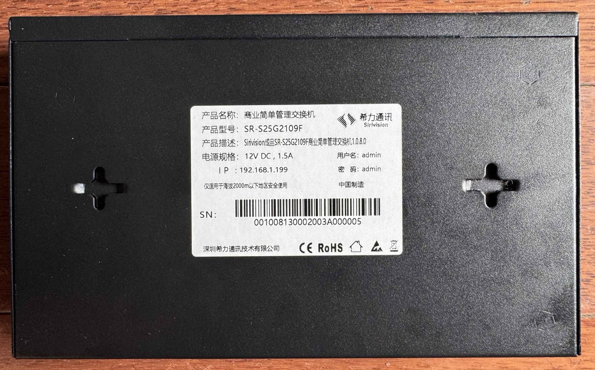
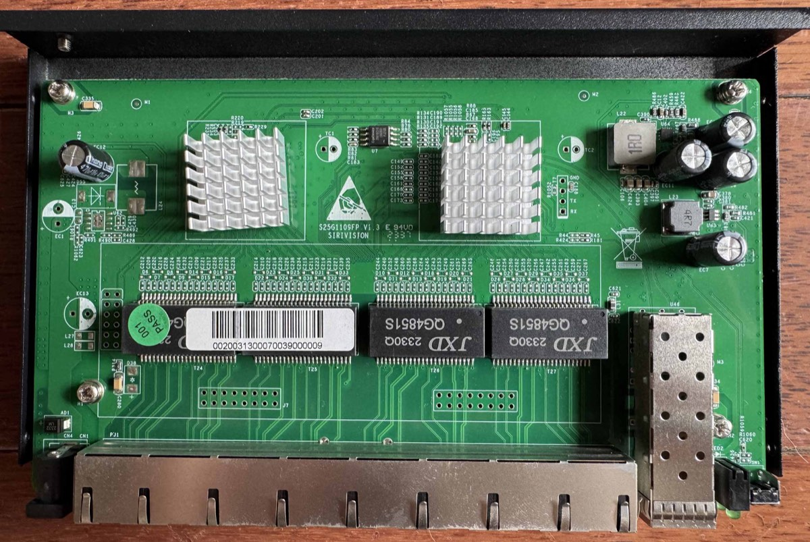
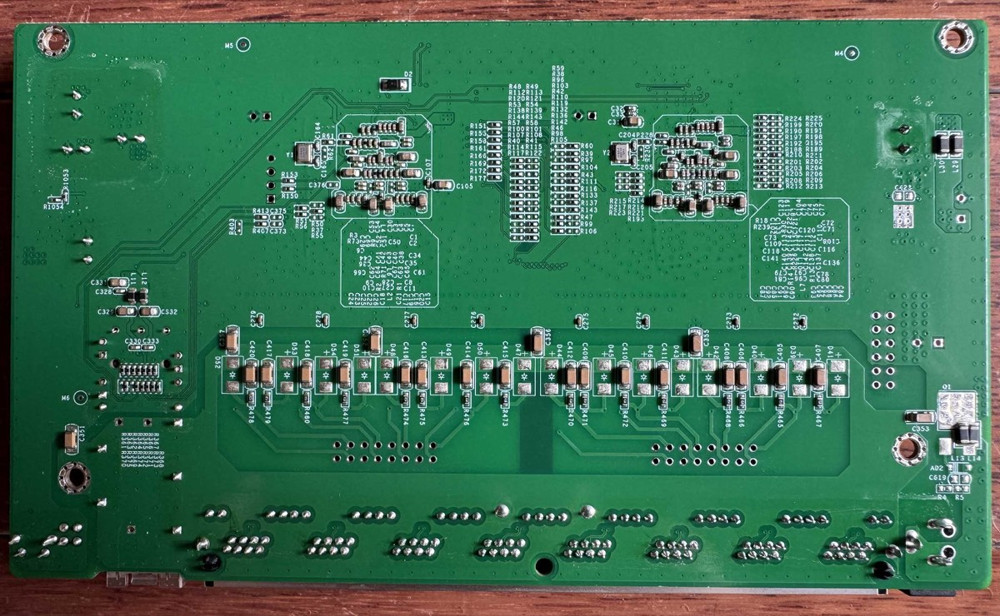
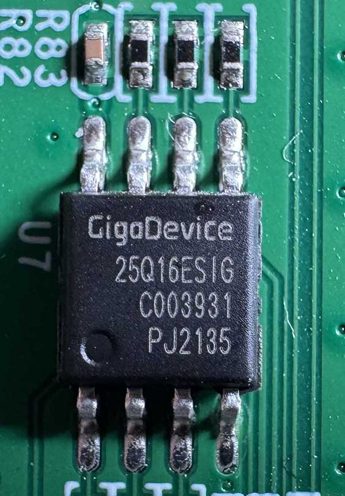

# Sirivision SR-S25G2109F (S25G1109FP V1.3)

RTL8373 (non-N) with an RTL8224 quad 2.5G PHY: 8 × 2.5G RJ45 + 1 × SFP+,
2 MB flash, no PoE.

## Label specifications

| Item | Value |
|------|-------|
| Manufacturer | Sirivision |
| Model | SR-S25G2109F |
| Ports | 8 × RJ45 10/100/1000/2500 Mbps, 1 × SFP+ 1G/2.5G/10G |
| Power input | 12 V DC, 1.5 A |
| Stock firmware | version 1.0.8.0 |
| Stock defaults | IP 192.168.1.199, user `admin`, password `admin` |
| Serial number | 001008130002003A000005 (also on the PCB barcode sticker) |

The label does not carry a MAC address.  After a factory initialisation the
stock firmware uses exactly the values printed on the label.

## PCB silkscreen and naming

Top side: `S25G1109FP V1.3 SIRIVISION`.  That model name belongs to an unmanaged
PoE switch; this board omits the PoE section entirely.  What is actually shipped
is the label model `SR-S25G2109F`: a simply managed, non-PoE switch.  Its stock
firmware provides a web interface, but it responds very slowly.

## CPU, PHY and flash

| Part | Identification |
|------|----------------|
| SoC | RTL8373, non-N: `regget 4` returns `0x83730000` and the boot console prints `Detecting CPU: RTL8373` |
| PHY | RTL8224, reported as `RTL8224 ID: 0x82240000` |
| Flash | GigaDevice 25Q16ESIG (U7), 2 MB, JEDEC id `c8 40 15` |

The two large ICs sit under soldered heatsinks, their markings are not readable.

## Build

```
make MACHINE=S25G1109FP_V1_3 CI=1
```

The resulting image can be uploaded through the web interface (`System` page)
or the stock web UI.

## Port mapping

| Front port | ASIC MAC | Interface |
|------------|----------|-----------|
| 1–8 | 0–7 | RJ45 2.5G |
| 9 | 8 | SFP+ (SDS1) |

## Board signals

| Function | GPIO |
|----------|------|
| SFP detect (ModAbs) | 30, low with a module inserted |
| SFP LOS | 37, high without light |
| SFP TX disable | not connected, `GPIO_NA` |
| SFP I2C | SDA 39 / SCL 40, `I2CBUS(GPIO39_I2C_SDA4, GPIO40_I2C_SCL3_MDC1)` |
| Reset button | 54 |

ModAbs and LOS are separate signals here: GPIO30 tells whether a module is
inserted, GPIO37 whether it receives light, so a module is identified even
before the link comes up and loss of signal is reported.  GPIO38 and GPIO48,
which the 8+1 reference boards use for ModAbs and for the reset button, never
change on this board; with GPIO38 as ModAbs the firmware believed a module was
permanently present and retried the I2C read forever.

Serial console: the stock firmware runs the loader at 57600 baud and the runtime
at 9600 baud, RTLPlayground uses 115200.

## Front panel

Each copper port has two LEDs, labelled `Link/Act` (left, yellow) and `2.5G`
(right, green).  The SFP cage has a single green `Link/Act` LED; next to it are
a `Power` LED and the `Reset` button.

## LED configuration

Copper ports use LED set 0, the SFP port uses LED set 1:

| Set | Function 0 (left / SFP) | Function 1 (right) |
|-----|-------------------------|--------------------|
| SET0 | all speeds, link with activity | 2.5G link |
| SET1 | all speeds, link with activity | not populated |

The board is wired in the stock port order — LED pin `3n+m` belongs to port
`n+1`, LED function `m` — so the mux table is the chip default with a single
change: the SFP LED sits on pin 25 and is driven by LED function 0, while the
default table maps pin 25 to function 1, which is unpopulated in SET1.  Without
that change the SFP LED stays dark.

A speed condition alone leaves an LED dark, `LEDS_LINK` has to be set as well.

## Reset button

| Hold time while running | Effect |
|-------------------------|--------|
| less than 3 s | no action |
| 3–10 s | reset the switch chip, the firmware reboots (~20 s of downtime) |
| more than 10 s | additionally restore the default configuration |

The system LED blinks slowly while the button is held.  Holding the button
during power-up instead waits for the release and restores the default
configuration when it is released after 10–30 s.

## MAC address

The factory MAC sits at `0x1FC000`, six bytes followed by `0xFF` padding.  The
stock value is a locally administered address (`1A:5D:23:47:4D:EB`), which the
firmware rejects, so the device runs with a UUID-derived MAC (`06:…`).  A valid
globally administered address stored there is used instead.

## What works

- all eight 2.5GBASE-T ports at 10/100/1000/2500 Mbps
- SFP+ with 10G and 1G modules, including DDM data where the module provides it
  - 10G: Finisar FCBG110SD1C05 AOC (no DDM), rate `0x67`, SerDes mode `1a`
  - 1G: ETU ESB5312-3SCD20 (DDM), rate `0x0d`, SerDes mode `04`
- LEDs, module insert/remove detection, loss of signal reporting, reset button

## Unverified

- 2.5G SFP modules, none was available for testing

## Photos

Front panel:



Label:



PCB top side:



PCB bottom side:



Flash chip, GigaDevice 25Q16ESIG:


