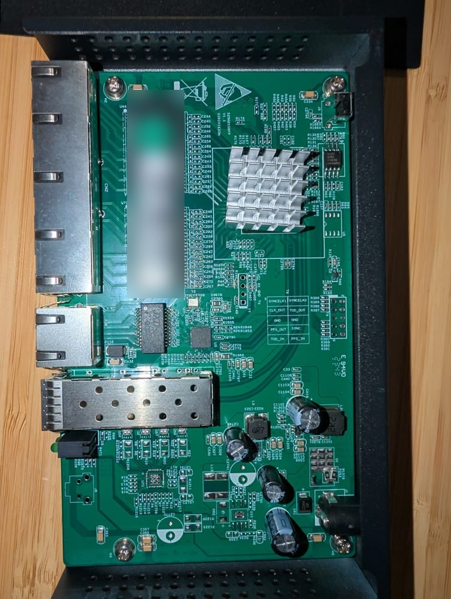
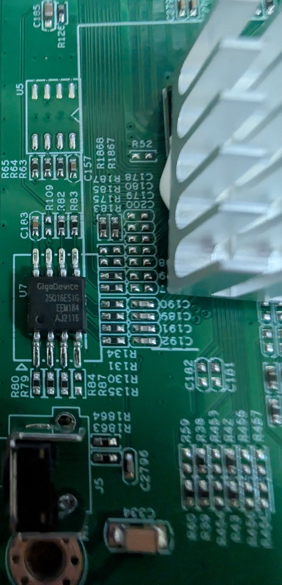

### S25G2106FP_V1_1

## Brands
|Brand|Type|Managed|PCB|Flash|Chip RTL|
|---|---|---|---|---|---|
| VIMIN | VM-S250501M | Yes | S25G2106FP V1.1 | 2M (GD25Q16ESIG) | 8372 |

The same board is sold by Nicgiga as the S25-0501-M (its stock firmware file is named
`S25G2106F_S25-0501-M_...`); that variant is untested.

### Label specifications

- **Ports**:
  - 5 × RJ45: 10/100/1000/2500 Mbps
  - 1 × SFP+: 1000 / 2500 / 10000 Mbps
- **Power**: 12V DC

### What works
- RJ45 ports 1-4 (internal PHYs): tested at 1000 Mbps, port 1 also at 2500 Mbps
- RJ45 port 5 (external RTL8221B): tested at 1000 and 2500 Mbps; with an Intel I226 at
  2.5G, iperf3 gave 2.33 Gbit/s in both directions without errors
- Installation was done with a flash programmer; later upgrades through RTLPlayground's web
  interface work. Installing from the OEM web interface is untested.

### What does not work yet
- SFP+ port 6: the cage is on SerDes 0 / chip port 3, but its I2C pins are not known.
  On the S25G2206FP the cage uses I2C bus 3 (GPIO41/40), which on this board are MDC1/MDIO1
  of the RTL8221B, so the bus is left unconfigured. Module detect/LOS are assumed to be on
  GPIO50/51 as on the S25G2206FP right cage (unverified).

### Port layout
| Front port | Chip port | Connected to |
|---|---|---|
| 1-4 | 4-7 | internal PHYs |
| 5 | 8 | RTL8221B (U3) on SerDes 1 (SGMII / HiSGMII), MDIO address 1 on MDC1/MDIO1 |
| 6 | 3 | SFP+ cage on SerDes 0 |

This is the reverse of the other 5+1 RTL8372 boards (e.g. PCB_SWTG024AS_V2_1_0_19023__1S1C),
where the RTL8221B is on chip port 3 / SerDes 0. The board definition sets `phy8221_p8`, which
makes the firmware:
- set SMI MAC type 0x00015515 (port 8 PHY, port 3 SFP) and poll ports 4-8
- keep the port 8 MDIO address and probe it at boot (the PHY answers at 1; 0 also answers as
  the broadcast address)
- set both SerDes to SGMII at boot and switch SerDes 1 to HiSGMII when port 5 links at 2.5G
- leave GPIO40/41 as MDC1/MDIO1 instead of muxing them to I2C bus 3
- clear power down and isolate in the RTL8221B's BMCR: the PHY comes up with BMCR 0x3ce0
  (PHY state 5) and only links after that

The OEM firmware (V3.0.2) does the same: before its RTL8221B init it sets the SMI MAC type,
polling and MDIO address for chip port 8.

### PCB overview

**Board markings**
- Top silkscreen: `S25G2106FP V1.1 SIRIVISION`

Top side (serial number label blurred)

### Flash
The flash is a GigaDevice GD25Q16ESIG (U7, 2 MB, 3.3 V, SOIC-8). It sits well away from
the heatsink, so a standard SOIC-8 clip fits. The dump and the write were done with a
Raspberry Pi (`flashrom -p linux_spi:dev=/dev/spidev0.0,spispeed=1000`); flashrom detects it as
"GD25Q16(B)". Pin 1 is at the dot / the ▷ next to R80. The empty SOIC-8 footprint U5 above it
is not populated.

The factory MAC is at flash offset 0x1FC000. It is a locally administered address
(`1A:6D:23:...`), so RTLPlayground replaces it with a generated one.

### Serial console
A 4-pin header below the heatsink, labelled `VCC RX GND TX`. No pins are fitted.
