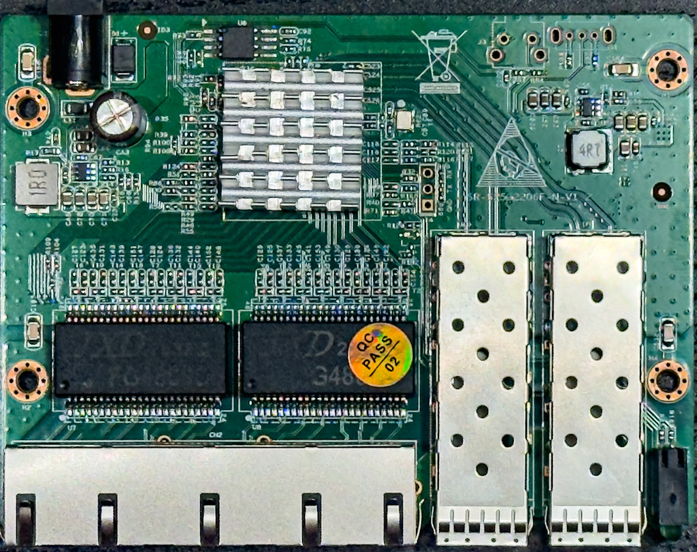
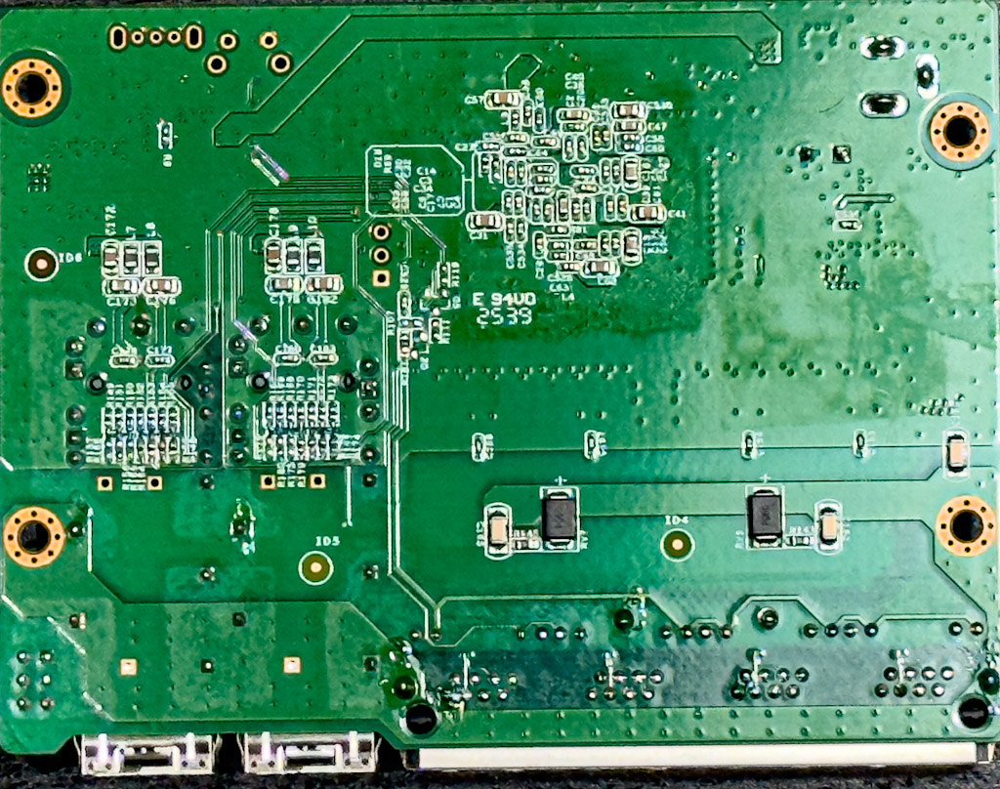

### SIRIVISION_S25G2206F_N_V1_2

## Brands
|Brand|Type|Managed|PCB|Flash|Chip RTL|
|---|---|---|---|---|---|
| NICGIGA | S25-0402-N | No | SIRIVISION_S25G2206F_N_V1_2 | 2M | 8372N |

### Label specifications

- **Name**:
- **Ports**:
  - 4 × RJ45: 10/100/1000/2500 Mbps
  - 2 × SFP+: 1000 / 2500 / 10000 Mbps
- **Power**: 12V DC, 1A  5525 connector

### What works
Tested:
- RJ45 ports at 1G and 2.5G
- SFP+ ports at 1G and 10G
- Other speeds not tested
- LEDs replicate OEM functionality
### PCB overview

**Board markings**
- Top silkscreen: SR S25G2206F-N-V1.2

Top side

Bottom side

## Power supply

Standard 12V DC barrel adpator
