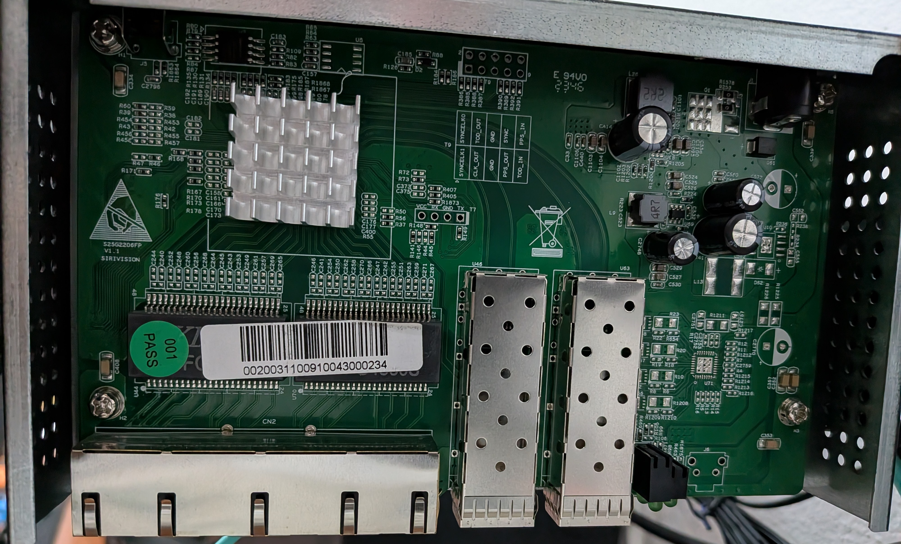

### SIRIVISION_S25G2206FP_V1_1

## Brands
|Brand|Type|Managed|PCB|Flash|Chip RTL|
|---|---|---|---|---|---|
| YuanLey | YS25-0402M | Yes | SIRIVISION_S25G2206FP_V1_1 | 2M | 8372 |

### Label specifications

- **Name**:
- **Ports**:
  - 4 × RJ45: 10/100/1000/2500 Mbps
  - 2 × SFP+: 1000 / 2500 / 10000 Mbps
- **Power**: 12V DC, 1A  5525 connector

### What works
The device is fully supported:
- ALL 2.5GBASE-T RJ45 ports work at 10/100/1000/2500 Mbps
- ALL SFP+ ports support 1G, 2.5G and 10G modules
- LEDs work with the same indiciations as the OEM firmware
### PCB overview

**Board markings**
- Top silkscreen: SIRIVISION S25G2206FP V1.1

Top side

## Power supply

Input power is delivered via barell plug, `12V 1A` adapter was provided.
