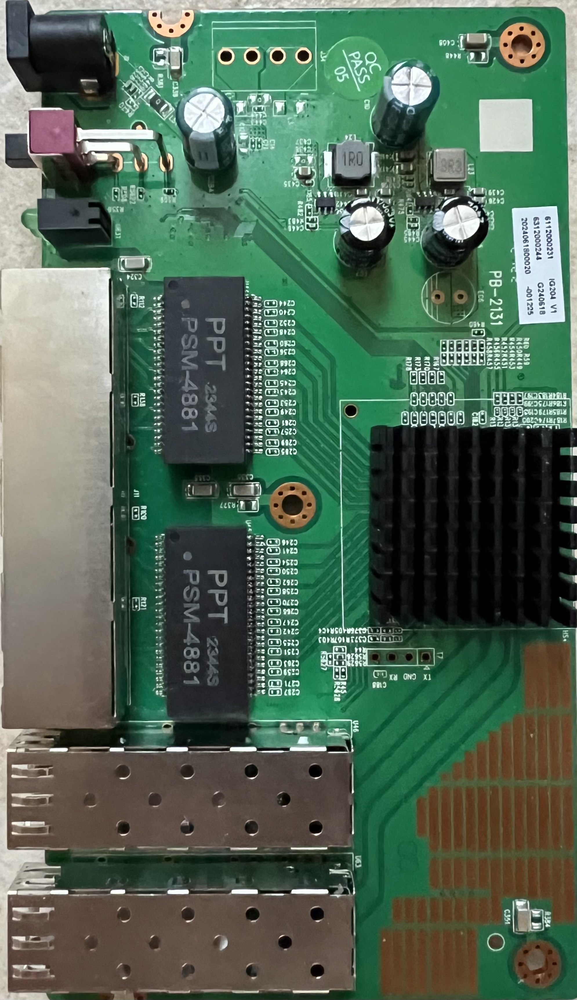

# Steamemo IG204-V1

Following is documentation for unmanaged switch marked as `IG204-V1`.

Using SPI clamp in-board is the only method for initial installation.

### Label specifications

- **Name**: 2.5G Ethernet Switch  
- **Model**: IG204 V1
- **Ports**:  
  - 4 × RJ45: 10/100/1000/2500 Mbps  
  - 2 × SFP: 1000 / 2500 / 10000 Mbps  

### Flash chip

EON Q32A-class SPI NOR, JEDEC RDID `0x1C 0x41 0x16`, 4 MiB (32 Mbit).
Factory layout: OEM firmware in the first 512 KiB, remaining 3.5 MiB
blank (`0xFF`), including the MAC/config area at `0x1FC000` — RTLPlayground
generates a locally-administered MAC from the SoC UUID when that block is
blank. The 512 KiB machine image must be padded with `0xFF` to the full
4 MiB chip size for a whole-chip write (flashrom refuses size mismatches).

Note for CH341A users: on this chip the bundled `WREN + opcode`
multicommand transactions that flashrom's `spi_write_cmd()` emits are
silently ignored — erase/program require each command to be sent
separately (see rjstanford-it/gsk-ig104-rtlplayground for a patched
flashrom and full analysis).

### Tested hardware (deployed in production since 2026-10)

- Four 2.5GBASE-T RJ45 ports: link + traffic verified on all four
  (2.5G ×3, 100M on a 100M-only device), including a live uplink
  walk between ports
- Two SFP ports: S+RJ10 (10G) module identified via I²C and linked on
  each cage
- LEDs
- Web UI + serial console

## Sold also as

- **Goalake GSK-IG104** — same PB-2131 board, verified identical:
  RTL8372, EON `1c:4116` flash, 4×2.5G + 2×SFP+, port map matches case
  labels 1:1 with no `machine.c` changes.

### PCB overview

**Board markings**  
- Top silkscreen: PB-2131

Top side

### Connectors
### T7, serial console

| `T7` pin | Signal      |
| -------- | ----------- |
| 1        | TX (Output) |
| 2        | GND         |
| 3        | RX (Input)  |
| 4        | 3V3         |

### Power supply

Input power is delivered via barell plug, `12V 1A` adapter was provided.
