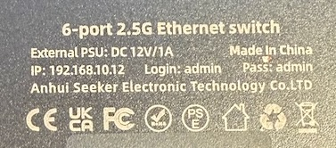

### SWTG024AS-V2.1

## Brands
|Brand|Type|Managed|PCB|Flash|Chip RTL|
|---|---|---|---|---|---|
| Xikestor | SKS3200-4E2X    | Yes | PCB-SWTG024AS-V2.1.0_19023 | 25Q16A | 8272 |
| Solola   | SL902-SWTG024AS | Yes | PCB-SWTG024AS-V2.1.0_19023 |        | 8272 |

### Label specifications

- **Ports**:
  - 4 × RJ45: 10/100/1000/2500 Mbps
  - 2 × SFP+: 1000/2500/10000 Mbps
- **Power**: 12V DC

#### Xikestore SKS-3200-4E2X label

### What works
- ALL 2.5GBASE-T RJ45 ports work at 10/100/1000/2500 Mbps
- The SFP+ port supports 1G, 2.5G and 10G modules.
- LEDs work with the same indiciations as the OEM firmware.

### PCB overview

**Board markings**
- Top silkscreen: PCB-SWTG024AS-V2.1.0

Top side

Bottom

