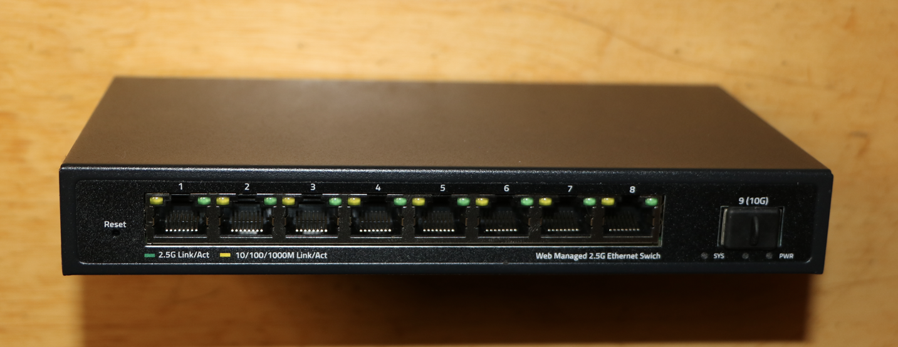
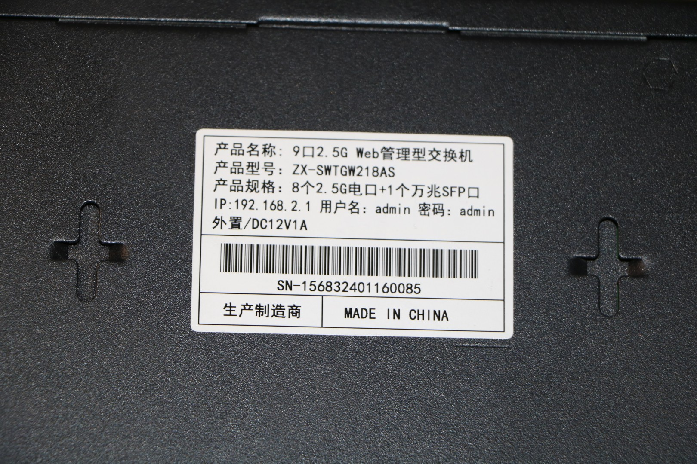

### ZX-SWTGW218AS

## Brands
|Brand|Type|Managed|PCB|Flash|Chip RTL|
|---|---|---|---|---|---|
| Mokerlink | ZX-SWTGW218AS | Yes|  SWTG118AS-V2.0-16029 | 2MB (FM25Q16A)| 8273N + 8224N |
| Sodola | | | | | |
| Horaco | HC-SWTGW218AS | Yes | SWTG118AS-V2.1 | 2MB | 8373 (non-N) |
| XikeStor | SKS3200-8E1X | Yes | SWTG118AS-V2.1-17462 | 2MB (25Q16JVSIQ) | |

All boards in this table use `MACHINE=SWTGW218AS`. The Horaco HC-SWTGW218AS is also sold with the
[SWTG018AS-A V2.0](SWTG018AS_A_V2_0.md) board, which needs a different firmware. Check the marking
on the PCB before flashing.

The PHY and flash-chip models for the tested Horaco units remain unverified.

## Photos

## PCB

See up'n'atom's Repo:

https://github.com/up-n-atom/SWTG118AS/blob/main/photos/SWTG118AS-v2.0/SWTG118AS-v2.0-pcb-top.JPG

https://github.com/up-n-atom/SWTG118AS/blob/main/photos/SWTG118AS-v2.0/SWTG118AS-v2.0-pcb-bottom.JPG

