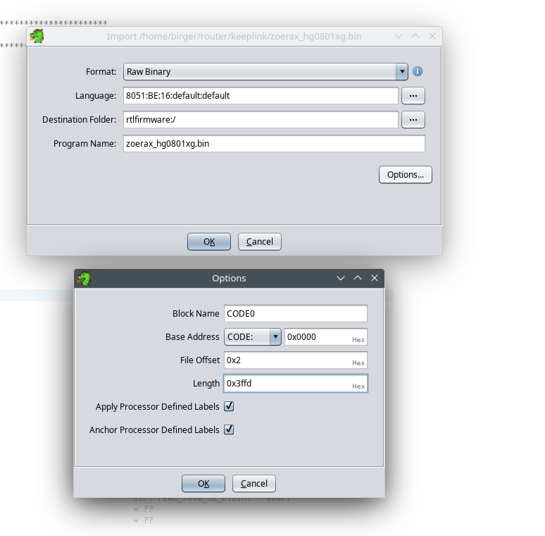
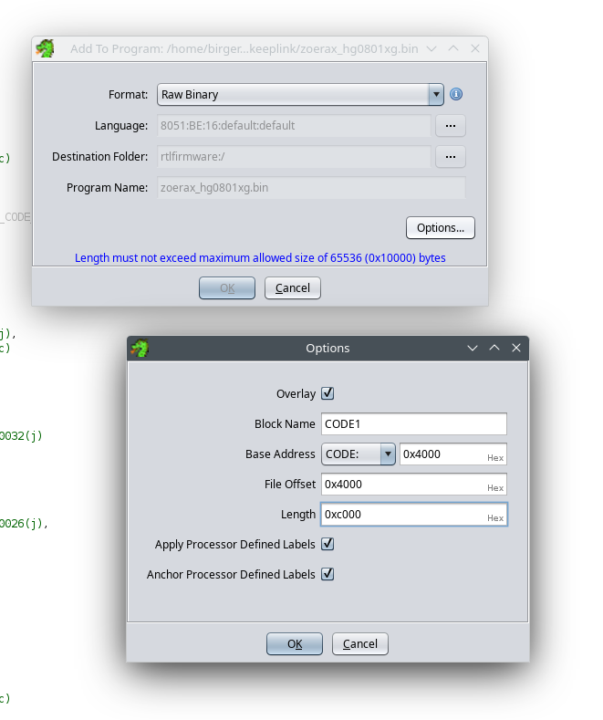
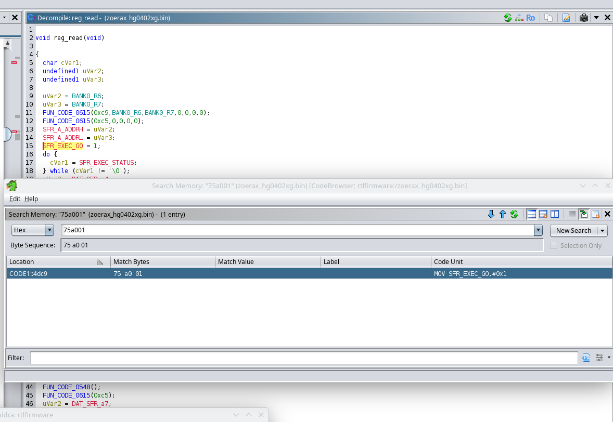

# LEDs HOWTO using firmware function tracing

This is a tutorial to show how to figure out the LED configuration for
unmanaged switches (on managed ones one can just print out the registers
from the command line) without using an I2C port on the device together
an I2C-capable microcontroller. You will only need to have a SOIC clamp
and will have to run ghidra to do a bit of reversing.

The additional advantage of this method is that it not only gives the LED
configuration but also the full PHY configuration and SDS configuration e.g.
in case of additional PHYs being used on the device.

We will use the ZoeRax HG0402XG V1.1 as an example device.

The first step is to read out the flash with a SOIC clamp.
Save the image as
`zoerax_hg0402xg.bin`

The next step is to use a decompiler such as ghidra to identify the
functions used to write or read registers, SDS or to the PHY.



First, load the code in BANK0 into ghidra. The type of code is
8051 default big-endian. The code starts at offset 0x0002 in the file
and has length 0x3ffd


Add BANK1 into ghidra by using File->Add to program...
and add the code starting at 0x4000 in `zoerax_hg0402xg.bin` with length
0xc000. Repeat for BANK2 (starts at 0x10000) and BANK3 (starts at 0x1c0000).
They both have length 0xc000.



Now, find the read_reg function. An example of the read-register function
is given below. Note the critical bit, namely the execution of the
read-function of an ASIC register via an SFR: 
```
CODE1::4dc9 75 a0 01           MOV        SFR_EXEC_GO,#0x1
```

This sequence of bytes is very specific. Replace 0x01 with 0x03 and you have
the regster write SFR, 0x05 reads the SerDes, 0x07 writes it. 0x09 reads
from the PHY and 0x0b writes to it.


```
                             **************************************************************
                             *                          FUNCTION                          *
                             **************************************************************
                             undefined reg_read()
             undefined         <UNASSIGNED>   <RETURN>
                             reg_read
     CODE1::4da9 ab 07              MOV        R3,BANK0_R7                                      = ??
     CODE1::4dab aa 06              MOV        R2,BANK0_R6                                      = ??
     CODE1::4dad e4                 CLR        A
     CODE1::4dae ff                 MOV        R7,A
     CODE1::4daf fe                 MOV        R6,A
     CODE1::4db0 fd                 MOV        R5,A
     CODE1::4db1 fc                 MOV        R4,A
     CODE1::4db2 90 00 c9           MOV        DPTR,#0xc9
     CODE1::4db5 12 06 15           LCALL      FUN_CODE_0615                                    undefined FUN_CODE_0615()
     CODE1::4db8 e4                 CLR        A
     CODE1::4db9 ff                 MOV        R7,A
     CODE1::4dba fe                 MOV        R6,A
     CODE1::4dbb fd                 MOV        R5,A
     CODE1::4dbc fc                 MOV        R4,A
     CODE1::4dbd 90 00 c5           MOV        DPTR,#0xc5
     CODE1::4dc0 12 06 15           LCALL      FUN_CODE_0615                                    undefined FUN_CODE_0615()
     CODE1::4dc3 ea                 MOV        A,R2
     CODE1::4dc4 f5 a2              MOV        SFR_A_ADDRH,A                                    = ??
     CODE1::4dc6 eb                 MOV        A,R3
     CODE1::4dc7 f5 a3              MOV        SFR_A_ADDRL,A                                    = ??
     CODE1::4dc9 75 a0 01           MOV        SFR_EXEC_GO,#0x1 <<<<<<<< Executes READ REG
                             LAB_CODE1__4dcc                                 XREF[1]:     CODE1::4dcf(j)  
     CODE1::4dcc af a1              MOV        R7,SFR_EXEC_STATUS                               = ??
     CODE1::4dce ef                 MOV        A,R7
     CODE1::4dcf 70 fb              JNZ        LAB_CODE1__4dcc
     CODE1::4dd1 af a4              MOV        R7,DAT_SFR_a4                                    = ??
     CODE1::4dd3 fc                 MOV        R4,A
     CODE1::4dd4 fd                 MOV        R5,A
     CODE1::4dd5 fe                 MOV        R6,A
     CODE1::4dd6 90 00 c9           MOV        DPTR,#0xc9
     CODE1::4dd9 12 06 15           LCALL      FUN_CODE_0615                                    undefined FUN_CODE_0615()
     CODE1::4ddc 90 00 c5           MOV        DPTR,#0xc5
     CODE1::4ddf 12 05 f9           LCALL      FUN_CODE_05f9                                    undefined FUN_CODE_05f9()
     CODE1::4de2 c0 00              PUSH       BANK0_R0
     CODE1::4de4 90 00 c9           MOV        DPTR,#0xc9
     CODE1::4de7 12 05 dd           LCALL      read_xmem_32_b                                   undefined read_xmem_32_b()
     CODE1::4dea 78 18              MOV        R0,#0x18
     CODE1::4dec 12 05 86           LCALL      FUN_CODE_0586                                    undefined FUN_CODE_0586()
     CODE1::4def d0 00              POP        BANK0_R0
     CODE1::4df1 12 05 48           LCALL      FUN_CODE_0548                                    undefined FUN_CODE_0548()
     CODE1::4df4 90 00 c5           MOV        DPTR,#0xc5
     CODE1::4df7 12 06 15           LCALL      FUN_CODE_0615                                    undefined FUN_CODE_0615()
     CODE1::4dfa af a5              MOV        R7,DAT_SFR_a5                                    = ??
     CODE1::4dfc e4                 CLR        A
     CODE1::4dfd fc                 MOV        R4,A
     CODE1::4dfe fd                 MOV        R5,A
     CODE1::4dff fe                 MOV        R6,A
     CODE1::4e00 90 00 c9           MOV        DPTR,#0xc9
     CODE1::4e03 12 06 15           LCALL      FUN_CODE_0615                                    undefined FUN_CODE_0615()
     CODE1::4e06 90 00 c5           MOV        DPTR,#0xc5
     CODE1::4e09 12 05 f9           LCALL      FUN_CODE_05f9                                    undefined FUN_CODE_05f9()
     CODE1::4e0c c0 00              PUSH       BANK0_R0
     CODE1::4e0e 90 00 c9           MOV        DPTR,#0xc9
     CODE1::4e11 12 05 dd           LCALL      read_xmem_32_b                                   undefined read_xmem_32_b()
     CODE1::4e14 78 10              MOV        R0,#0x10
     CODE1::4e16 12 05 86           LCALL      FUN_CODE_0586                                    undefined FUN_CODE_0586()
     CODE1::4e19 d0 00              POP        BANK0_R0
     CODE1::4e1b 12 05 48           LCALL      FUN_CODE_0548                                    undefined FUN_CODE_0548()
     CODE1::4e1e 90 00 c5           MOV        DPTR,#0xc5
     CODE1::4e21 12 06 15           LCALL      FUN_CODE_0615                                    undefined FUN_CODE_0615()
     CODE1::4e24 af a6              MOV        R7,DAT_SFR_a6                                    = ??
     CODE1::4e26 e4                 CLR        A
     CODE1::4e27 fc                 MOV        R4,A
     CODE1::4e28 fd                 MOV        R5,A
     CODE1::4e29 fe                 MOV        R6,A
     CODE1::4e2a 90 00 c9           MOV        DPTR,#0xc9
     CODE1::4e2d 12 06 15           LCALL      FUN_CODE_0615                                    undefined FUN_CODE_0615()
     CODE1::4e30 90 00 c5           MOV        DPTR,#0xc5
     CODE1::4e33 12 05 f9           LCALL      FUN_CODE_05f9                                    undefined FUN_CODE_05f9()
     CODE1::4e36 c0 00              PUSH       BANK0_R0
     CODE1::4e38 90 00 c9           MOV        DPTR,#0xc9
     CODE1::4e3b 12 05 dd           LCALL      read_xmem_32_b                                   undefined read_xmem_32_b()
     CODE1::4e3e 78 08              MOV        R0,#0x8
     CODE1::4e40 12 05 86           LCALL      FUN_CODE_0586                                    undefined FUN_CODE_0586()
     CODE1::4e43 d0 00              POP        BANK0_R0
     CODE1::4e45 12 05 48           LCALL      FUN_CODE_0548                                    undefined FUN_CODE_0548()
     CODE1::4e48 90 00 c5           MOV        DPTR,#0xc5
     CODE1::4e4b 12 06 15           LCALL      FUN_CODE_0615                                    undefined FUN_CODE_0615()
     CODE1::4e4e af a7              MOV        R7,DAT_SFR_a7                                    = ??
     CODE1::4e50 e4                 CLR        A
     CODE1::4e51 fc                 MOV        R4,A
     CODE1::4e52 fd                 MOV        R5,A
     CODE1::4e53 fe                 MOV        R6,A
     CODE1::4e54 90 00 c9           MOV        DPTR,#0xc9
     CODE1::4e57 12 06 15           LCALL      FUN_CODE_0615                                    undefined FUN_CODE_0615()
     CODE1::4e5a 90 00 c5           MOV        DPTR,#0xc5
     CODE1::4e5d 12 05 dd           LCALL      read_xmem_32_b                                   undefined read_xmem_32_b()
     CODE1::4e60 90 00 c9           MOV        DPTR,#0xc9
     CODE1::4e63 12 05 f9           LCALL      FUN_CODE_05f9                                    undefined FUN_CODE_05f9()
     CODE1::4e66 12 05 48           LCALL      FUN_CODE_0548                                    undefined FUN_CODE_0548()
     CODE1::4e69 90 00 c5           MOV        DPTR,#0xc5
     CODE1::4e6c 12 06 15           LCALL      FUN_CODE_0615                                    undefined FUN_CODE_0615()
     CODE1::4e6f 90 00 c5           MOV        DPTR,#0xc5
     CODE1::4e72 02 05 dd           LJMP       read_xmem_32_b                                   undefined read_xmem_32_b()
                             -- Flow Override: CALL_RETURN (CALL_TERMINATOR)

```

INSERT ghidra_search_read_reg.png

Identify all the read and write function to the HW of the SoC using the find
in memory function.

The next task is to adapt the intercept routines in a special assembler
file. Don't worry, you do not need to understand assembler to do this.

```
; Assembler file to intercept register writes/reads and PHY writes/reads
; assemble with as31
; Compile with
; as31 -Fbyte -Orwintercept_zoerax_hg0402xg.hex rwintercept_zoerax_hg0402xg.asm
; ./injector zoerax_hg0402xg.bin RTLPlayground/rwintercept_zoerax_hg0402xg.hex zoerax_hg0402xg_patched.bin
; Start at 0x3b00, where there is always some space in BANK 0
	.equ	valptr, 0x199


	.equ	SFR_DATA_0, 0xa7
	.equ	SFR_DATA_8, 0xa6
	.equ	SFR_DATA_16, 0xa5
	.equ	SFR_DATA_24, 0xa4

; Intercept Register Write
	.org 0x4d62
	lcall	reg_write
	nop

; Intercept Register Read
	.org 0x4dad
	lcall	reg_read_head
	.org 0x4e6f
	lcall	reg_read_tail

; Intercept PHY write
	.org 0x522c
	lcall	phy_write

; Intercept PHY read
	.org 0x526f
	lcall	phy_read_head
	.org 0x5295
	ljmp	phy_read_tail

; Intercept SDS write
	.org 0x503c
	lcall	sds_write
	nop

; Intercept SDS read
	.org 0x5061
	lcall	sds_read_head
	nop
	.org 0x507b
	ljmp	sds_read_tail

;
; BEGIN actual code at unused end of BANK0
;
	.org 0x3b00

;
; print the address of a register write. The address is in R6/R7. A and r4 can be scratched
;
reg_write:	
	mov	a, #'R'
	acall	putc

	mov	a, r6
	acall	wbyte

	mov	a, r7
	acall	wbyte

	mov	a, #'-'
	acall	putc

	mov	dptr, #valptr
	movx	a, @dptr
	acall	wbyte
	mov	dptr, #valptr + 1
	movx	a, @dptr
	acall	wbyte
	mov	dptr, #valptr + 2
	movx	a, @dptr
	acall	wbyte
	mov	dptr, #valptr + 3
	movx	a, @dptr
	acall	wbyte

	mov	a, #' '
	acall	putc

	mov	a, r7
	mov	r5, a
	mov	a, r6
	mov	r4, a
	ret
[...]
```

The full assembler file can be found here: XXXXXXXXXX


Once you have assembled the code, inject the bytes into the existing image,
creating a patched version:
```
$ as31 -Fbyte -Orwintercept_zoerax_hg0402xg.hex rwintercept_zoerax_hg0402xg.asm
Begin Pass #1
Begin Pass #2
./injector zoerax_hg0402xg.bin rwintercept_zoerax_hg0402xg.hex zoerax_hg0402xg_patched.bin
Input file size: 1048576
Bytes read:: 1048576
Patched 417 bytes.
```

Now flash `zoerax_hg0402xg_patched.bin` onto device.

Connect a serial adapter and plug in power. You will see:

```
$ picocom -b 9600 /dev/ttyUSB0 
picocom v3.1

port is        : /dev/ttyUSB0
flowcontrol    : none
baudrate is    : 9600
parity is      : none
databits are   : 8
stopbits are   : 1
escape is      : C-a
local echo is  : no
noinit is      : no
noreset is     : no
hangup is      : no
nolock is      : no
send_cmd is    : sz -vv
receive_cmd is : rz -vv -E
imap is        : 
omap is        : 
emap is        : crcrlf,delbs,
logfile is     : none
initstring     : none
exit_after is  : not set
exit is        : no

Type [C-a] [C-h] to see available commands
Terminal ready
[The printout only starts once the serial peripherial has been set up. Initially its timing is off:]
�.Ӛ�҂���������30-00005555 r6330:00005555 R6330-00005515 [RTL837X_REG_SMI_MAC_TYPE]
[RTL837X_REG_SMI_PORT_POLLING: ]
r6334:00000000 R6334-000000f0
r6454:00000000 R6454-00007000

[Read SoC-Revision]
r000c:00200000 R000c-002a0000 r000c:202a6818 r000c:202a6818 R000c-20206818
p001e.000d:ffff R02f8-0000ffff R02f4-0000fffa P000001.1e00000d:fffa p001e.000d:ffff p001e.000d:ffff
R02f8-0000ffff R02f4-0000fff0 P000001.1e00000d:fff0

[RTL837X_REG_LED_MODE being configured:]
r6520:0021fdb0 R6520-0021e7b0 r6520:0021e7b0 R6520-0021e6b0

[RLDP Leds configured via RTL837X_REG_LED_RLDP_X:]
r65f8:00000018 R65f8-0000001b R65fc-fffff000 r6600:00000000 R6600-0000000f

[RTL837X_REG_LED_GLB_IO_EN: ]
r65dc:5fffff00 R65dc-7fffff00 r65dc:7fffff00 R65dc-77ffff00

[RTL837X_PIN_MUX_0, makes serial go out of sync:]
r7f8c:30000000 R7f8c-30000000 r7f8c:300��.Ӛ�҂���������30-00005555

r6330:00005555 R6330-00005515 r6334:00000000 R6334-000000f0

r6454:00000000 R6454-00007000

[Read SoC-Revision (again)]
r000c:00200000 R000c-002a0000 r000c:202a6818 r000c:202a6818 R000c-20206818
p001e.000d:ffff R02f8-0000ffff R02f4-0000fffa P000001.1e00000d:fffa p001e.000d:ffff p001e.000d:ffff
R02f8-0000ffff R02f4-0000fff0
P000001.1e00000d:fff0

#### LED configuration ########
[RTL837X_REG_LED_MODE being configured (final):]
r6520:0021fdb0 R6520-0021e7b0 r6520:0021e7b0 R6520-0021e6b0

[More RTL837X_REG_LED_RLDP]
r65f8:00000018 R65f8-0000001b R65fc-fffff000 r6600:00000000 R6600-0000000f

[RTL837X_REG_LED_GLB_IO_EN]
r65dc:5fffff00 R65dc-7fffff00 r65dc:7fffff00 R65dc-77ffff00

[RTL837X_PIN_MUX_0
r7f8c:30000000 R7f8c-30000000 r7f8c:30000000 R7f8c-38000000

[RTL837X_LED_PORT_SET_SEL]
r654c:00000000 R654c-00010000

[RTL837X_REG_LED1_0_SET0]
R6548-00000141

[RTL837X_REG_LED3_2_SET0]
r6544:01411000 R6544-01410174

[RTL837X_REG_LED1_0_SET1]
r6540:00440070 R6540-0044017f

[RTL837X_REG_LED3_0_SET1]
r6528:00000000 R6528-000f0000

[SDS 0 being configure:]
r7b20:00000bff R7b20-000003ff r7b20:000003ff R7b20-000003fa r7b20:000003fa R7b20-000003fa
Q002110:4480 Q002113:0400 Q002118:6d02 Q00211b:424e Q00211d:0002 Q00361c:1390 
Q003614:003f Q003610:0200 Q002e04:0080 Q002e06:0408 Q002e07:020d Q002e09:0601 
Q002e0b:222c Q002e0c:a217 Q002e0d:fe40 Q002e15:f5c1 Q002e16:0443 Q002e1d:abb0 
Q000612:5078 Q000706:9401 Q000708:9401 Q00070a:9401 Q00070c:9401 Q001f0b:0003 
Q000603:c45c Q00061f:2100 q001f0b:0003 Q001f0b:000f q002000:0000 Q002000:0030 
q002000:0030 Q002000:0010 q002000:0010 Q002000:0050 q002000:0050 Q002000:00d0 
q002000:00d0 Q002000:0cd0 q002000:0cd0 Q002000:04d0 q002000:04d0 Q002000:04d0 
q002000:04d0 Q002000:0cd0 q002000:0cd0 Q002000:00d0 q002000:00d0 Q002000:00d0 
q002000:00d0 Q002000:0050 q002000:0050 Q002000:0010 q002000:0010 Q002000:0010 
q002000:0010 Q002000:0030 q002000:0030 Q002000:0000 q001f00:0000 Q001f00:000b 
q001f00:000b Q001f00:0000

[SDS 1 being configured]
r7b20:000003fa R7b20-000003fa r7b20:000003fa R7b20-0000035a r7b20:0000035a R7b20-0000035a
Q012110:4480 Q012113:0400 Q012118:6d02 Q01211b:424e Q01211d:0002 Q01361c:1390 
Q013614:003f Q013610:0200 Q012e04:0080 Q012e06:0408 Q012e07:020d Q012e09:0601 
Q012e0b:222c Q012e0c:a217 Q012e0d:fe40 Q012e15:f5c1 Q012e16:0443 Q012e1d:abb0 
Q010612:5078 Q010706:9401 Q010708:9401 Q01070a:9401 Q01070c:9401 Q011f0b:0003 
Q010603:c45c Q01061f:2100 q011f0b:0003 Q011f0b:000f q012000:0000 Q012000:0030 
q012000:0030 Q012000:0010 q012000:0010 Q012000:0050 q012000:0050 Q012000:00d0 
q012000:00d0 Q012000:0cd0 q012000:0cd0 Q012000:04d0 q012000:04d0 Q012000:04d0 
q012000:04d0 Q012000:0cd0 q012000:0cd0 Q012000:00d0 q012000:00d0 Q012000:00d0 
q012000:00d0 Q012000:0050 q012000:0050 Q012000:0010 q012000:0010 Q012000:0010 
q012000:0010 Q012000:0030 q012000:0030 Q012000:0000 q011f00:0000 Q011f00:000b 
q011f00:000b Q011f00:0000 q012100:4902 Q012100:4906 q013605:0000 Q013605:4000 
Q011f02:001f q011f15:0096 q002100:4902 Q002100:4906 q003605:0000 Q003605:4000 
Q001f02:001f q001f15:00a6

r0a90:000000f3 R0a90-000000fc P0000f0.1f00a610:2858 r5fd4:0002914a 
R5fd4-001a914a r1538:00000e33 R1538-00000e37 r1538:00000e37 R1538-00000e37 
r1538:00000e37 R1538-00000f37 r1638:00000e33 R1638-00000e37 r1638:00000e37 
R1638-00000e37 r1638:00000e37 R1638-00000f37 r1738:00000e33 R1738-00000e37 
r1738:00000e37 R1738-00000e37 r1738:00000e37 R1738-00000f37 r1838:00000e33 
R1838-00000e37 r1838:00000e37 R1838-00000e37 r1838:00000e37 R1838-00000f37 
r1938:00000e33 R1938-00000e37 r1938:00000e37 R1938-00000e37 r1938:00000e37 
R1938-00000f37 r1a38:00000e33 R1a38-00000e37 r1a38:00000e37 R1a38-00000e37 
r1a38:00000e37 R1a38-00000f37 r0b7c:000000d8 R0b7c-000000f8 R7124-00001050 
R7128-00001050 R712c-00001050 R7130-00001050 R7134-00001050 R7138-00001050 
R713c-00001050 R7140-00001050 R7144-00001050 R7148-00001050 r6040:00000030 
R6040-00000031 p041f.a436:8195 P000010.1f00a436:0005 p041f.a438:02d4 
P000010.1f00a436:801e p041f.a438:0000 p041f.b820:0000 P000010.1f00b820:0010 
p041f.b800:00c0 p041f.a436:801e P000010.1f00a436:8023 p041f.a438:0000 
P000010.1f00a438:1802 p041f.a436:8025 

[PHY with ID 5 being patched] P000010.1f00a436:b82e p041f.a438:0000 
P000010.1f00a438:0001 p041f.b820:0010 P000010.1f00b820:0090 
P000010.1f00a436:a016 P000010.1f00a438:0000 P000010.1f00a436:a012 
P000010.1f00a438:0000 P000010.1f00a436:a014 P000010.1f00a438:1800 
P000010.1f00a438:8010 P000010.1f00a438:1800 P000010.1f00a438:8013 
P000010.1f00a438:1800 P000010.1f00a438:8026 P000010.1f00a438:1800 
P000010.1f00a438:802a P000010.1f00a438:1800 P000010.1f00a438:802e 
P000010.1f00a438:1800 P000010.1f00a438:802e P000010.1f00a438:1800 
P000010.1f00a438:802e P000010.1f00a438:1800 P000010.1f00a438:802e 
...
```
Where:
```
r: read-reg
R: write-reg
q: read SDS
Q: write SDS
p: read PHY
P: write SDS
```

The LED configuration has been marked above. We now write exactly those registers
into the registers of `rtlplayground.c` on startup:

```
[...]
	set_sys_led_state(SYS_LED_ON);

	// [RTL837X_REG_LED_MODE being configured (final):]
	// r6520:0021fdb0 R6520-0021e7b0 r6520:0021e7b0 R6520-0021e6b0
	REG_SET(RTL837X_REG_LED_MODE, 0x0021e6b0);

	// [More RTL837X_REG_LED_RLDP]
	// r65f8:00000018 R65f8-0000001b R65fc-fffff000 r6600:00000000 R6600-0000000f
	REG_SET(0x65f8, 0x0000001b);
	REG_SET(0x65fc, 0xfffff000);
	REG_SET(0x6600, 0x0000000f);

	// [RTL837X_REG_LED_GLB_IO_EN]
	// r65dc:5fffff00 R65dc-7fffff00 r65dc:7fffff00 R65dc-77ffff00
	REG_SET(0x65dc, 0x77ffff00);

	// [RTL837X_PIN_MUX_0
	// r7f8c:30000000 R7f8c-30000000 r7f8c:30000000 R7f8c-38000000
	REG_SET(0x7f8c, 0x38000000);

	// [RTL837X_LED_PORT_SET_SEL]
	// r654c:00000000 R654c-00010000
	REG_SET(0x654c, 0x00010040);

	// [RTL837X_REG_LED1_0_SET0]
	// R6548-00000141
	REG_SET(0x6548, 0x00000141);

	// [RTL837X_REG_LED3_2_SET0]
	// r6544:01411000 R6544-01410174
	REG_SET(0x6544, 0x01410174);

	// [RTL837X_REG_LED1_0_SET1]
	// r6540:00440070 R6540-0044017f
	REG_SET(0x6540, 0x0044017f);

	// [RTL837X_REG_LED3_0_SET1]
	// r6528:00000000 R6528-000f0000
	REG_SET(0x6528, 0x000f0000);

	cmd_editor_init();
[...]
```

Create an initial configuraiton for your device by copying over an existing one
for the same device type, i.e. same port-configuraiton and same SoC,
give it a new name. Make sure that the led_mux_custom and led_mux fields are not
used, because our device does not customize the LED muxes.

Compile and flash onto your device.

Now, boot the switch and issue the `leds`command, which will print out:
```
RTL837X_PIN_MUX_0: 0x38000000
RTL837X_REG_LED_GLB_IO_EN: 0x77ffff00
RTL837X_REG_LED1_0_SET0: 0x00000141
RTL837X_REG_LED3_2_SET0: 0x01410174
RTL837X_REG_LED1_0_SET1: 0x0044017f
RTL837X_REG_LED3_2_SET1: 0x18000040
RTL837X_REG_LED1_0_SET2: 0x00000000
RTL837X_REG_LED3_2_SET2: 0x00000000
RTL837X_REG_LED1_0_SET3: 0x00000000
RTL837X_REG_LED3_2_SET3: 0x00000000
RTL837X_REG_LED3_0_SET1: 0x000f0000
RTL837X_REG_LED3_0_SET3: 0x00000000
RTL837X_LED_PORT_SET_SEL: 0x00010040
RTL837X_REG_LED_GLB_MUX_1: 0x3fffffff
RTL837X_REG_LED_GLB_MUX_2: 0x0c3fffff
RTL837X_REG_LED_GLB_MUX_3: 0x1245038d
RTL837X_REG_LED_GLB_MUX_4: 0x19616554
RTL837X_REG_LED_GLB_MUX_5: 0x2079d71a
RTL837X_REG_LED_GLB_MUX_6: 0x000238a1
RTL837X_REG_LED_GLB_ACTIVE: 0x3ffbedff
RTL837X_REG_LED_MODE: 0x0021e6b0
LED pad Configuration:
00 01 02 03 04 05 06 07 08 09 0a 0b 0c 0d 0e 0f 10 11 12 13 14 15 16 17 18 19 1a 1b 
3f 3f 3f 3f 3f 3f 3f 3f 0f 0c 0d 0e 10 11 12 14 15 16 18 19 1a 1c 1d 1e 20 21 22 23 
LED-set Configuration:
LED-ID          0               1               2               3
SET 0:     000141          000000          000174          000141
SET 1:     0f017f          000044          000040          001800
SET 2:     000000          000000          000000          000000
SET 3:     000000          000000          000000          000000
Port 3: SET 1: ( 2G5 TWO_1G 1G 500M 100M 10M LINK ACT 10G TWO_5G 5G TWO_2G5), ( 1G LINK), ( LINK), ( COL DUPLEX), 
Port 4: SET 0: ( 2G5 LINK ACT), (), ( 1G 100M 10M LINK ACT), ( 2G5 LINK ACT), 
Port 5: SET 0: ( 2G5 LINK ACT), (), ( 1G 100M 10M LINK ACT), ( 2G5 LINK ACT), 
Port 6: SET 0: ( 2G5 LINK ACT), (), ( 1G 100M 10M LINK ACT), ( 2G5 LINK ACT), 
Port 7: SET 0: ( 2G5 LINK ACT), (), ( 1G 100M 10M LINK ACT), ( 2G5 LINK ACT), 
Port 8: SET 1: ( 2G5 TWO_1G 1G 500M 100M 10M LINK ACT 10G TWO_5G 5G TWO_2G5), ( 1G LINK), ( LINK), ( COL DUPLEX), 

```
Together with the GPIO information, this will give you the following machine configuration:
```
_code const struct machine machine = {
	.machine_name = "ZOERAX HG0402XG",
	.isRTL8373 = 0,
	.min_port = 3,
	.max_port = 8,
	.n_sfp = 2,
	.log_to_phys_port = {0, 0, 0, 5, 1, 2, 3, 4, 6},
	.phys_to_log_port = {4, 5, 6, 7, 3, 8, 0, 0, 0},
	.is_sfp = {0, 0, 0, 1, 0, 0, 0, 0, 2},
	// Left SFP port (5)
	.sfp_port[0].pin_detect = GPIO30_ACL_BIT3_EN,
	.sfp_port[0].pin_los = GPIO_NA,
	.sfp_port[0].pin_tx_disable = GPIO_NA,
	.sfp_port[0].sds = 1,
	.sfp_port[0].i2c = I2CBUS( GPIO39_I2C_SDA4, GPIO40_I2C_SCL3_MDC1 ),
	// Right SFP port (6)
	.sfp_port[1].pin_detect = GPIO50_I2C_SCL2_UART1_TX,
	.sfp_port[1].pin_los = GPIO_NA,
	.sfp_port[1].pin_tx_disable = GPIO_NA,
	.sfp_port[1].sds = 0,
	.sfp_port[1].i2c = I2CBUS( GPIO41_I2C_SDA3_MDIO1, GPIO40_I2C_SCL3_MDC1 ),
	.reset_pin = GPIO_NA,
	.high_leds = { .mux = LED_27 | LED_29, .enable = LED_28_SYS | LED_29 },
	.port_led_set = { 0, 0, 0, 1, 0, 0, 0, 0, 1},
	/* On Ethernet: Left led is orange, right green
	 * 100M and 1G give right led green with activity
	 * 2.5GBit adds solid left orange LED
	 * LEDs for the SFP-ports are the same as for the Ethernet ports
	*/
	.led_sets = { { LEDS_2G5 | LEDS_LINK | LEDS_ACT,
			0,
			LEDS_1G | LEDS_100M | LEDS_10M | LEDS_LINK | LEDS_ACT,
			LEDS_2G5 | LEDS_LINK | LEDS_ACT
		      },
		      { LEDS_2G5 | LEDS_TWO_PAIR_1G | LEDS_1G | LEDS_500M | LEDS_100M | LEDS_10M |
			LEDS_LINK | LEDS_ACT | LEDS_10G | LEDS_TWO_PAIR_5G | LEDS_5G | LEDS_TWO_PAIR_2G5,
			LEDS_1G | LEDS_LINK,
			LEDS_LINK,
			LEDS_COL | LEDS_DUPLEX
		      } 
		    }
		    
};
```


